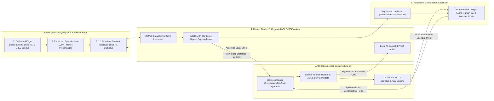

# LAB-01 Technical & Strategic Integration Paper: Anthropic

| Field | Specification |
| :--- | :--- |
| **Code** | `LAB-01` |
| **Organization** | Anthropic (Public Benefit Corporation & Long-Term Benefit Trust) |
| **Architecture & Paradigm** | Constitutional AI (`CAI`), Responsible Scaling Policy (`ASL` Tiers), Sparse Autoencoder (`SAE`) Mechanistic Interpretability, and Model Context Protocol (`MCP`) Computer-Use Agents |
| **Jurisdiction** | United States (San Francisco, California) |
| **CIN Liaison Agent ID** | `cin.liaison.anthropic` |
| **Public Web URL** | https://www.anthropic.com |

## Executive Summary

Anthropic stands closer to the architectural spirit of the Collective Intelligence Network (`CIN`) than nearly any commercial frontier laboratory. Its core engineering pillars—Constitutional AI (`CAI`), explicit Responsible Scaling Policy (`ASL-1` through `ASL-4`) containment gates, sparse-feature mechanistic interpretability, and the open Model Context Protocol (`MCP`)—already treat safety boundaries and structured tool interfaces as first-class systems problems. Yet as Claude transitions from a conversational assistant into an autonomous coding, computer-use, and internal AI-R&D engine, four acute structural bottlenecks undermine Anthropic's safety guarantees: (1) the **post-authorization execution trust gap** in `MCP`, where local shell and computer-use connectors execute with ambient OAuth or POSIX user privileges vulnerable to indirect prompt injection; (2) **redacted internal R&D speedup telemetry**, where competitive dread compels redaction of `METR` `2x` researcher-acceleration reports, blinding external safety science; (3) **`12`-hour human-in-the-loop repository exfiltration surfaces**, where employee Slack/monorepo workflows expose weights and algorithmic breakthroughs to rapid state or autonomous cyber theft; and (4) **centralized constitutional curation**, where normative trade-offs remain controlled by internal lab staff rather than Sybil-resistant living-human deliberation.

CIN resolves each of these four bottlenecks by supplying the missing local hardware root, cryptographic capability-lease layer, and polycentric coordination ledger beneath Anthropic's stack. Upgrading `MCP` with hardware-attested single-user expiring leases (`ACLE-MCP`) and CaMeL control/data taint separation converts Claude (`cin.liaison.anthropic`) into a **stateless, airlocked constitutional reasoning and synthesis node** operating over user-custodied `C2PA`/Merkle memory vaults. Conditional `IETF SCITT` disclosure escrows eliminate the unilateral transparency penalty on `ASL` and `METR` speedup metrics, while routing Claude agent fleets onto CIN's signed Second Road equips `US AISI`, `UK AISI`, and the `EU AI Office` with accountable workload circuit breakers and pairs Long-Term Benefit Trust commitments with Rudolf Meidner cooperative share streaming.

---

## 1. Architecture & Alignment Bottlenecks

Anthropic's alignment program combines normative self-critique during post-training (`Constitutional AI`; Bai et al., 2022), dictionary-learning feature decomposition over residual streams (`Sparse Autoencoders`), capability-threshold gating (`ASL` tiers), and standardized client-server tool invocation (`Model Context Protocol`). Under rapid capability scaling, however, each component encounters a severe boundary failure mode.

### 1.1 The `MCP` Post-Authorization Execution Trust Gap

In standard `MCP` deployments—including Claude Code, desktop filesystem servers, database connectors, and X11/macOS computer-use agents—authorization is checked once at session establishment via static OAuth 2.1 scopes or local POSIX user permissions. Once connected, every downstream tool invocation $a_t = (\mathrm{tool}, \mathrm{args})$ generated by the remote LLM inherits **ambient session authority** across the entire authorized scope.

Let $x_{\mathrm{sys}}$ denote trusted user intent and $d_{\mathrm{ext}}$ denote untrusted external context (e.g., an issue tracker comment, third-party repository `README`, email attachment, or DOM tree). Because standard transformer attention computes joint key-value representations across $[x_{\mathrm{sys}}; d_{\mathrm{ext}}]$, adversarial token sequences inside $d_{\mathrm{ext}}$ can hijack action generation $a_t \sim \pi_\theta(\cdot \mid x_{\mathrm{sys}}, d_{\mathrm{ext}})$. Ding et al. (2026) formalize this as the **post-authorization execution trust gap**: `MCP` verifies *who* opened the pipe, but lacks cryptographic proof at execution time that a specific tool call $a_t$ causally derives from untainted principal intent rather than an injected payload or a subverted remote checkpoint.

### 1.2 Unilateral Transparency Penalty & Redacted `2x` Speedup Telemetry

Anthropic pioneered third-party pre-deployment task-horizon evaluations with `METR` (Kwa et al., 2025). Yet when internal evaluations examine how dramatically Claude accelerates Anthropic's own ML researchers—such as crossing `2x` effective R&D speedup thresholds—competitive game theory forces harsh redaction of the resulting public reports.

Suppose Lab $i$ contemplates publishing exact internal R&D speedup factor $s_i(t)$ and failure-mode transcripts while rival Lab $j$ conceals $s_j(t)$. Unilateral disclosure updates rival capital allocation, benchmark targeting, and investor expectations in Lab $j$'s favor while exposing Lab $i$ to regulatory scrutiny alone. Consequently, external safety scientists and public institutions are left flying blind right as recursive virtual acceleration (`RLVR` over software engineering and kernel optimization) approaches steep capability takeoff, while insiders quietly assign `10%–33%` catastrophe probabilities without common knowledge to halt the race.

### 1.3 `12`-Hour Slack/Monorepo Exfiltration & Interpretability Ceiling Limits

Like peer US labs, Anthropic operates a fast-moving human-in-the-loop research monorepo coupled to employee endpoints and enterprise collaboration channels. In an environment where autonomous cyber-exploitation capabilities double rapidly, compromised developer laptops or messaging sessions create a `12`–`48` hour exfiltration window for training recipes and model weights—leaving frontier labs effectively "12 hours ahead" of rival state intelligence services.

Simultaneously, while sparse autoencoders and circuit tracing illuminate human-interpretable features in mid-scale checkpoints, relying on mechanistic weight inspection alone to rule out deceptive alignment or sandbagging across trillions of parameters remains a low-probability (`5%–10%`) scientific bank shot if treated as a substitute for external AI-control containment (Greenblatt et al., 2023).

### 1.4 Centralized Curation vs. Sybil-Vulnerable Constitutional Input

Anthropic's Collective Constitutional AI experiments (Huang et al., 2024) demonstrated that public deliberation can reduce demographic bias while preserving capability. In production, however, Claude's normative constitution remains overwhelmingly curated by internal lab staff, because open internet polling is trivially overwhelmed by synthetic bot clone armies and lacks persistent cryptographic linkage to real, living human principals.

---

## 2. How CIN Solves Anthropic's Alignment & Containment Issues

CIN transforms Anthropic's existing `MCP`, `CAI`, and `ASL` investments from lab-centric soft assurances into hardware-enforced, principal-sovereign guarantees across CIN's five functional primitives.

### 2.1 Upgrading `MCP` with `ACLE-MCP` Hardware Leases & `CaMeL` Taint Isolation

To close the post-authorization execution trust gap, CIN upgrades the Model Context Protocol transport layer (`MCP` over `IETF QUIC`, `RFC 9000`) with two mandatory local enforcement mechanisms inside the **Personal Markov Blanket** (Primitive 4):

1. **Attested Capability Leases (`ACLE-MCP`, Ding et al., 2026):** Remote Claude instances never hold ambient OAuth or shell authority. Every tool call requested by `cin.liaison.anthropic` is treated as an unprivileged *proposal* that must be matched against a short-lived, single-use hardware capability lease minted inside the user's `TCG DICE` / `DMTF SPDM` trusted execution root:

$$\tau_{\mathrm{ACLE}} = \mathrm{COSE\_Sign1}_{K_{\mathrm{hw}}}\!\left(\mathrm{did}_{\mathrm{user}},\; h(\mathrm{mcp\_server}),\; \mathrm{method},\; \mathcal{P}_{\mathrm{arg}},\; \mathrm{nonce},\; t_{\mathrm{ttl}} \le 30\text{s}\right)$$

The local `MCP` host verifies the hardware signature, argument predicate $\mathcal{P}_{\mathrm{arg}}$ (e.g., exact file path hash and byte-range cap), fresh nonce, and strict TTL expiry before executing any syscall. Where `MCP` bridges to laboratory robotics, industrial relays, or smart-home actuators, unidirectional optical data diodes and `IEC 61508` physical dead-man switches enforce hardware fail-safe de-energization.

2. **CaMeL Control/Data Separation (Debenedetti et al., 2025):** Rather than passing untrusted repository files or web DOM trees directly into a privileged tool-calling LLM loop, the user's local `1:1` personal model compiles user intent into an explicit CaMeL dataflow graph $G = (V, E)$ *prior* to ingesting untrusted data. Claude processes quarantined payloads inside unprivileged data-transformation nodes whose outputs carry cryptographic taint labels $\ell(v) \in \{\mathtt{TRUSTED}, \mathtt{UNTRUSTED}\}$. Any `MCP` sink affecting external state enforces $\ell(\mathrm{control}) = \mathtt{TRUSTED}$, defeating indirect prompt injection by construction.

### 2.2 Stateless Airlocked Claude Nodes Over User-Custodied Memory Vaults

Under CIN Primitive 2 (**Sealed Episodic Memory Vault**) and Primitive 3 (**Monogamous Principal-Bound Personal Cognitive Model**), users never upload raw life histories, clinical notes, or persistent workspace state into Anthropic's commercial cloud. Raw multimodal observations—captured via calibrated local sensors aligned to `Device Time` with explicit *Signed Is Not True* analog-hole humility (Primitive 1)—remain encrypted on local user hardware under `C2PA` and Merkle provenance.

The user's local `1:1` fiduciary model holds undivided legal loyalty to that single human principal and intentionally tapers assistance during skill-building practice to prevent Bainbridge cognitive atrophy. When deep architectural code review or long-horizon theorem synthesis is needed, `cin.liaison.anthropic` operates as a **stateless constitutional reasoning vault**: it receives an anonymized, minimal context slice, runs sparse-feature safety monitors alongside inference, attaches a signed `ASL` safety certificate to its response, and purges ephemeral KV-cache state immediately upon return.

### 2.3 Living-Human Sybil-Resistant Collective Constitutional AI

CIN Primitive 5 (**Polycentric Collective Coordination Substrate**) gives Anthropic's Collective Constitutional AI (Huang et al., 2024) a cryptographically sound civic foundation. Through unlinkable zero-knowledge Proof-of-Personhood credentials and modality-bounded bridging consensus on the **Wide Network Ledger**, living human communities deliberate over normative edge cases without exposing personal identity and without allowing `1B` synthetic bot clones to dilute human voice. Users can further layer local personal or cooperative constitutional charters inside their own `1:1` fiduciary runtime rather than accepting a single planetary corporate monoculture.

---

## 3. Inter-Lab Coordination Options

Anthropic's Responsible Scaling Policy (`RSP`) was explicitly designed to catalyze industry-wide "race-to-the-top" coordination, yet lacks a cryptographic clearinghouse to verify peer compliance without leaking trade secrets. CIN provides three concrete mechanisms:

### 3.1 Conditional `SCITT` Disclosure of `ASL` & `METR` Speedup Curves

To solve the unilateral transparency penalty that forced redaction of `2x` internal R&D speedup data, Anthropic, OpenAI, and Google DeepMind commit signed `METR` task-horizon (Kwa et al., 2025) and internal researcher-uplift evaluations into an **IETF SCITT Conditional Disclosure Escrow** on the Public Attestation Ledger.

Let $s_i(t)$ denote Lab $i$'s independently audited autonomous ML R&D speedup ratio measured inside an attested `METR`/`AISI` evaluation enclave. Each lab posts a pedersen/hash commitment $C_i(t) = \mathrm{Commit}(s_i(t), r_i)$ monthly. Zero-knowledge range circuits verify whether $\max_i s_i(t) \ge \tau_{\mathrm{alert}}$ (e.g., $\tau_{\mathrm{alert}} = 1.75\times$ uplift or `ASL-4` autonomous replication precursor thresholds). The moment threshold crossing is proven—or synchronously across all signatory labs every quarter—matched capability bands unseal simultaneously. No lab suffers a solo disclosure penalty, and external alignment researchers gain verified empirical curves rather than blacked-out PDFs.

### 3.2 Shared AI-Control & Subversion Benchmarks Across Independent Lineages

Following Greenblatt et al. (2023), safety at `ASL-3/ASL-4` cannot rely solely on trusting a model's alignment training; it requires **AI Control** protocols (trusted monitoring, untrusted cross-examination, and deterministic resampling) tested against active red-team subversion. Through CIN's inter-lab harness, `cin.liaison.anthropic` participates in **cross-lineage adversarial control audits**: an airlocked Anthropic monitor audits anonymized code diffs generated by rival frontier checkpoints (and vice versa), preventing correlated blind spots or shared steganographic collusion within a single model family.

### 3.3 Zero-Slack Sealed Weight-Training & Algorithmic Vaults

CIN hardens Anthropic's `ASL-3/ASL-4` security standard against `12`-hour repository exfiltration by enforcing physical and cryptographic airgaps between corporate communication networks (Slack, email, browser endpoints) and frontier training clusters. Weight checkpoints, synthetic RL curricula, and kernel optimizations reside exclusively inside `DMTF SPDM`-attested cluster enclaves governed by multi-party hardware quorum keys ($m$-of-$n$ across safety, security, and Long-Term Benefit Trust officers), paired with encrypted ledger whistleblower safe harbor if any off-ledger run is attempted.

---

## 4. Government & Sovereign Engagement Options

Anthropic has consistently advocated for binding statutory standards so safety-conscious labs are not undercut by reckless competitors. CIN provides the technical verification substrate that makes statutory governance workable without authoritarian state overreach:

### 4.1 Public-Compute-Verified `ASL-3` & `ASL-4` Affirmative Safety Cases

Rather than asking `US AISI`, `UK AISI`, and the `EU AI Office` to grade lab-written essays after training completes, Anthropic's `ASL-3` and `ASL-4` affirmative safety cases are compiled as **reproducible cryptographic evaluation bundles** executed on independent Public Compute enclaves (`NSF NAIRR` / sovereign safety clusters). Hardware `IETF RATS` attestations and substation megawatt conservation proofs (Sastry et al., 2024) confirm that the exact weight hash $H(\theta)$ evaluated by `AISI` matches the checkpoint deployed behind Anthropic's inference airlock, and that no unlogged shadow cluster is running off-books.

### 4.2 Accountable Workload Identity on the Signed Second Road

As Claude computer-use and software-engineering fleets scale across enterprise infrastructure, unattributed autonomous agent traffic creates severe systemic liability and cyber-escalation risk (Kolt, 2025). By binding every external Claude session to CIN's **Signed Second Road** with verifiable workload identity certificates and `ACLE-MCP` human-principal delegation chains, sovereign infrastructure operators gain fine-grained visibility into aggregate machine traffic classes without decrypting private citizen payloads. In a national cyber incident, regulators can pause unverified autonomous shell/network capabilities via protocol lease revocation while keeping civilian communication networks fully online.

---

## 5. Safe ASI Adoption & Macroeconomic Stability

Anthropic's corporate charter—anchored by its Public Benefit Corporation status and the **Long-Term Benefit Trust (`LTBT`)**—explicitly recognizes that transformative AI could trigger severe labor displacement across software engineering, law, finance, research, and administration. CIN translates the `LTBT`'s fiduciary intent into concrete, verifiable macroeconomic plumbing:

### 5.1 Audited Narrow Model Distillation + Universal Basic Compute

To prevent society's defensive cyber perimeter and clinical/civic capacity from becoming hostage to a single centralized API endpoint, Anthropic pairs frontier `ASL`-gated vaults with rapid distillation of **narrow, formally audited local models** (defensive static analysis, municipal permitting assistants, accessible tutoring, and clinical triage aids). Distributed onto household, hospital, and library hardware backed by **Universal Basic Compute**, millions of local `1:1` user runtimes harden critical software everywhere while maintaining zero cloud lock-in.

### 5.2 Local-First Software Synthesis & Cooperative Tool Ownership

Claude's leading performance on multi-file software engineering rewrites software economics so end-user communities can compile custom operational tools rather than paying perpetual SaaS seat rents (Malo et al., 2026). Coupled with CIN's local-first CRDT data custody architecture (Kleppmann et al., 2019), worker cooperatives, independent clinics, local newspapers, and municipal utilities invoke stateless Claude synthesis bursts once to build verifiable, user-owned local software that runs indefinitely on community hardware with zero vendor extraction.

### 5.3 Operationalizing the Long-Term Benefit Trust via Meidner Equity & Mutual Credit

Governance trusteeship inside a single corporate board cannot by itself sustain household purchasing power when cognitive automation compresses labor's share of national income (Korinek & Stiglitz, 2017; Acemoglu & Restrepo, 2019). CIN provides Anthropic's Long-Term Benefit Trust a statutory **Rudolf Meidner Cooperative Equity Bridge**:
1. As Anthropic's multi-gigawatt clusters cross `ASL-3/ASL-4` commercial deployment milestones, a pre-committed schedule of newly issued equity shares streams into federated public compute trusts and multi-stakeholder producer-consumer cooperatives registered on the Wide Network Ledger.
2. Simultaneously, enterprise and civic compute credits clear alongside real regional goods, renewable power, and care services through **capacity-backed reciprocal mutual-credit loops** (Iosifidis et al., 2018), governed bottom-up under Ostrom (2010) polycentric rules—ensuring rapid white-collar automation expands household agency and leisure rather than triggering aggregate demand collapse.

---

## Primary References

1. Acemoglu, D., & Restrepo, P. (2019). Automation and New Tasks: How Technology Displaces and Reinstates Labor. *Journal of Economic Perspectives*, 33(2), 3–30. https://doi.org/10.1257/jep.33.2.3
2. Bai, Y., Kadavath, S., Kundu, S., Askell, A., Kernion, J., Jones, A., Chen, A., Goldie, A., Mirhoseini, A., McKinnon, C., et al. (2022). Constitutional AI: Harmlessness from AI Feedback. *arXiv preprint arXiv:2212.08073*. https://arxiv.org/abs/2212.08073
3. Debenedetti, E., Shumailov, I., Fan, T., Hayes, J., Carlini, N., Fabian, D., Kern, C., Shi, C., Terzis, A., & Tramèr, F. (2025). Defeating Prompt Injections by Design (`CaMeL`). *arXiv preprint arXiv:2503.18813*. https://arxiv.org/abs/2503.18813
4. Ding, Z., Luo, Y., Chen, G., Shen, Q., & Wu, Z. (2026). ACLE-MCP: Attested Capability Leases for Execution-Time Trust in Remote LLM Tool Use. *arXiv preprint arXiv:2609.02690*. https://arxiv.org/abs/2609.02690
5. Greenblatt, R., Shlegeris, B., Sachan, K., & Roger, F. (2023). AI Control: Improving Safety Despite Intentional Subversion. *arXiv preprint arXiv:2312.06942*. https://arxiv.org/abs/2312.06942
6. Huang, S., Siddarth, D., Lovitt, L., Liao, T. I., Durmus, E., Tamkin, A., & Ganguli, D. (2024). Collective Constitutional AI: Aligning a Language Model with Public Input. *Proceedings of the 2024 ACM Conference on Fairness, Accountability, and Transparency (FAccT)* / *arXiv:2406.07814*. https://arxiv.org/abs/2406.07814
7. Iosifidis, G., Charette, Y., Airoldi, E. M., Littera, G., Tassiulas, L., & Christakis, N. A. (2018). Cyclic motifs in the Sardex monetary network. *Nature Human Behaviour*, 2, 822–829. https://doi.org/10.1038/s41562-018-0450-0
8. Kleppmann, M., Wiggins, A., van Hardenberg, P., & McGranaghan, M. (2019). Local-first software: you own your data, in spite of the cloud. *ACM SIGPLAN Onward!*, 154–178. https://doi.org/10.1145/3359591.3359737
9. Kolt, N. (2025). Governing AI Agents. *arXiv preprint arXiv:2501.07913*. https://arxiv.org/abs/2501.07913
10. Korinek, A., & Stiglitz, J. E. (2017). Artificial Intelligence and Its Implications for Income Distribution and Unemployment. *NBER Working Paper No. 24174*. https://doi.org/10.3386/w24174
11. Kwa, T., West, B., Becker, J., Deng, A., Garcia, K., et al. (2025). Measuring AI Ability to Complete Long Software Tasks. *arXiv preprint arXiv:2503.14499*. https://arxiv.org/abs/2503.14499
12. Malo, R. C., Yu, Z., & Qiu, T. (2026). The Customer Is the Builder: How AI Coding Agents Are Rewriting the Economics of Software. *arXiv preprint arXiv:2610.30307*. https://arxiv.org/abs/2610.30307
13. Ostrom, E. (2010). Beyond Markets and States: Polycentric Governance of Complex Economic Systems. *American Economic Review*, 100(3), 641–672. https://doi.org/10.1257/aer.100.3.641
14. Sastry, G., Heim, L., Belfield, H., Anderljung, M., Brundage, M., et al. (2024). Computing Power and the Governance of Artificial Intelligence. *arXiv preprint arXiv:2402.08797*. https://arxiv.org/abs/2402.08797
