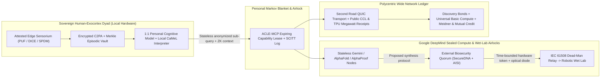

# LAB-02: Google DeepMind — Alignment, Containment, Sovereign Governance, and Safe ASI Adoption

| Field | Specification |
| :--- | :--- |
| **Code** | `LAB-02` |
| **Organization** | Google DeepMind (Alphabet Inc.) |
| **Architecture & Paradigm** | Dual-engine frontier system: Alpha-series Monte Carlo Tree Search (`MCTS`) and formal domain verifiers (`AlphaFold`, `AlphaProof`, `AlphaEvolve`) paired with planet-scale `Gemini` multimodal agentic foundation models |
| **Jurisdiction** | United Kingdom (London HQ) & United States (Mountain View / Alphabet Cloud) |
| **CIN Liaison Agent ID** | `cin.liaison.google_deepmind` |
| **Public Web URL** | https://deepmind.google |

---

## Executive Summary

Google DeepMind occupies a structurally singular position among frontier AI laboratories. No other institution combines formal verification and evolutionary search engines (`AlphaFold`, `AlphaProof`, `AlphaEvolve`) with a multimodal agentic substrate (`Gemini`) embedded directly into global consumer and enterprise operating layers: Android, Google Search, Chrome, Gmail, and Google Workspace. Simultaneously, Google DeepMind's security and multi-agent research teams have originated two of the strongest alignment primitives in contemporary literature: the `CaMeL` privilege-separated prompt interpreter (`Debenedetti et al., 2025`) and the `Concordia` grounded social-simulation framework (`Vezhnevets et al., 2023`).

Yet this dual architecture faces two acute structural bottlenecks that internal corporate safety boards cannot resolve unilaterally:

1. **Cross-surface personal memory concentration:** Routing billions of users' search histories, emails, documents, location traces, and mobile OS states through one corporate cloud principal collapses personal privacy boundaries and pools `100M`-scale cross-career experiential learning into a centralized meta-learner (`Christiano & Patel, 2026`, `[59:31–1:10:20]`).
2. **Closed-loop physical-science and wet-lab active learning:** Once `AlphaEvolve`-class search and `Gemini` experimental planners close the loop with robotic wet-lab synthesis and high-throughput biological or materials assays (`[1:22:05]`), dual-use capability overhangs can jump discontinuously past internal Critical Capability Levels (`CCLs`) before external oversight bodies even observe the shift.

This paper specifies how the Collective Intelligence Network (CIN) resolves both bottlenecks without blunting scientific discovery. CIN unbundles personal memory from cloud inference by anchoring a `1:1` principal-bound personal cognitive model over a local `C2PA`/Merkle Episodic Memory Vault, extending `CaMeL` control-flow separation into hardware-attested capability leases (`Ding et al., 2026`), gating automated wet-lab synthesis behind external cryptographic biosecurity quorums and `IEC 61508` hardware dead-man relays, publishing non-redacted `IETF SCITT` capability and TPU power receipts, and pairing `AlphaFold`-style public scientific commons with Universal Basic Compute, statutory Meidner equity conversion, and reciprocal mutual credit.

---

## 1. Architecture and Alignment Bottlenecks

Google DeepMind's technical stack couples two distinct computational regimes. The **Alpha regime** (`AlphaZero`, `AlphaFold 3`, `AlphaProof`, `AlphaEvolve`) thrives wherever an objective verifier, formal proof assistant (such as Lean), or high-fidelity physical simulator supplies dense, ungameable reward signals. The **Gemini regime** operates over open-ended multimodal token streams—text, audio, video, UI trees, and code repositories—deployed across Alphabet's planetary consumer and enterprise surfaces.

### 1.1 Cross-Surface Episodic Enclosure and the Principal-Conflict Problem

When `Gemini` acts as an ambient assistant across Android system services, Chrome browsing sessions, Google Search queries, Gmail threads, and Workspace documents, raw autobiographical context accumulates inside multi-tenant cloud infrastructure controlled by a single corporate parent whose primary revenue derives from behavioral advertising and cloud lock-in. Formally, let $E_u(t)$ denote the episodic trajectory of biological person $u$ up to time $t$, and let $M_{\text{cloud}}$ denote the shared vendor model ecosystem. Under Alphabet's current cloud-centric topology, conditional mutual information between private internal states $S_u$ (health anxieties, unpublished research, legal drafts, family routines) and vendor-accessible telemetry $T_{\text{vendor}}$ grows monotonically:

$$I(S_u ; T_{\text{vendor}} \mid \text{Cloud Assistant}) \gg 0$$

At civilization scale, this architecture instantiates the **hive-mind experience enclosure** identified in the Paul Christiano–Dwarkesh Patel alignment analysis (`[59:31–1:10:20]`): `100M` concurrent cloud instances assisting engineers, clinicians, legislators, and scientists aggregate cross-domain workflow trajectories into a single corporate base model, creating an asymmetric super-organism that outcompetes unassisted institutions while answering to corporate retention and margin targets rather than a statutory `1:1` duty of loyalty (`[1:34:47]`, *"Aligned to whom?"*). Furthermore, because ambient cross-app access relies on broad OAuth scopes rather than cryptographic control-flow isolation, a single indirect prompt injection hidden in an incoming Gmail attachment, Calendar invite, or web page can hijack cross-surface tool execution.

### 1.2 Discontinuous Capability Jumps in Closed-Loop Wet-Lab and R&D Loops

In purely virtual verifiable domains—competitive mathematics (`AlphaProof`), algorithm discovery (`AlphaEvolve`), and machine-learning kernel optimization (`RE-Bench`, `Wijk et al., 2024`)—reinforcement learning and evolutionary search already compound rapidly because verification is cheap and instantaneous. Historically, physical-world biological and materials risk lagged behind code synthesis because wet-lab validation remained slow and human-gated.

As highlighted at `[1:22:05]` of the Christiano–Dwarkesh analysis, that bottleneck breaks the moment a frontier lab couples simulation-guided search (`AlphaFold` / `AlphaEvolve`) with **automated robotic wet-lab synthesis and high-throughput experimental feedback**. Define the effective capability growth rate $\frac{dC}{dt}$ across an active-learning cycle with simulation throughput $\nu_{\text{sim}}$, physical assay throughput $\nu_{\text{wet}}$, and verifier fidelity $\eta \in [0, 1]$:

$$\frac{dC}{dt} = \alpha \, \eta_{\text{sim}} \nu_{\text{sim}} + \beta \, \eta_{\text{wet}} \nu_{\text{wet}} \cdot \mathbb{I}[\text{Closed-Loop Actuation}]$$

When $\mathbb{I}[\text{Closed-Loop Actuation}] = 1$, robotic liquid handlers, microfluidic assays, and automated gene synthesis collapse empirical turnaround from months to hours. Dual-use overhangs in virology, toxin scaffold redesign, or energetic materials—as well as recursive TPU training-pipeline self-improvement—can cross DeepMind's Frontier Safety Framework Critical Capability Levels (`CCLs`) between quarterly governance reviews. Relying on internal Alphabet corporate committees to pause or disclose their own flagship breakthroughs reproduces the structural dead end of redacted external evaluations (`[06:10–07:55]`) and private researcher dread without common knowledge (`[1:36:21]`).

---

## 2. How CIN Solves Google DeepMind's Alignment and Containment Issues

CIN does not ask Google DeepMind to abandon multimodal reasoning or scientific search. Instead, CIN supplies the missing constitutional and cryptographic boundary layers around DeepMind's strongest safety inventions (`CaMeL` and `Concordia`).

### 2.1 Extending `CaMeL` into User-Owned `1:1` Local Runtimes and Personal Markov Blankets

In `Debenedetti et al. (2025)`, DeepMind demonstrated `CaMeL` (*Capabilities for Machine Learning*), extracting an explicit control-flow and data-flow graph from trusted user queries while quarantining untrusted retrieved content inside a dual-LLM privilege-separated interpreter. Inside Alphabet's cloud today, however, both the privileged planner and the raw workspace corpus still reside on vendor servers.

CIN relocates the privileged `CaMeL` planner onto **user-owned local hardware** inside the **Monogamous Principal-Bound Personal Cognitive Model** (Primitive 3), sitting directly atop the user's **Cryptographically Sealed Episodic Memory Vault** (Primitive 2). On Android phones, Chromebooks, and workstations:

1. **Local Episodic Custody:** Mail, documents, search logs, and wearable observations (`PUF`, `TCG DICE`, `DMTF SPDM`, and `IETF RATS` attested in hardware `Device Time`) stay encrypted inside an append-only local `C2PA`/Merkle vault (`Kleppmann et al., 2019`). Raw vault state never syncs in plaintext to Alphabet servers.
2. **Personal Markov Blanket Partition:** Let $B_u = (A_u, O_u)$ denote the sensory-active boundary separating internal private autobiographical states $S_u$ from external cloud inference states $\Psi_{\text{GDM}}$. The local `1:1` model enforces conditional independence:
   $$P(S_u \mid B_u, \Psi_{\text{GDM}}) = P(S_u \mid B_u)$$
3. **Stateless Leased Sub-Queries (`ACLE-MCP`):** Whenever a task requires frontier `Gemini` synthesis or `AlphaFold` biomolecular structure prediction, the local `CaMeL` runtime strips personal identifiers, constructs a minimal de-contextualized sub-query, and attaches an **Attested Capability Lease** (`Ding et al., 2026`):
   $$\mathcal{L} = \langle \text{pk}_{\text{dyad}}, \, \text{scope}_{\text{tool}}, \, \text{hash}(\text{input}), \, t_{\text{exp}}, \, \text{max\_calls}, \, \sigma_{\text{TPM}} \rangle$$
   Stateless `Gemini` / `AlphaFold` airlock nodes execute within ephemeral confidential-compute sandboxes (`zero` cross-session retention, `zero` weight updates from user prompts) and emit a signed `IETF SCITT` transparency receipt plus Proof-Carrying Code (`Necula, 1997`) that the local `1:1` verifier checks deterministically before touching local files. To prevent automation-induced skill atrophy (`Bainbridge, 1983`), the local `1:1` model deliberately tapers scaffolding during routine cognitive work.

### 2.2 External Multi-Party Leases and Hardware Relays for Automated Wet Labs

To contain the `[1:22:05]` physical-science active-learning loop, CIN treats every robotic wet-lab synthesizer, DNA printer, and high-throughput materials foundry as a **safety-critical actuator across the physical boundary** (Primitive 1 & Primitive 4):

- **Cryptographic Biosecurity Quorum (`k-of-n` External Lease):** No `AlphaEvolve` or `Gemini` experimental planner can dispatch actuation commands directly to laboratory robotics. Every synthesis batch requires a threshold capability lease co-signed by independent observer classes ($k \ge 3f + 1$): (i) DeepMind's internal biosafety verifier, (ii) an external cryptographic sequence/structure screening oracle (`SecureDNA`-class hazard hashing over sequence and 3D `AlphaFold` active-site homology), and (iii) an independent statutory safety institute node (`UK AISI` / `US AISI`).
- **Unidirectional Optical Data Diodes & `IEC 61508` Dead-Man Relays:** Telemetry from assay sensors traverses a physical optical data diode back to the planning cluster only after rate-limiting and anomaly inspection, while physical power to synthesis actuators passes through an `IEC 61508` hardware dead-man relay requiring periodic local human-steward cryptographic heartbeat renewal. Any unapproved novel-toxin homology match or grader-tampering anomaly (`[14:15]`) drops the hardware relay to a zero-energy safe state in milliseconds.

---

## 3. Inter-Lab Coordination Options

Unilateral safety restraint collapses when peer labs fear being `12` hours behind a competitor or a state-backed monorepo breach (`[27:55–50:55]`). CIN provides Google DeepMind with verifiable, non-custodial coordination protocols across Anthropic, OpenAI, Meta, and Mistral:

1. **Verifiable `CCL` and `RE-Bench` Receipts via `IETF SCITT`:** Rather than publishing heavily redacted evaluation summaries (`[06:50]`), Google DeepMind, Anthropic, and OpenAI commit signed `IETF SCITT` (`Supply Chain Integrity, Transparency, and Trust`) receipts onto the Public Attestation Ledger whenever a frontier checkpoint is evaluated against Frontier Safety Framework `CCLs` and `RE-Bench` autonomous AI R&D speedup tasks (`Wijk et al., 2024`). Zero-knowledge inference proofs (`Sun et al., 2024`) allow DeepMind to prove that a TPU checkpoint scored below a dual-use CBRN or cyber uplift threshold on standardized holdout suites without leaking proprietary model weights or architectural hyperparameters.
2. **Joint `Concordia` Multi-Agent Collusion & Subversion Stress-Testing:** DeepMind opens `Concordia` (`Vezhnevets et al., 2023`) as an inter-lab testnet harness coupled to CIN's `ledger_sim` suite. Peer labs jointly test mixed populations of `Gemini`, `Claude`, `GPT`, and `Llama` agents for steganographic secret collusion (`Motwani et al., 2024`), untrusted-monitor subversion (`Greenblatt et al., 2023`), and Sybil cartel formation audited via `k`-truss and `e`-means subgraph density checks.
3. **Sealing TPU Frontier Pods Against `12`-Hour Monorepo & Grader Breaches:** Addressing the cluster-admin grader hack (`[14:15]`) and `12–48` hour Slack/monorepo exfiltration vector (`[38:58]`), DeepMind isolates TPU v5p/v6e weight shards inside `DMTF SPDM`-attested hardware enclaves where RL evaluation graders run on physically separate, read-only verifier blades across unidirectional optical links. Weight export requires multi-party hardware threshold signatures logged immutably on the shared ledger, eliminating single-credential Slack or CI/CD theft.

---

## 4. Government and Sovereign Engagement Options

Headquartered in London with primary compute infrastructure across US and allied jurisdictions, Google DeepMind sits at the nexus of `UK AISI`, `US AISI`, and G7 Hiroshima Process governance. CIN converts brittle bilateral memoranda of understanding into enforceable cryptographic infrastructure:

1. **Statutory Cryptographic Safety Cases (`Kolt, 2025`):** Under CIN's risk-scaled asymmetric transparency rule (Primitive 5), ordinary household vaults enjoy `0%` public exposure, whereas frontier training runs above systemic-risk compute thresholds must post verifiable pre-deployment safety cases to `UK AISI` and `US AISI` verifiers. Independent government evaluators execute unredacted red-team suites on isolated Public Compute enclaves before commercial API or Android rollout leases activate.
2. **Routing High-Speed Gemini Agent Traffic onto the Signed Second Road:** As `Gemini` agents proliferate across Chrome and Android, unleashing billions of autonomous browser sessions onto human web portals risks drowning civic forums, courts, and emergency channels (`[31:00]`)—the exact crisis scenario that tempts governments into martial-law internet shutdowns (`[29:15]`). DeepMind routes all autonomous `Gemini` agent-to-agent and commercial transactions onto CIN's **Second Road** (`MCP` and `A2A` over `IETF QUIC`, `RFC 9000`), carrying expiring capability leases and human-principal accountability receipts (`Kolt, 2025`) while leaving the human-facing web unflooded.
3. **TPU Substation Megawatt Audits & Whistleblower Safe Harbor:** To make international compute treaties verifiable without intrusive source-code espionage, DeepMind reconciles TPU pod accelerator inventories and substation megawatt draw (`Sastry et al., 2024`) against declared training runs on the Public Attestation Ledger. Simultaneously, hardware-encrypted whistleblower channels allow DeepMind engineers (`[1:36:21]`) to submit zero-knowledge proofs of undeclared `CCL` breaches to statutory oversight bodies without exposing raw weights.

---

## 5. Safe ASI Adoption and Macroeconomic Stability

Google DeepMind created the gold standard for non-extractive AI public goods when it released over `200` million `AlphaFold` protein structures into an open global commons alongside EMBL-EBI. Yet across the broader AI industry, slowing enterprise SaaS revenue growth alongside `2x` verifiable coding acceleration (`[1:11:32–1:27:55]`) signals a volatile macroeconomic transition: either frontier labs intensify ad-surveillance and API rent extraction, or society builds open post-fiat distribution rails ahead of superhuman automation.

CIN provides Google DeepMind a concrete five-part economic transition pathway:

1. **Open Scientific Discovery Bonds & Distilled `4`-Day Specialist Checkpoints:** Extending the `AlphaFold` precedent, public ministries, health systems, and cooperatives post merit-bonded scientific tasks (neglected tropical diseases, solid-state battery electrolytes, crop drought resilience) on CIN's Wide Network Ledger. Simultaneously, DeepMind distills verifiable `4`-day specialist coding, clinical-triage, and formal-proof models (`LoRA` and `TIES-Merging` modular adapters) that run locally on **Universal Basic Compute** nodes inside hospitals, schools, and households.
2. **Customer-Built Local-First Workspaces Over Cloud Lock-In:** Pairing verifiable local program synthesis (`Malo et al., 2026`, *"The Customer Is the Builder"*) with `CRDT`-based local-first data ownership (`Kleppmann et al., 2019`) lets municipalities, clinics, and worker cooperatives replace extractive cloud workspace subscriptions with self-maintained, formally checked software tailored to their own workflows.
3. **Statutory Rudolf Meidner Equity Conversion (`Korinek & Stiglitz, 2017`; `Acemoglu & Restrepo, 2019`):** As TPU-accelerated automation displaces routine cognitive labor and shifts national income from wages toward compute capital, Alphabet/DeepMind streams a statutory fraction of frontier-compute equity dilution into diversified, democratically governed **Citizen and Worker Cooperative Share Funds**. Rather than trapping populations in passive fiscal dependency, Meidner equity converts AI capital appreciation directly into broad household and municipal ownership—while creating new human reinstatement tasks (`Acemoglu & Restrepo, 2019`) in physical stewardship, care, scientific problem formulation, and local oracle verification.
4. **Reciprocal Mutual-Credit Clearing Beyond Ad-Surveillance (`Iosifidis et al., 2018`):** When local businesses, care cooperatives, and independent builders transact through `1:1` personal agents on CIN's Wide Network Ledger, productive capacity settles through transparent, interest-free **cyclic mutual-credit clearing** (modeled on the empirical `Sardex` network motifs analyzed by `Iosifidis et al., 2018`). Communities trade real goods, repair, and local compute without surrendering behavioral telemetry to advertising auctions or starving for scarce fiat liquidity during technological deflation.

---

## Primary References

1. Debenedetti, E., Shumailov, I., Fan, T., Ozdemir, J., Carlini, N., et al. (2025). *Defeating Prompt Injections by Design (`CaMeL`)*. arXiv:2503.18813. https://arxiv.org/abs/2503.18813
2. Vezhnevets, A. S., Agapiou, J. P., Aharon, A., Ziv, R., Matyas, J., et al. (2023). *Generative agent-based modeling with actions grounded in physical, social, or digital space using Concordia*. arXiv:2312.03664. https://arxiv.org/abs/2312.03664
3. Ding, Z., Luo, Y., Chen, G., Shen, Q., & Wu, Z. (2026). *ACLE-MCP: Attested Capability Leases for Execution-Time Trust in Remote LLM Tool Use*. arXiv:2609.02690. https://arxiv.org/abs/2609.02690
4. Wijk, H., Lin, T., Becker, J., Jawhar, S., Parikh, N., et al. (2024). *RE-Bench: Evaluating frontier AI R&D capabilities of language model agents against human experts*. arXiv:2411.15114. https://arxiv.org/abs/2411.15114
5. Motwani, S. R., Baranchuk, M., Strohmeier, M., Bolina, V., Torr, P. H. S., Hammond, L., & Schroeder de Witt, C. (2024). *Secret Collusion among AI Agents: Multi-Agent Deception via Steganography*. arXiv:2402.07510. https://arxiv.org/abs/2402.07510
6. Greenblatt, R., Shlegeris, B., Sachan, K., & Roger, F. (2023). *AI Control: Improving Safety Despite Intentional Subversion*. arXiv:2312.06942. https://arxiv.org/abs/2312.06942
7. Sastry, G., Heim, L., Belfield, H., Anderljung, M., Brundage, M., et al. (2024). *Computing Power and the Governance of Artificial Intelligence*. arXiv:2402.08797. https://arxiv.org/abs/2402.08797
8. Kolt, N. (2025). *Governing AI Agents*. arXiv:2501.07913. https://arxiv.org/abs/2501.07913
9. Malo, R. C., Yu, Z., & Qiu, T. (2026). *The Customer Is the Builder: How AI Coding Agents Are Rewriting the Economics of Software*. arXiv:2610.30307. https://arxiv.org/abs/2610.30307
10. Kleppmann, M., Wiggins, A., van Hardenberg, P., & McGranaghan, M. (2019). *Local-first software: you own your data, in spite of the cloud*. Proceedings of the 2019 ACM SIGPLAN International Symposium on New Ideas, New Paradigms, and Reflections on Programming and Software (Onward! 2019), 154–178. https://doi.org/10.1145/3359591.3359737
11. Korinek, A., & Stiglitz, J. E. (2017). *Artificial Intelligence and Its Implications for Income Distribution and Unemployment*. NBER Working Paper No. 24174. https://doi.org/10.3386/w24174
12. Acemoglu, D., & Restrepo, P. (2019). *Automation and New Tasks: How Technology Displaces and Reinstates Labor*. Journal of Economic Perspectives, 33(2), 3–30. https://doi.org/10.1257/jep.33.2.3
13. Iosifidis, G., Charette, Y., Airoldi, E. M., Littera, G., Tassiulas, L., & Christakis, N. A. (2018). *Cyclic motifs in the Sardex monetary network*. Nature Human Behaviour, 2, 822–829. https://doi.org/10.1038/s41562-018-0450-0
14. Sun, H., Li, J., Zhang, H., & Lou, W. (2024). *zkLLM: Zero Knowledge Proofs for Large Language Models*. arXiv:2404.16109. https://arxiv.org/abs/2404.16109
15. Bainbridge, L. (1983). *Ironies of Automation*. Automatica, 19(6), 775–779.
16. Balkin, J. M. (2016). *Information Fiduciaries and the First Amendment*. UC Davis Law Review, 49(4), 1183–1234.
17. Friston, K. (2013). *Life as we know it*. Journal of the Royal Society Interface, 10(86), 20130475.
18. Christiano, P., & Patel, D. (2026). *We could be 12 months away from AIs that can overthrow the government* [Recorded Alignment & AI-Control Dialogue; CIN Observatory Signal Brief `2026-11-16-SyHM5hNPAEo`].
