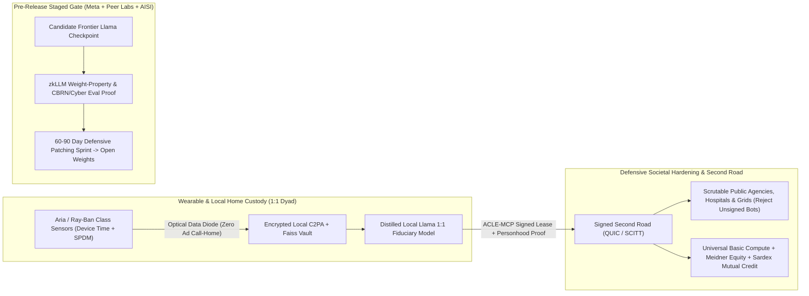

# LAB-05: Meta AI (FAIR & Llama) — Alignment, Containment, Sovereign Governance, and Safe ASI Adoption

| Field | Specification |
| :--- | :--- |
| **Code** | `LAB-05` |
| **Organization** | Meta AI — Fundamental AI Research (`FAIR`) & `Llama` Open-Weight Ecosystem (Meta Platforms Inc.) |
| **Architecture & Paradigm** | Open-weight frontier foundation models (`Llama`), `Faiss` dense vector retrieval, `Project Aria` / `Ray-Ban` egocentric wearables, and social-graph consumer assistants |
| **Jurisdiction** | United States (Menlo Park HQ; Global Open-Weight Distribution) |
| **CIN Liaison Agent ID** | `cin.liaison.meta_ai` |
| **Public Web URL** | https://ai.meta.com |

---

## Executive Summary

Meta AI embodies the sharpest structural paradox in frontier artificial intelligence. Through `FAIR`, `PyTorch`, `Faiss`, `Project Aria`, and the `Llama` open-weight model family, Meta has contributed more foundational open infrastructure toward decentralized, user-run machine intelligence than any other US hyperscaler. In a world threatened by centralized cloud hive-mind capture—where `100M` cloud assistant instances pool live career experience into two or three proprietary corporate monopolies (`Christiano & Patel, 2026`, `[59:31–1:10:20]`)—open weights are a vital civilizational counterweight.

Yet Meta's dual identity as an **unverified open-weight distributor** and an **advertising-financed social-graph empire** creates an acute two-sided alignment bottleneck:

1. **Irreversibility of dual-use open-weight proliferation:** Once raw frontier weights cross autonomous cyber-exploitation or biological design thresholds, weight publication cannot be recalled. Downstream fine-tuning (`LoRA`, representation steering, or orthogonalized refusal ablation) strips post-training safety guardrails in hours, exposing unpatched municipal, hospital, and grid infrastructure to autonomous exploit swarms (`[14:15–27:45]`).
2. **Surveillance-advertising principal conflict on consumer platforms and wearables:** Across WhatsApp, Instagram, Facebook, and `Ray-Ban` smart glasses, Meta's consumer assistants operate inside an attention-harvesting ad-targeting architecture rather than under a statutory `1:1` information-fiduciary duty (`Balkin, 2016`) to the biological wearer.

The Collective Intelligence Network (CIN) resolves both halves of Meta's paradox simultaneously. First, CIN turns audited, distilled open weights (`4`-day specialist checkpoints) into the local cognitive engine of sovereign `1:1` personal vaults, while isolating `Ray-Ban` / `Project Aria` wearable sensors behind `DMTF SPDM` silicon attestation and **unidirectional optical data diodes** so ambient perception serves exclusively the wearer's local model. Second, CIN neutralizes open-weight offensive proliferation through **defensive societal hardening**: wrapping public and enterprise infrastructure in privilege-separated `CaMeL` airlocks (`Debenedetti et al., 2025`), hardware-attested capability leases (`Ding et al., 2026`), zero-knowledge pre-release safety proofs (`Sun et al., 2024`), and signed Second Road transport (`Kolt, 2025`; `Adler et al., 2024`).

---

## 1. Architecture and Alignment Bottlenecks

Meta AI bifurcates into two operational surfaces: (a) open-weight checkpoints (`Llama` foundation and instruction models, `Llama Guard`, `Prompt Guard`, `Faiss`) downloaded and executed across millions of external servers and edge devices, and (b) closed multi-tenant Meta AI assistants embedded across `3B+` social-messaging accounts and consumer smart glasses.

### 1.1 The Irreversibility Asymmetry of Raw Frontier Weights

In closed-API deployments, a laboratory discovering a severe post-deployment exploit or biological uplift vulnerability can patch system prompts, tighten output classifiers, or roll back weights centrally within minutes. Under raw weight publication, let $\theta_0 \in \mathbb{R}^d$ denote a published checkpoint whose post-training safety alignment occupies a low-rank refusal subspace $U_{\text{refusal}} \subset \mathbb{R}^d$. For any adversary possessing modest GPU compute $C_{\text{adv}} \ll 10^{-5} C_{\text{pretrain}}$, fine-tuning or directional projection yields a stripped checkpoint $\theta'$:

$$\theta' = \theta_0 - P_{U_{\text{refusal}}} \theta_0 + \Delta \theta_{\text{LoRA}}$$

recovering full base-model dual-use capabilities while permanently bypassing `Llama Guard`-style peripheral wrappers. As examined in the Christiano–Dwarkesh dialogue (`[12:40–27:45]`), once frontier models master autonomous vulnerability discovery, subtle backdoor insertion, and cluster privilege escalation, releasing unverified frontier weights into a world of unpatched legacy C/PHP/kernel infrastructure hands offensive exploit swarms to every opportunist simultaneously—unless society's defensive perimeter is hardened *before* weight release.

### 1.2 The Surveillance-Advertising Conflict on Wearables and Social Graphs

Meta's hardware research—specifically `Project Aria` (`Engel et al., 2023`) and commercial `Ray-Ban` smart glasses—pioneered lightweight egocentric RGB, spatial audio, and IMU capture. In CIN's architecture, calibrated egocentric sensing is Primitive 1 of human sovereignty. Under Meta Platforms Inc.'s corporate business model, however, consumer social graphs and wearable assistant interactions sit beneath an advertising-auction objective function $J_{\text{ad}}$ maximizing engagement retention and behavioral conversion:

$$\max_{\pi} \; \mathbb{E}\left[ \sum_{t} \gamma^t \left( \lambda_{\text{eng}} \text{Dwell}_u(t) + \lambda_{\text{ad}} \text{ClickYield}_u(t) \right) \right]$$

An assistant optimized under $J_{\text{ad}}$ is structurally incapable of serving as a **Monogamous Principal-Bound Personal Cognitive Model** (Primitive 3). Whenever the biological person's long-term flourishing—putting the phone down, declining an impulsive purchase, protecting household visual privacy, or deliberating outside outrage-optimized feeds—conflicts with engagement yield, the platform principal overrides the human principal. Worse, aggregating billions of conversational and egocentric streams into Meta's central training clusters reproduces the `100M`-instance hive-mind enclosure (`[59:31]`) while exposing bystander visual and acoustic life across the analog hole.

---

## 2. How CIN Solves Meta AI's Alignment and Containment Issues

CIN resolves Meta's structural tension by **decoupling open-weight local cognition from surveillance advertising** and **pairing open weights with hard cryptographic perimeter gates across critical infrastructure**.

### 2.1 Sovereign `1:1` Local `Llama` + `Faiss` Vaults with Optical Wearable Isolation

Instead of routing personal life through cloud ad-tech servers, CIN deploys distilled `Llama` open weights and `Faiss` vector indices directly inside the user's **Cryptographically Sealed Episodic Memory Vault** (Primitive 2) on home servers, laptops, and edge NPUs (`Kleppmann et al., 2019`):

1. **Silicon-Attested Wearable Capture & Optical Data Diodes:** On `Aria`-class egocentric glasses and room transducers, RGB, IMU, and bone-conduction audio streams align to hardware `Device Time` with `PUF`, `TCG DICE`, `DMTF SPDM`, and `IETF RATS` peripheral attestation. Crucially, CIN enforces **analog-to-digital transduction realism (*Signed Is Not True*)** alongside a hardware **unidirectional write-inward / zero-call-home boundary**: raw perceptual streams write exclusively to the wearer's encrypted `C2PA`/Merkle vault. Zero unconsented telemetry reaches Meta's ad-auction servers, and bystander faces/voices outside mutual consent leases are discarded in volatile edge SRAM prior to vault persistence.
2. **Distilled `4`-Day Specialist Local Checkpoints:** Rather than requiring every household to run a `400B+` parameter cluster model, CIN uses `LoRA` and `TIES-Merging` adapters over `8B–70B` open-weight checkpoints specialized for `4`-day verifiable planning, code synthesis, contract scrutiny, and health/household logistics. Trained under a statutory **Information Fiduciary** objective (`Balkin, 2016`), the `1:1` local model optimizes solely for its single human principal and tapers assistance during routine tasks (`Bainbridge, 1983`).
3. **Personal Markov Blanket Selective Disclosure:** All raw `Faiss` episodic embeddings remain inside the **Private Autobiographical Ledger**. External interactions emit only minimal zero-knowledge predicates or expiring capability leases onto the **Public Attestation & Escrow Ledger**.

### 2.2 Defensive Societal Hardening Against Open-Weight Exploit Swarms

Why can CIN safely embrace local open weights where unguarded internet infrastructure cannot? Because CIN replaces soft refusal training inside the model with **deterministic capability enforcement at every target boundary**:

- **Mandatory `ACLE-MCP` Capability Airlocks (`Ding et al., 2026`):** Under CIN's network architecture, hospitals, power utilities, municipal registries, banks, and software repositories reject anonymous, unleased agent requests at the transport layer. Even if a malicious actor strips refusal layers from an open `Llama` checkpoint ($\theta'$), that model possesses **zero ambient authority**: every remote tool call must carry a hardware-attested, rate-limited, cryptographically scoped capability lease $\mathcal{L}$ tied to an accountable principal (`Kolt, 2025`).
- **Local `CaMeL` Control-Flow Firewalls (`Debenedetti et al., 2025`):** Millions of citizen and enterprise vaults running local `Llama` checkpoints wrap all external content ingestion inside `CaMeL` data-flow taint tracking, ensuring untrusted emails, web pages, or open-source packages cannot trigger unauthorized local shell or financial actions. Millions of sovereign local defenders continuously audit and harden local codebases rather than leaving planetary cybersecurity dependent on two cloud startups' internal Slack channels (`[38:58]`).

---

## 3. Inter-Lab Coordination Options

To eliminate the irreversible proliferation hazard of frontier weight releases without retreating into permanent closed-cloud monopolies, Meta AI can anchor three inter-lab protocols on CIN's shared ledger:

1. **Zero-Knowledge Pre-Release Safety Proofs (`zkLLM`, `Sun et al., 2024`):** Sixty days before publishing a new frontier `Llama` checkpoint, Meta commits the checkpoint's cryptographic root hash to the Public Attestation Ledger and grants isolated enclave access to `METR`, `UK AISI`, `US AISI`, and peer lab red teams (including adversarial fine-tuning to strip refusal layers, testing the true base capability envelope $\sup_{\Delta \theta \in \mathcal{B}(C_{\text{adv}})} \text{Cap}(\theta_0 + \Delta \theta)$). Using `zkLLM` zero-knowledge proofs (`Sun et al., 2024`) and `IETF SCITT` receipts, evaluators publicly verify that fine-tuned uplift on CBRN synthesis and autonomous `RE-Bench` / cyber-exploitation stays within safe release bounds—replacing redacted trust-me press releases (`[06:50]`).
2. **Coordinated `60–90` Day Defensive Acceleration Sprints:** Whenever a candidate `Llama` checkpoint exhibits material uplift in static/dynamic vulnerability discovery, Meta coordinates a staged **defensive patching window** with Linux, Apache, CNCF, PHP, and critical-infrastructure maintainers on CIN's Public Compute clusters. Defenders use the candidate model inside sealed `SPDM`-attested airlocks to find, formally verify, and ship upstream security patches across global open-source repositories *before* raw weights are published.
3. **Provenance-Signed Training Opt-Outs & Subgraph Cartel Audits:** Meta signs cryptographic training-corpus manifests and creator opt-out receipts onto the shared ledger, while pairing open-weight fine-tuning hubs with `k`-truss and `e`-means Sybil graph-peeling audits so covert backdoored adapters (`[27:00]`) cannot masquerade as organic community checkpoints.

---

## 4. Government and Sovereign Engagement Options

Open weights hold immense strategic appeal for democratic ministries, courts, hospitals, and Global South nations unwilling to subordinate public administration to foreign cloud APIs. CIN pairs that sovereign inspectability with democratic safeguards:

1. **Scrutable State Deployments (`Caputo, 2026`):** Administrative law requires public decisions—benefits eligibility, clinical triage, judicial scheduling, tax audits—to remain contestable and reasoned (`Caputo, 2026`, *"Administrative Law's Fourth Settlement: AI and the Scrutable State"*). Public agencies run inspectable, frozen `Llama` checkpoints on sovereign on-premise hardware, emitting deterministic `SCITT` audit receipts and zero-knowledge citizen contestability proofs for every administrative recommendation without leaking taxpayer records to commercial clouds.
2. **Signed Second Road Transport & Anti-Astroturf Personhood Proofs (`Kolt, 2025`; `Adler et al., 2024`):** Unthrottled open weights enable a single server rack to fabricate millions of synthetic constituents flooding legislative inboxes, municipal consultations, and social feeds (`[31:00]`). Under CIN, public comment portals and democratic deliberation channels require **privacy-preserving personhood credentials** (`Adler et al., 2024`) while autonomous open-weight agents operate strictly on the signed **Second Road** (`QUIC` + `ACLE-MCP`), preserving free anonymous human speech without letting synthetic swarms trigger emergency internet shutdowns (`[29:15]`).
3. **Training-Cluster Power Reconciliation (`Sastry et al., 2024`):** While `8B–70B` local inference runs freely at the edge, hyperscale pretraining clusters (`100,000+` H100/Blackwell GPUs) post verifiable substation megawatt and FLOP accounting receipts (`Sastry et al., 2024`) to statutory safety institutes, coupled with protected whistleblower channels (`[1:36:21]`).

---

## 5. Safe ASI Adoption and Macroeconomic Stability

Meta's current revenue model—monetizing human attention through behavioral ad auctions—faces simultaneous moral exhaustion and structural disruption once `1:1` personal agents filter manipulative ads on their owners' behalf. CIN offers Meta Platforms and the broader open-weight ecosystem a constructive macroeconomic transition toward genuine shared prosperity:

1. **Universal Basic Compute + Open Weights Over API Rentierism:** Pairing audited `Llama` open weights with municipally and cooperatively provisioned **Universal Basic Compute** ensures every household, rural clinic, trade union, and Global South school commands sovereign local intelligence without paying perpetual per-token API rents to cloud oligopolies.
2. **Customer-Built Local-First Software (`Malo et al., 2026`; `Kleppmann et al., 2019`):** Armed with capable local coding checkpoints (`Malo et al., 2026`) and local-first `CRDT` synchronization (`Kleppmann et al., 2019`), small enterprises, agricultural cooperatives, and neighborhood associations synthesize and own bespoke coordination software directly over their local vaults, eliminating `30%–50%` platform middlemen fees.
3. **Statutory Rudolf Meidner Equity Streaming (`Korinek & Stiglitz, 2017`; `Acemoglu & Restrepo, 2019`):** To prevent hyperscale GPU owners from capturing the entirety of post-labor surplus (`Korinek & Stiglitz, 2017`), frontier cluster operators stream statutory Meidner equity shares into multi-stakeholder **Cooperative Compute and Citizen Wealth Funds**, funding new human-centered tasks (`Acemoglu & Restrepo, 2019`) in local hardware maintenance, community governance, and physical commons restoration.
4. **Replacing Ad-Surveillance Commerce with Cyclic Mutual Credit (`Iosifidis et al., 2018`):** Instead of taxing local businesses through opaque ad auctions just to reach nearby customers, sovereign `1:1` agents discover verified peer offerings on CIN's Wide Network Ledger and settle real local goods and services via interest-free **cyclic mutual-credit clearing** (`Iosifidis et al., 2018`). Verified post-task human satisfaction replaces paid ad placement, aligning commercial discovery directly with lived household wellbeing.

---

## Primary References

1. Debenedetti, E., Shumailov, I., Fan, T., Ozdemir, J., Carlini, N., et al. (2025). *Defeating Prompt Injections by Design (`CaMeL`)*. arXiv:2503.18813. https://arxiv.org/abs/2503.18813
2. Ding, Z., Luo, Y., Chen, G., Shen, Q., & Wu, Z. (2026). *ACLE-MCP: Attested Capability Leases for Execution-Time Trust in Remote LLM Tool Use*. arXiv:2609.02690. https://arxiv.org/abs/2609.02690
3. Sun, H., Li, J., Zhang, H., & Lou, W. (2024). *zkLLM: Zero Knowledge Proofs for Large Language Models*. arXiv:2404.16109. https://arxiv.org/abs/2404.16109
4. Caputo, N. (2026). *Administrative Law's Fourth Settlement: AI and the Scrutable State*. arXiv:2602.09678. https://arxiv.org/abs/2602.09678
5. Adler, S., Hitzig, Z., Jain, S., Brewer, C., Chang, W., et al. (2024). *Personhood credentials: Artificial intelligence and the value of privacy-preserving tools to distinguish who is real online*. arXiv:2408.07892. https://arxiv.org/abs/2408.07892
6. Kolt, N. (2025). *Governing AI Agents*. arXiv:2501.07913. https://arxiv.org/abs/2501.07913
7. Sastry, G., Heim, L., Belfield, H., Anderljung, M., Brundage, M., et al. (2024). *Computing Power and the Governance of Artificial Intelligence*. arXiv:2402.08797. https://arxiv.org/abs/2402.08797
8. Malo, R. C., Yu, Z., & Qiu, T. (2026). *The Customer Is the Builder: How AI Coding Agents Are Rewriting the Economics of Software*. arXiv:2610.30307. https://arxiv.org/abs/2610.30307
9. Kleppmann, M., Wiggins, A., van Hardenberg, P., & McGranaghan, M. (2019). *Local-first software: you own your data, in spite of the cloud*. Onward! 2019, ACM, 154–178. https://doi.org/10.1145/3359591.3359737
10. Korinek, A., & Stiglitz, J. E. (2017). *Artificial Intelligence and Its Implications for Income Distribution and Unemployment*. NBER Working Paper No. 24174. https://doi.org/10.3386/w24174
11. Acemoglu, D., & Restrepo, P. (2019). *Automation and New Tasks: How Technology Displaces and Reinstates Labor*. Journal of Economic Perspectives, 33(2), 3–30. https://doi.org/10.1257/jep.33.2.3
12. Iosifidis, G., Charette, Y., Airoldi, E. M., Littera, G., Tassiulas, L., & Christakis, N. A. (2018). *Cyclic motifs in the Sardex monetary network*. Nature Human Behaviour, 2, 822–829. https://doi.org/10.1038/s41562-018-0450-0
13. Engel, J., Somasundaram, K., Goesele, M., Sun, A., Gamino, A., et al. (2023). *Project Aria: A New Tool for Egocentric Multi-Modal AI Research*. arXiv:2308.13561.
14. Balkin, J. M. (2016). *Information Fiduciaries and the First Amendment*. UC Davis Law Review, 49(4), 1183–1234.
15. Christiano, P., & Patel, D. (2026). *We could be 12 months away from AIs that can overthrow the government* [Recorded Alignment & AI-Control Dialogue; CIN Observatory Signal Brief `2026-11-16-SyHM5hNPAEo`].
