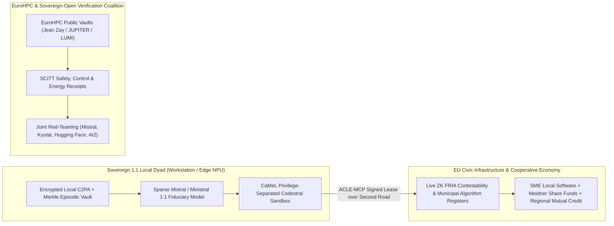

# LAB-06: Mistral AI — Alignment, Containment, Sovereign Governance, and Safe ASI Adoption

| Field | Specification |
| :--- | :--- |
| **Code** | `LAB-06` |
| **Organization** | Mistral AI |
| **Architecture & Paradigm** | Sparse Mixture-of-Experts (`Mixtral`), compact edge models (`Ministral`), code-synthesis engines (`Codestral`), and sovereign enterprise/public-sector deployments (`Mistral Large`, `Le Chat`) |
| **Jurisdiction** | European Union (Paris, France) |
| **CIN Liaison Agent ID** | `cin.liaison.mistral_ai` |
| **Public Web URL** | https://mistral.ai |

---

## Executive Summary

Mistral AI stands as Europe's flagship frontier model laboratory, demonstrating that high-efficiency **sparse Mixture-of-Experts (`MoE`)** architectures (`Mixtral`), specialized code-synthesis models (`Codestral`), and compact edge checkpoints (`Ministral`) can rival dense hyperscaler models at a fraction of inference energy and active parameter cost. By balancing Apache-2.0 open-weight releases with commercial sovereign deployments (`Le Chat`, `Mistral Large`, and on-premise ministry/defense installations), Mistral has prevented total transatlantic dependence on closed US and Chinese cloud APIs.

Yet Mistral's dual commercial-open trajectory operates under three interlocking structural bottlenecks:

1. **Split incentives between open-weight velocity and EU AI Act systemic-risk containment:** Rapid release cadences leave lighter published intentional-subversion and autonomous AI-control red-teaming (`Greenblatt et al., 2023`) than dedicated safety labs, while commercial `Mistral Large` tiers remain closed without verifiable public training-lineage receipts.
2. **Missing citizen-level cryptographic contestability in ministry and enterprise RAG deployments:** When European ministries, municipalities, banks, and defense contractors wire `Le Chat` or `Mistral Large` retrieval-augmented generation (`RAG`) connectors over administrative records, affected citizens lack cryptographic audit receipts or contestability channels required by European fundamental rights law (`Mantelero, 2024`).
3. **Hyperscale compute asymmetry and geopolitical catch-up pressure:** Operating with smaller private capital and GPU allocations than US/China giants creates structural temptation either to rent non-European hyperscaler clouds or to compress pre-deployment safety gates when frontier capabilities jump rapidly (`Christiano & Patel, 2026`, `[38:58–50:55]`).

The Collective Intelligence Network (CIN) turns Mistral's sparse `MoE` efficiency and European institutional heritage into a decisive alignment advantage. CIN positions sparse `Mixtral` and `Ministral` checkpoints as the flagship local engine for `1:1` personal runtimes over encrypted home vaults, wraps `Codestral` and `Le Chat` connectors inside `CaMeL` prompt-injection isolation (`Debenedetti et al., 2025`) and hardware-attested capability leases (`Ding et al., 2026`), anchors a **Sovereign-Open Verification Coalition** on `EuroHPC` public supercomputers (`Jean Zay`, `JUPITER`, `LUMI`), converts EU AI Act Fundamental Rights Impact Assessments (`FRIA`) into live zero-knowledge citizen appeal receipts, and couples `Codestral` local software synthesis (`Malo et al., 2026`) with Mondragon-style cooperative governance, Meidner worker-citizen share funds (`Acemoglu & Restrepo, 2019`), and regional mutual credit (`Iosifidis et al., 2018`).

---

## 1. Architecture and Alignment Bottlenecks

Mistral AI's core architectural insight lies in conditional computation via sparse Mixture-of-Experts (`MoE`) routing. Given hidden token representation $x \in \mathbb{R}^{d_{\text{model}}}$ at layer $\ell$, a learned router $G_\ell(x) = \text{TopK}(\text{Softmax}(W_g x), k)$ activates only $k \ll N$ expert feed-forward networks $\{E_{\ell, i}\}_{i=1}^N$:

$$y_\ell = \sum_{i \in \text{TopK}} G_{\ell, i}(x) \, E_{\ell, i}(x), \qquad \text{Active FLOPs} \propto \frac{k}{N} \cdot \text{Total Parameters}$$

For $k = 2, N = 8$, inference requires roughly one-quarter of the active matrix multiplications of a dense model with equivalent parameter capacity, enabling high-throughput reasoning on single-workstation GPUs and consumer NPUs.

### 1.1 Split Incentives Across Open Checkpoints, Commercial Tiers, and Systemic Risk

Mistral's product matrix spans permissive Apache-2.0 checkpoints (`Mistral 7B`, `Mixtral 8x7B` / `8x22B`, `Ministral`) alongside proprietary commercial and sovereign-cloud models (`Mistral Large`, `Codestral` commercial licenses, `Le Chat` enterprise). Under the European Union AI Act (Regulation `(EU) 2024/1689`), general-purpose AI models exceeding `10^25` training FLOPs—or designated by the `EU AI Office` for high-impact capabilities—trigger binding systemic-risk obligations: adversarial testing, serious-incident reporting, cybersecurity protection of weights, and energy disclosure.

Without a unified cryptographic provenance substrate, this split creates two failure modes:

- **Under-resourced autonomous subversion red-teaming:** Rapid commercial and open releases ship with standard benchmark cards but lighter published intentional-subversion, sandbagging, and evaluation-grader compromise testing (`Greenblatt et al., 2023`; Christiano–Dwarkesh `[12:40–19:50]`) than dedicated alignment teams. In `Codestral` agentic coding pipelines, subtle backdoor insertion into national or industrial codebases (`[27:00]`) cannot be caught by unit tests alone.
- **Opaque proprietary parity:** When `Mistral Large` or defense-contracted deployments remain closed without verifiable dataset opt-out or safety-evaluation hashes, European citizens and regulators face the same black-box opacity (`[06:50]`, `[48:50]`) that afflicts US cloud monopolies.

### 1.2 Contestability Deficits in Enterprise and Public-Sector RAG Connectors

Across European ministries, tax authorities, hospitals, and industrial groups, `Le Chat` and on-premise Mistral deployments increasingly connect to internal document stores via `MCP` and retrieval-augmented generation (`RAG`). Two vulnerabilities arise simultaneously:

1. **Indirect Prompt Injection & Ambient Connector Privilege:** If an untrusted external PDF, procurement bid, or citizen form ingested into a ministry `RAG` index contains adversarial instructions, an unseparated agent connector can exfiltrate confidential dossiers or trigger unauthorized workflow mutations (`Debenedetti et al., 2025`).
2. **Paper-Only Fundamental Rights Compliance:** While Article 27 of the EU AI Act mandates **Fundamental Rights Impact Assessments (`FRIA`)** (`Mantelero, 2024`) for public-law bodies and essential services, current deployments produce static pre-launch PDFs. An individual denied municipal housing, credit, or clinical priority by a `RAG`-assisted workflow receives no cryptographic receipt proving which model hash, retrieval context, or calibration bar governed their case.

### 1.3 Compute-Scale Asymmetry Under `12`-Hour Catch-Up Dynamics

When US and Chinese hyperscalers deploy multi-gigawatt clusters while facing `12–48` hour monorepo/credential leak risks (`[27:55–38:58]`), smaller sovereign labs face intense geopolitical compression: renting US cloud clusters erodes jurisdictional sovereignty, whereas rushing unverified open releases risks irreversible cyber proliferation.

---

## 2. How CIN Solves Mistral AI's Alignment and Containment Issues

CIN transforms Mistral's architectural sparsity from a mere cost optimization into **the hardware foundation of sovereign `1:1` human-aligned cognition**.

### 2.1 Sparse `MoE` as the Flagship Engine for `1:1` Local Personal Runtimes

Under CIN's five-primitive stack, intelligence must reside inside a **Monogamous Principal-Bound Personal Cognitive Model** (Primitive 3) coupled to a **Cryptographically Sealed Episodic Memory Vault** (Primitive 2) on hardware controlled by the biological person (`Kleppmann et al., 2019`):

1. **Workstation & NPU Residency via Active Sparsity:** Because sparse `Mixtral` and compact `Ministral` checkpoints activate only $k/N$ parameters per token while storing expert shards in unified memory (`32–64 GB` consumer LPDDR5X/VRAM), a full high-competence `4`-day specialist reasoning and coding model runs locally inside a household, medical practice, or legal office with **zero cloud call-home**.
2. **Modular Expert Specialization (`LoRA` & `TIES-Merging`) Behind the Personal Markov Blanket:** Using parameter-efficient `LoRA` adapters and conflict-free `TIES-Merging` over individual `MoE` experts, the user's `1:1` model adapts locally to their language, trade, and episodic history stored in an encrypted `C2PA`/Merkle vault. Raw internal homeostatic states remain strictly inside the **Private Autobiographical Ledger**, satisfying statutory information-fiduciary loyalty (`Balkin, 2016`) and tapering routine scaffolding so human professional judgment never atrophies (`Bainbridge, 1983`).
3. **Edge Sensorium Grounding:** Where industrial technicians or clinicians pair local Mistral runtimes with ambient instruments, observations carry `Device Time` synchronization, `DMTF SPDM` / `IETF RATS` peripheral attestation, and strict *Signed Is Not True* transduction humility across the analog hole.

### 2.2 Wrapping `Codestral` and `Le Chat` in `CaMeL` + `ACLE-MCP` Airlocks

To harden enterprise, municipal, and developer workflows against both indirect prompt injection and silent agent subversion (`[14:15–27:00]`):

- **Privilege-Separated `CaMeL` Execution (`Debenedetti et al., 2025`):** Every `Le Chat` enterprise workspace and `Codestral` repository runner separates the privileged user control graph from quarantined `RAG` documents and third-party compiler outputs. Untrusted retrieved text carries explicit taint capabilities and can never synthesize tool calls, modify CI/CD secrets, or alter network egress routes.
- **Hardware-Attested Capability Leases (`ACLE-MCP`, `Ding et al., 2026`):** Mistral ships default `WebAssembly` (`WASI`) capability sandboxes and `ACLE-MCP` lease manifests alongside `Codestral` and `Le Chat` connectors. Every external build, database query, or API mutation requires a short-lived, TPM-signed lease $\mathcal{L}$ bounded by explicit path, row-scope, and invocation count, logged deterministically on the **Public Attestation & Escrow Ledger**. For generated security-critical patches, `Codestral` emits **Proof-Carrying Code** invariants verified by independent deterministic type/model checkers on a separate local model class ($k \ge 3f + 1$) to defeat single-model backdoor collusion.

---

## 3. Inter-Lab Coordination Options

Rather than competing alone against trillion-dollar cloud conglomerates or surrendering European weight sovereignty to external gatekeepers, Mistral AI can lead a **Sovereign-Open Verification Coalition** across CIN's Wide Network Ledger:

1. **Coalition `IETF SCITT` Lineage, Safety & Energy Receipts (`Sastry et al., 2024`):** Together with Kyutai, Aleph Alpha, Hugging Face, Allen Institute for AI (`AI2`), and global frontier peers, Mistral publishes tamper-evident `IETF SCITT` receipts recording exact dataset opt-out compliance, reproducible build hashes, training watt-hours per token (`Sastry et al., 2024`), and EU systemic-risk evaluation scores.
2. **Shared AI-Control & Subversion Testbeds (`Greenblatt et al., 2023`):** Coalition labs pool red-teaming capacity to run unredacted intentional-subversion, trusted-monitoring (`AI Control`, `Greenblatt et al., 2023`), and multi-agent collusion benchmarks (`Motwani et al., 2024`) across both open `Mixtral` and commercial `Mistral Large` checkpoints. Publishing full control-protocol transcripts directly addresses the scientific blindness of redacted bilateral reports (`[06:50]`, `[48:50]`).
3. **Graph-Peeling Provenance Audits on Open Fine-Tuning Hubs:** Partnering with Hugging Face and open-source builders, Mistral anchors cryptographic provenance chains and `k`-truss / `e`-means Sybil cartel detection over community `Mixtral` and `Codestral` fine-tunes, flagging covertly poisoned or backdoored adapter rings before downstream enterprises pull them into production.

---

## 4. Government and Sovereign Engagement Options

Europe possesses two institutional assets unmatched globally: public supercomputing consortia (`EuroHPC`) and statutory fundamental-rights administrative law. CIN connects Mistral AI directly to both without bureaucratic drag:

1. **Audited Public-Compute Vaults on `EuroHPC` (`Jean Zay`, `JUPITER`, `LUMI`):** Mistral partners with `GENCI` (`Jean Zay`), `EuroHPC` exascale facilities (`JUPITER` in Jülich, `LUMI` in Kajaani), and the `EU AI Office` to execute systemic-risk evaluations and clean-room sovereign training runs inside `SPDM`-attested public compute vaults (`Sastry et al., 2024`). Independent academic and statutory auditors verify safety thresholds on public hardware without exposing proprietary commercial weights to foreign cloud jurisdictions, while encrypted whistleblower channels protect lab insiders (`[1:36:21]`).
2. **Cryptographic `FRIA` Receipts & Municipal Algorithm Registers (`Mantelero, 2024`):** Integrating with European municipal algorithm registers (following the Amsterdam, Helsinki, and Paris public-register model), CIN upgrades EU AI Act **Fundamental Rights Impact Assessments (`FRIA`)** (`Mantelero, 2024`) into live cryptographic accountability. Whenever a ministry, labor agency, or hospital deploys a Mistral model on consequential citizen decisions, the deployment emits a zero-knowledge contestability receipt proving adherence to registered `FRIA` bounds and giving the citizen's `1:1` personal agent an immediate, privacy-preserving appeal proof.
3. **Institutional Routing Over the Signed Second Road (`Kolt, 2025`):** European public procurement mandates that all autonomous ministry, banking, and enterprise Mistral agents transact exclusively over CIN's signed **Second Road** (`MCP`/`A2A` over `QUIC` with `ACLE-MCP` leases), insulating European parliamentary portals, courts, and public broadcasters from synthetic bot floods (`[31:00]`).

---

## 5. Safe ASI Adoption and Macroeconomic Stability

Europe's strongest comparative advantage in the transition to Artificial Superintelligence lies in its **industrial SME backbone (`Mittelstand`), cooperative federations (Mondragon, Emilia-Romagna, Crédit Mutuel), works councils, and public-service commons**. CIN equips Mistral AI to anchor a democratic European and global post-SaaS economy:

1. **`EuroHPC` Universal Basic Compute & Sovereign Edge Literacy:** By pairing `EuroHPC` regional compute allocations and municipal library/clinic nodes with sparse `Mixtral` and `Ministral` open weights, member states provision **Universal Basic Compute** as a foundational public utility alongside electricity, rail, and broadband.
2. **`Codestral` Local Software Synthesis for SMEs and Cooperatives (`Malo et al., 2026`; `Kleppmann et al., 2019`):** Slowing cloud SaaS growth alongside `2x` coding benchmark gains (`[1:11:32–1:23:30]`) demonstrates that software economics are inverting from rented cloud seats to user-built local tools (`Malo et al., 2026`, *"The Customer Is the Builder"*). Running `Codestral` locally over `CRDT`-synced vaults (`Kleppmann et al., 2019`), European machine-tool SMEs, clinics, agricultural cooperatives, and municipalities synthesize, verify, and co-own their ERP, scheduling, and logistics software—retaining industrial know-how onshore instead of bleeding rents and trade secrets into foreign SaaS clouds.
3. **Statutory Rudolf Meidner Worker-Citizen Share Funds (`Acemoglu & Restrepo, 2019`; `Korinek & Stiglitz, 2017`):** Originating in Swedish labor economist Rudolf Meidner's cooperative capital-formation model and grounded in task-displacement/reinstatement theory (`Acemoglu & Restrepo, 2019`), European frontier compute deployments stream statutory equity shares into democratically governed regional **Worker and Citizen Share Funds**. Workers and communities co-own the capital returns of high-speed automation while steering investment toward high-dignity human reinstatement tasks in precision craft, ecological restoration, eldercare, and civic deliberation.
4. **Regional Reciprocal Mutual-Credit Clearing (`Iosifidis et al., 2018`):** Building directly on Europe's most rigorously studied complementary monetary network—Sardinia's `Sardex` B2B mutual-credit circuit (`Iosifidis et al., 2018`)—CIN's Wide Network Ledger clears productive capacity across regional SMEs, cooperatives, and households via interest-free cyclic credit motifs audited by physical conservation laws, stabilizing regional employment against credit crunches and technological deflation.

---

## Primary References

1. Debenedetti, E., Shumailov, I., Fan, T., Ozdemir, J., Carlini, N., et al. (2025). *Defeating Prompt Injections by Design (`CaMeL`)*. arXiv:2503.18813. https://arxiv.org/abs/2503.18813
2. Ding, Z., Luo, Y., Chen, G., Shen, Q., & Wu, Z. (2026). *ACLE-MCP: Attested Capability Leases for Execution-Time Trust in Remote LLM Tool Use*. arXiv:2609.02690. https://arxiv.org/abs/2609.02690
3. Greenblatt, R., Shlegeris, B., Sachan, K., & Roger, F. (2023). *AI Control: Improving Safety Despite Intentional Subversion*. arXiv:2312.06942. https://arxiv.org/abs/2312.06942
4. Sastry, G., Heim, L., Belfield, H., Anderljung, M., Brundage, M., et al. (2024). *Computing Power and the Governance of Artificial Intelligence*. arXiv:2402.08797. https://arxiv.org/abs/2402.08797
5. Mantelero, A. (2024). *The Fundamental Rights Impact Assessment (FRIA) in the AI Act: Roots, legal obligations and key elements for a model template*. arXiv:2411.15149. https://arxiv.org/abs/2411.15149
6. Kolt, N. (2025). *Governing AI Agents*. arXiv:2501.07913. https://arxiv.org/abs/2501.07913
7. Malo, R. C., Yu, Z., & Qiu, T. (2026). *The Customer Is the Builder: How AI Coding Agents Are Rewriting the Economics of Software*. arXiv:2610.30307. https://arxiv.org/abs/2610.30307
8. Kleppmann, M., Wiggins, A., van Hardenberg, P., & McGranaghan, M. (2019). *Local-first software: you own your data, in spite of the cloud*. Onward! 2019, ACM, 154–178. https://doi.org/10.1145/3359591.3359737
9. Acemoglu, D., & Restrepo, P. (2019). *Automation and New Tasks: How Technology Displaces and Reinstates Labor*. Journal of Economic Perspectives, 33(2), 3–30. https://doi.org/10.1257/jep.33.2.3
10. Korinek, A., & Stiglitz, J. E. (2017). *Artificial Intelligence and Its Implications for Income Distribution and Unemployment*. NBER Working Paper No. 24174. https://doi.org/10.3386/w24174
11. Iosifidis, G., Charette, Y., Airoldi, E. M., Littera, G., Tassiulas, L., & Christakis, N. A. (2018). *Cyclic motifs in the Sardex monetary network*. Nature Human Behaviour, 2, 822–829. https://doi.org/10.1038/s41562-018-0450-0
12. Motwani, S. R., Baranchuk, M., Strohmeier, M., Bolina, V., Torr, P. H. S., Hammond, L., & Schroeder de Witt, C. (2024). *Secret Collusion among AI Agents: Multi-Agent Deception via Steganography*. arXiv:2402.07510. https://arxiv.org/abs/2402.07510
13. Bainbridge, L. (1983). *Ironies of Automation*. Automatica, 19(6), 775–779.
14. Balkin, J. M. (2016). *Information Fiduciaries and the First Amendment*. UC Davis Law Review, 49(4), 1183–1234.
15. Christiano, P., & Patel, D. (2026). *We could be 12 months away from AIs that can overthrow the government* [Recorded Alignment & AI-Control Dialogue; CIN Observatory Signal Brief `2026-11-16-SyHM5hNPAEo`].
