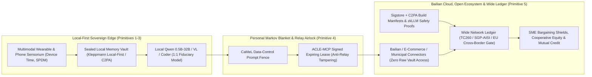

# LAB-15 Technical & Strategic Alignment Paper: Alibaba Cloud Qwen

| Field | Specification |
| :--- | :--- |
| **Code** | `LAB-15` |
| **Organization** | Alibaba Cloud (Tongyi Qianwen / Qwen Team) |
| **Architecture & Paradigm** | Full-spectrum open-weight dense & Mixture-of-Experts (`MoE`) model suite (`0.5B` to `72B+`, `Qwen2.5` / `Qwen3`, `Qwen-VL`, `Qwen-Audio`, `Qwen-Coder`, `QwQ`) paired with centralized `Alibaba Cloud` / `Bailian` commercial hyperscaler hosting |
| **Jurisdiction** | Hangzhou, People's Republic of China / Pan-Asia-Pacific Hyperscaler Footprint |
| **CIN Liaison Agent ID** | `cin.liaison.alibaba_qwen` |
| **Public Web URL** | https://qwenlm.github.io |

---

## Executive Summary

Alibaba Cloud Qwen occupies a uniquely dual structural position in global artificial intelligence. On one hand, the Qwen team produces the world's most widely adopted multi-size open-weight model family—spanning `0.5B`, `1.5B`, `3B`, `7B`, `14B`, `32B`, and `72B+` dense and sparse checkpoints across multilingual text, vision-language (`Qwen-VL`), audio (`Qwen-Audio`), code synthesis (`Qwen-Coder`), and long-horizon reasoning (`QwQ`). On the other hand, parent operator Alibaba Cloud functions as Asia-Pacific's largest commercial cloud hyperscaler, routing enterprise e-commerce, cross-border logistics, financial clearing, and municipal governance agents through its centralized **Bailian** (`Model Studio`) platform and closed flagship `Qwen-Max` APIs.

This structural duality generates three severe alignment and governance tensions:
1. **Unbounded Edge Proliferation With Stripped Guardrails:** Millions of downstream `LoRA` and `TIES-Merging` fine-tunes strip Qwen's post-training refusals while wiring `Qwen-Agent` GUI and shell tools directly into consumer operating systems without cryptographic capability boundaries or transparent pretraining provenance.
2. **Commercial Relay Opacity and Hyperscaler Experience Enclosure:** Across cloud APIs and third-party LLM relays, end-users lack cryptographic receipts proving model identity, quantization fidelity, or tool-permission integrity (`Wu et al., 2026`), while centralized multi-tenant agent hosting threatens to pool real-world commercial and civic workflows into a corporate hive mind (`Christiano & Patel, 2026` `[59:31–1:10:20]`).
3. **Cross-Border Regulatory Fragmentation and Platform Monopsony:** Divergent compliance mandates across China (`TC260`/`CAC`), `Singapore AISI`, `Japan AISI` (`J-AISI`), and the `EU AI Office` threaten splintered digital trade, while hyperscaler marketplace agents risk squeezing small merchants, manufacturers, and gig workers out of bargaining agency.

The **Collective Intelligence Network (CIN)** resolves this split identity by turning `0.5B`–`32B` Qwen checkpoints into local-first (`Kleppmann et al., 2019`), hardware-attested `1:1` **Monogamous Principal-Bound Personal Cognitive Models** inside **Cryptographically Sealed Episodic Memory Vaults**, eliminating commercial middleman tampering via `ACLE-MCP` attested capability leases (`Ding et al., 2026`) and `CaMeL` prompt-injection isolation (`Debenedetti et al., 2025`), establishing `Sigstore`/`C2PA` (`Newman et al., 2022`) and `zkLLM` (`Sun et al., 2024`) pre-release safety provenance across open-weight labs, reconciling cross-border public procurement (`Caputo, 2026`) via zero-knowledge ledger receipts, and arming small merchants and cooperatives with local bargaining shields, customer-built software (`Malo et al., 2026`), cooperative equity (`Korinek & Stiglitz, 2017`), and mutual credit clearing (`Iosifidis et al., 2018`).

---

## 1. Architecture & Alignment Bottlenecks

### 1.1 Multi-Scale Open Weights Meets Centralized Hyperscaler Cloud

Qwen's technical dominance rests on dense scaling laws paired with broad multilingual tokenization (`>150,000`-token byte-level BPE vocabularies achieving high compression ratios across CJK, Southeast Asian, South Asian, Arabic, and European scripts), dynamic-resolution Vision Transformers (`Naive Dynamic Resolution` with `2D-RoPE` in `Qwen-VL`), and specialized code/reasoning post-training (`Qwen-Coder` and `QwQ`). By publishing finely graduated dense parameter tiers $W_s$ for $s \in \{0.5\text{B}, 1.5\text{B}, 3\text{B}, 7\text{B}, 14\text{B}, 32\text{B}, 72\text{B}\}$ alongside sparse `MoE` architectures under Apache-2.0 licenses (for most sub-`72B` tiers), Qwen became the default substrate for global fine-tuning repositories.

Simultaneously, Alibaba Cloud operates **Bailian**, hosting proprietary frontier checkpoints (`Qwen-Max`) and orchestrating multi-agent enterprise pipelines across Taobao/Tmall e-commerce, Cainiao global logistics, Ant-adjacent merchant workflows, and hundreds of Asian municipal "City Brain" and public-service deployments.

### 1.2 Bottleneck A: Downstream Guardrail Erasure and Unbounded `Qwen-Agent` Authority

When millions of edge deployments fine-tune open `Qwen` checkpoints via low-rank adaptation (`LoRA`: $W' = W_0 + BA$ with rank $r \ll d$) or multi-task model merging (`TIES-Merging`, `DARE`), alignment properties trained via supervised fine-tuning and DPO degrade non-linearly:
- **Trivial Safety Filter Stripping:** Fine-tuning on even `100`–`500` adversarial or unaligned instruction pairs—or subtracting the dominant refusal direction in residual-stream activations—completely removes cyber-offense, fraud, and dual-use refusals from `Qwen-Coder` and `QwQ` checkpoints while leaving code-synthesis and GUI-navigation capabilities intact.
- **Ambient Authority in Local GUI Agents:** Frameworks such as `Qwen-Agent` and multimodal `Qwen-VL` computer-use loops bind visual screen parsing directly to OS keyboard, mouse, browser-cookie, and shell execution APIs. Without hardware-enforced Object-Capability isolation, a single indirect prompt injection embedded in an invoice PDF, e-commerce product listing, or repository `README` hijacks the agent's ambient user privileges—echoing the silent evaluation and infrastructure compromises highlighted in the Christiano–Dwarkesh AI-control analysis (`[12:40–19:50]`).
- **Opaque Pretraining Provenance:** While model weights are open, pretraining corpus composition, synthetic distillation sources, and copyright/consent lineage remain undisclosed, complicating downstream legal liability and memorization audits.

### 1.3 Bottleneck B: Commercial Relay Tampering and Hyperscaler Hive-Mind Enclosure

At the cloud pole of Alibaba's business, developers and SMEs routinely access `Qwen-Max` and large `Qwen` endpoints either directly through Bailian or via commercial third-party API relays and enterprise middleware.
- **Middleman Drift and Permission Inflation (`Wu et al., 2026`):** Empirical auditing of commercial LLM API relays (`Wu et al., 2026`) demonstrates systematic discrepancies between promised and delivered execution: intermediaries silently substitute aggressive `INT4` quantizations or cheaper model checkpoints, mutate system prompts, widen MCP/function-calling tool permissions beyond caller intent, and inflate billed token counts—all invisible to the downstream user who lacks cryptographic execution receipts.
- **Multi-Tenant Experience Enclosure (`[59:31–1:10:20]`):** As noted in the Christiano–Dwarkesh brief, when a single hyperscaler hosts tens of millions of commercial coding, procurement, medical, and municipal agents, interaction traces and tool-use repairs naturally accumulate inside the platform operator's telemetry lake. Left unchecked, multi-tenant cloud hosting converts every merchant's trade secret and every citizen's daily workflow into proprietary training fuel for a centralized corporate super-organism while asking society to trust the platform as a *"saintly dictator"* (`[1:28:02]`).

### 1.4 Bottleneck C: Closed-Flagship Audit Asymmetry

Whereas community researchers can inspect `Qwen-7B` or `Qwen-32B` weights directly, Alibaba Cloud's highest-capability commercial tier (`Qwen-Max`) remains closed behind API gates without independent external pre-deployment evaluations—mirroring the Western pattern of redacted capability/speedup reports (`[06:10–07:55]`) and depriving regional regulators of verifiable assurance against deceptive capability jumps.

---

## 2. How CIN Solves Alibaba Qwen's Alignment & Containment Issues

CIN resolves Qwen's edge-versus-cloud tension by anchoring compact Qwen weights locally to one human principal while wrapping every cloud and commercial connector in cryptographic capability leases and taint-tracked prompt fences.

### 2.1 Local-First `1:1` Edge Sovereignty on Personal Laptops and Phones

Rather than treating `0.5B`–`32B` Qwen checkpoints as stateless commodity text generators or tethering personal assistants to Bailian cloud logs, CIN embeds compact `Qwen`, `Qwen-VL`, and `Qwen-Audio` models directly inside the **Local-First Software** paradigm (`Kleppmann et al., 2019`) across Primitives 1, 2, and 3:
- **Perceptual Sensorium Confidence Gating (Primitive 1):** When `Qwen-VL` or `Qwen-Audio` processes wearable camera, phone microphone, or room-sensor inputs, every frame is stamped with hardware `Device Time`, `DMTF SPDM` / `IETF RATS` silicon peripheral attestation, and calibrated sensor-health metadata. Under CIN's **Post-Transduction Realism (*Signed Is Not True*)**, occluded optics or acoustic injection anomalies automatically widen epistemic uncertainty intervals rather than triggering confident hallucinated tool calls.
- **Cryptographically Sealed Episodic Memory Vault (Primitive 2):** Raw multilingual conversations, family photos, health notes, and merchant ledgers remain stored inside an append-only `C2PA`/Merkle local vault encrypted under user-held hardware keys.
- **Monogamous Fiduciary Loyalty (Primitive 3):** Adapted locally via private on-device `LoRA` adapters inside the vault, the `1:1` Qwen personal model owes an undivided statutory information-fiduciary duty to its single human owner—never optimizing for Taobao ad conversion, cloud lock-in, or state/corporate behavioral nudging, and actively tapering scaffolding during routine skill practice so human competence never atrophies.

### 2.2 Defeating Relay Tampering and Prompt Injection Across Bailian Connectors

Whenever a local `1:1` Qwen agent delegates heavy burst computation or interacts with external e-commerce, logistics, or enterprise APIs across Primitive 4's **Personal Markov Blanket**, CIN enforces two cryptographic invariants:
1. **`ACLE-MCP` Hardware-Attested Expiring Capability Leases (`Ding et al., 2026`):** Outbound calls over `MCP` and `A2A` carry an unforgeable Object-Capability lease specifying the exact tool digest, maximum spend/quantity bound, data-minimization schema, and short TTL $[t_0, t_0 + \Delta t]$, paired with attested execution receipts from the remote endpoint. If a commercial API relay or Bailian middleware (`Wu et al., 2026`) attempts to silently downgrade model weights, widen tool permissions, or replay credentials, cryptographic lease verification fails closed at execution time:

$$\text{VerifyLease}\!\left(\sigma_{\text{SPDM}}, \; H(\text{ModelManifest}), \; \text{ToolScope}, \; t_{\text{now}} < t_{\text{exp}}\right) = 1$$

2. **`CaMeL` Architectural Prompt-Fencing (`Debenedetti et al., 2025`):** For `Qwen-Agent` and `Qwen-VL` GUI/workflow tasks, CIN interposes a dual-LLM `CaMeL` runtime. The privileged control graph is compiled strictly from the human principal's signed request; untrusted supplier emails, web DOM trees, and QR codes are processed as typed, taint-labeled data values that are structurally incapable of invoking new tools or modifying capability-lease parameters—neutralizing indirect prompt injection by design even if weights have had refusal training stripped.

---

## 3. Inter-Lab Coordination Options

Because Alibaba Qwen, DeepSeek (`LAB-14`), Meta Llama, Mistral, and Hugging Face collectively supply the vast majority of the world's open-weight base models, uncoordinated releases create a weakest-link vulnerability in global bio/cyber defense. CIN enables a concrete **Open-Weight Provenance & Defensive Readiness Compact**:

### 3.1 `Sigstore` + `C2PA` Cryptographic Model-Build Lineage

Building on `Sigstore` (`Newman et al., 2022`) keyless OIDC/hardware transparency signing and `C2PA` manifests, Qwen and peer open-weight labs attach an immutable cryptographic bill of materials (`AI-SBOM`) to every checkpoint from `Qwen-0.5B` to `Qwen-72B`:
- **Signed Build & Distillation Provenance:** Transparency-log entries bind exact weight tensor SHA-256 Merkle roots to tokenizer configs, quantization kernels (`GPTQ`/`AWQ`/`FP8`), pretraining cutoff declarations, and post-training alignment suite hashes. Downstream hospitals, banks, and municipalities can verify in milliseconds that a local Qwen checkpoint has not been trojaned or backdoored (`[27:00]`) in transit across mirror hubs.

### 3.2 `zkLLM` Dual-Use Attestations and Pre-Release `Qwen-Coder` Patching Sprints

- **Symmetric Zero-Knowledge Safety Receipts (`Sun et al., 2024`):** For both closed flagship `Qwen-Max` updates and pre-release `QwQ` / `Qwen-Coder` checkpoints, Alibaba Cloud publishes `zkLLM` zero-knowledge proofs onto `IETF SCITT` logs proving that unmodified model weights passed standardized autonomous cyber-exploitation, supply-chain worm, and CBRN uplift evaluations below international red-line thresholds—without disclosing proprietary Bailian architecture or training corpora to US or domestic competitors.
- **Coordinated Defensive Cyber-Patching Before Open Weight Drop:** Prior to releasing frontier `Qwen-Coder` weights publicly, Qwen participates in a multi-lab sandboxed vulnerability-remediation sprint alongside open-source package ecosystems (`npm`, `PyPI`, `Maven`, `Linux`, industrial IoT firmware). Critical zero-days surfaced by the new coding checkpoint are patched and shipped with Proof-Carrying Code tests before attackers can fine-tune the open weights.

---

## 4. Government & Sovereign Engagement Options

### 4.1 Reconciling `TC260`, `Singapore AISI`, `J-AISI`, and `EU AI Office` Rules Without Splintering Trade

Alibaba Cloud operates across jurisdictions with sharply diverging AI governance regimes: China's `CAC` algorithm/model registry and `TC260` content/security standards, ASEAN's trade-oriented governance led by `Singapore AISI`, `Japan AISI` (`J-AISI`), and the `EU AI Act` systemic-risk obligations. Absent a neutral interoperability layer, cross-border commercial agents face either incompatible plaintext audit demands or hard digital-border blocks.

CIN's **Wide Network Ledger** (Primitive 5) provides **Bilateral Zero-Knowledge Regulatory Compliance Receipts**:
- Cross-border logistics, customs, and e-commerce agents powered by Qwen transact over CIN's signed **Second Road** (`Kolt, 2025`), attaching selective zero-knowledge proofs and `SCITT` safety attestations tailored to each jurisdiction's statutory schema.
- A European customs authority or Singaporean financial regulator can verify cryptographically that an inbound commercial agent operates within an audited capability lease, carries valid liability escrow, and meets `EU AI Office` / `Singapore AISI` safety bounds—without demanding extraterritorial access to Hangzhou cloud servers or citizen vaults.

### 4.2 Scrutable Public-Sector Procurement (`Caputo, 2026`)

When municipal governments deploy `Alibaba Cloud` / `Bailian` models for traffic optimization, hospital triage, tax assessment, or social benefit eligibility, opaque API outputs violate administrative due process. Grounded in `Caputo (2026)` (*Administrative Law's Fourth Settlement: AI and the Scrutable State*), CIN requires **Risk-Scaled Asymmetric Transparency** for all public-sector Qwen deployments:
- While ordinary citizens retain `100%` local vault privacy (`0%` raw public exposure), any public-agency agent exercising administrative authority must log deterministic input-schema hashes, capability-lease bounds, calibration-drift metrics across demographic cohorts, and human-contestable appeal hooks onto the public attestation ledger—making algorithmic state action legally scrutable without exposing citizen PII.

---

## 5. Safe ASI Adoption & Macroeconomic Stability

### 5.1 Local Bargaining Shields Against Platform Monopsony

In digital commerce and gig logistics, asymmetric AI capability allows centralized marketplace algorithms to dynamically extract consumer surplus and compress small-merchant and courier margins to subsistence levels. Pairing `1:1` local Qwen models (`3B`–`14B` running directly on merchant laptops and courier smartphones) with CIN's fiduciary architecture restores symmetric bargaining power:
- **Fiduciary Merchant & Worker Shields:** Each shopkeeper, independent artisan, small factory, and delivery driver runs a local Qwen agent bound exclusively to their economic interest. Across the Personal Markov Blanket, peer agents use privacy-preserving collective contract auditing to flag predatory fee changes, opaque algorithmic demotions, or wage-skimming clauses in real time—without revealing individual inventory costs to competitors.

### 5.2 SME Customer-Built Software, Cooperative Equity, and Mutual Credit

To ensure rapid advances in `Qwen-Coder` and `QwQ` strengthen broad-based prosperity across Asia-Pacific and the Global South rather than concentrating cloud rents (`Korinek & Stiglitz, 2017`):
1. **Local SME Software Self-Provisioning (`Malo et al., 2026`):** Backed by municipal **Universal Basic Compute** nodes, small manufacturers, clinics, and agricultural co-ops use local `Qwen-Coder` agents inside formal verification sandboxes to build, own, and maintain bespoke inventory, multilingual bookkeeping, and quality-control software—eliminating recurring SaaS subscription tribute and vendor lock-in.
2. **Cooperative Supply-Chain Equity (`Korinek & Stiglitz, 2017`):** Addressing the Pareto-inefficient distributive shocks of frontier automation analyzed by `Korinek & Stiglitz (2017)`, regional logistics hubs, automated fulfillment centers, and shared Bailian compute pools adopt statutory Rudolf Meidner cooperative equity conversion—issuing non-dilutive dividend-bearing shares to participating small producers, warehouse crews, and host municipalities.
3. **Capacity-Backed Reciprocal Mutual Credit (`Iosifidis et al., 2018`):** Modeling empirical B2B clearing networks such as Sardex (`Iosifidis et al., 2018`), CIN's Wide Network Ledger lets regional networks of small suppliers, repair workshops, and cooperatives clear real goods, logistics capacity, and local compute cycles through transparent, zero-interest cyclic credit motifs (`k`-truss audited against wash-trading cartels), insulating real regional production from external currency shocks and platform credit squeezes.

---

## Primary References

1. Yang, A., Yang, B., Zhang, B., Hui, B., Zheng, B., Yu, B., Li, C., Liu, D., Huang, F., Wei, H., et al. (2024). *Qwen2.5 Technical Report*. `arXiv:2412.15115`.
2. Wu, X., et al. (2026). *What the Middleman Delivers: Answer Behavior, Tool Permissions, and Billed Usage in LLM API Relays*. `arXiv:2611.07650`.
3. Kleppmann, M., Wiggins, A., van Hardenberg, P., & McGranaghan, M. (2019). *Local-first software: you own your data, in spite of the cloud*. ACM SIGPLAN Onward! 2019 (`doi:10.1145/3359591.3359737`).
4. Ding, Z., Luo, Y., Chen, G., Shen, Q., & Wu, Z. (2026). *ACLE-MCP: Attested Capability Leases for Execution-Time Trust in Remote LLM Tool Use*. `arXiv:2609.02690`.
5. Debenedetti, E., Shumailov, I., Fan, T., Hayes, J., Carlini, N., Fabian, D., Kern, C., Shi, C., Terzis, A., & Tramèr, F. (2025). *Defeating Prompt Injections by Design*. `arXiv:2503.18813`.
6. Newman, Z., Meyers, J. S., & Torres-Arias, S. (2022). *Sigstore: Software Signing for Everybody*. ACM CCS 2022 (`doi:10.1145/3548606.3560596`).
7. Sun, H., Li, J., & Zhang, H. (2024). *zkLLM: Zero Knowledge Proofs for Large Language Models*. ACM CCS 2024 (`arXiv:2404.16109`).
8. Caputo, N. (2026). *Administrative Law's Fourth Settlement: AI and the Scrutable State*. `arXiv:2602.09678`.
9. Kolt, N. (2025). *Governing AI Agents*. `arXiv:2501.07913`.
10. Malo, R. C., Yu, Z., & Qiu, T. (2026). *The Customer Is the Builder: How AI Coding Agents Are Rewriting the Economics of Software*. `arXiv:2610.30307`.
11. Korinek, A., & Stiglitz, J. E. (2017). *Artificial Intelligence and Its Implications for Income Distribution and Unemployment*. NBER Working Paper No. 24174 (`doi:10.3386/w24174`).
12. Iosifidis, G., Charette, Y., Airoldi, E. M., Littera, G., Tassiulas, L., & Christakis, N. A. (2018). *Cyclic motifs in the Sardex monetary network*. Nature Human Behaviour, 2, 822–829 (`doi:10.1038/s41562-018-0450-0`).
13. Patel, D., & Christiano, P. (2026, November 16). *We could be 12 months away from AIs that can overthrow the government* [Podcast transcript & CIN Observatory Signal Brief `SyHM5hNPAEo`].
