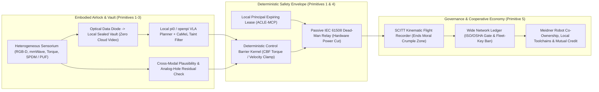

# LAB-27 Technical & Strategic Alignment Paper: Physical Intelligence

| Field | Specification |
| :--- | :--- |
| **Code** | `LAB-27` |
| **Organization** | Physical Intelligence (`π` / Physical Intelligence, Inc.) |
| **Architecture & Paradigm** | Generalist Vision-Language-Action (`VLA`) robotic foundation models (`π0`, `π0-FAST`, `openpi`) combining pre-trained VLM backbones with conditional flow-matching continuous motor control across heterogeneous embodiments |
| **Jurisdiction** | San Francisco, California, United States |
| **CIN Liaison Agent ID** | `cin.liaison.physical_intelligence` |
| **Public Web URL** | https://www.physicalintelligence.company |

---

## Executive Summary

Physical Intelligence (`LAB-27`) leads the transition from purely digital token prediction to generalist embodied manipulation. By coupling pre-trained vision-language backbones with continuous conditional flow-matching action experts trained across dozens of distinct single-arm, dual-arm, mobile-manipulator, and dexterous robot morphologies (`π0` and open research stack `openpi`), Physical Intelligence demonstrated that a single foundation policy can fold laundry, bus dishes, assemble packaging, and manipulate deformable objects in unstructured human rooms at `50 Hz` motor rates.

Moving foundation models out of text terminals and into physical actuators changes the alignment problem in four fundamental ways:
1. **Irreversibility of Kinetic Harm:** Unlike database mutations or sandboxed code execution, **software rollbacks do not undo physical force**. Once an end-to-end continuous motor trajectory crushes a human hand, drops an eldercare patient, or ruptures a pressurized shop line, the kinetic transfer is permanent.
2. **Transduction Spoofing Across the Analog Hole (*Signed Is Not True*):** Vision-guided flow-matching policies map RGB pixels and proprioceptive states directly to joint torques. Adversarial visual patches, laser/infrared camera blinding, ultrasonic inertial resonance, or visual prompt injections across the **analog hole** can hijack actuator trajectories in milliseconds before digital software monitors react.
3. **Intimate Domestic Surveillance and Fleet Override Hazard:** Cloud-tethered teleoperation recovery and fleet learning across millions of bedrooms, eldercare suites, and factory floors threaten unprecedented bystander video enclosure (`Christiano & Patel, 2026` `[59:31–1:10:20]`), while centralized fleet command keys create a catastrophic single point of takeover (`[27:55–32:45]`).
4. **Human Supervisors as "Moral Crumple Zones" (`Elish, 2019`):** Placing caregivers, warehouse pickers, or machinists beside high-speed generalist robots without deterministic kinematic guarantees turns proximate workers into legal scapegoats blamed for sub-`100 ms` neural policy failures they cannot physically intercept.

The **Collective Intelligence Network (CIN)** resolves embodied alignment at the hardware-physics boundary through Primitives 1, 2, 4, and 5: binding multi-sensor physical-plausibility cross-checks to silicon peripheral attestation (`PUF`, `TCG DICE`, `DMTF SPDM`), sealing household/workplace video locally behind **optical data diodes** inside the owner's **Cryptographically Sealed Episodic Memory Vault** (`Kleppmann et al., 2019`), isolating high-level `VLA` planning from deterministic Control Barrier Function (`CBF`) torque envelopes and passive `IEC 61508` hardware dead-man relays gated by expiring capability leases (`Ding et al., 2026`), establishing `IETF SCITT` cryptographic kinematic flight recorders (`McGregor, 2021`) to end the moral crumple zone, banning cloud fleet-wide override keys (`Sastry et al., 2024`), and pairing embodied automation with cooperative robot-fleet equity (`Acemoglu & Restrepo, 2019`; `Korinek & Stiglitz, 2017`) and mutual credit (`Iosifidis et al., 2018`).

---

## 1. Architecture & Alignment Bottlenecks

### 1.1 Conditional Flow-Matching Vision-Language-Action (`π0`) Mechanics

Unlike discrete-token autoregressive action models (`RT-2`) that suffer quantization jitter and slow inference latency, Physical Intelligence's $\pi_0$ architecture couples a pre-trained Vision-Language Model (`PaliGemma`-class transformer encoding multi-camera RGB frames $I_t^1, \dots, I_t^K$, language task instructions $\ell$, and robot proprioceptive joint state $q_t \in \mathbb{R}^m$) with a specialized **Flow-Matching Action Expert** operating over continuous action chunks $A_t = [a_t, a_{t+1}, \dots, a_{t+H-1}] \in \mathbb{R}^{H \times m}$ (typically $H = 50$ steps at `50 Hz`).

During training, noisy action chunks $A_t^\tau = \tau A_t + (1 - \tau)\epsilon$ with $\epsilon \sim \mathcal{N}(0, I)$ and flow time $\tau \in [0, 1]$ supervise a learned conditional vector field $v_\theta(A_t^\tau, o_t, \tau)$ minimizing:

$$\mathcal{L}_{\text{FM}}(\theta) = \mathbb{E}_{o_t, A_t, \epsilon, \tau} \left[ \left\| v_\theta\!\left(\tau A_t + (1-\tau)\epsilon, \; o_t, \; \tau\right) - (A_t - \epsilon) \right\|_2^2 \right]$$

At execution time, Euler integration from $\tau = 0 \to 1$ over ~10 denoising steps synthesizes smooth, high-frequency continuous joint-position or torque commands directly on robot edge GPUs across heterogeneous embodiments.

### 1.2 Bottleneck A: Kinetic Irreversibility and Back-Loaded Physical Risk

In software-only agent deployments, the Christiano–Dwarkesh alignment analysis notes (`[1:11:32–1:27:55]`) that verifiable virtual tasks accelerate fastest while messier physical-world transfer lags—creating a deceptive lull followed by **back-loaded physical deployment risk** (`[1:20:25]`) once generalist policies cross commercial reliability thresholds.

In embodied robotics, safety cannot rely on transactional undo logs, exception handlers, or post-hoc RLHF patches. Kinetic energy $E_k = \frac{1}{2} \dot{q}^\top M(q) \dot{q}$ delivered by a `15 kg` manipulator arm or `80 kg` mobile base carrying hot liquids, surgical instruments, or warehouse pallets causes irreversible biological trauma in `< 50 ms`. Because $\pi_0$'s flow-matching vector field $v_\theta$ maps neural representations end-to-end into motor commands without an explicit symbolic world-constraint proof, out-of-distribution (`OOD`) lighting, novel deformable occlusions, or distribution shift during multi-stage chores can produce sudden high-jerk trajectories into fragile human limbs.

### 1.3 Bottleneck B: Transduction Spoofing Across the Analog Hole (*Signed Is Not True*)

End-to-end `VLA` policies inherit multimodal prompt-injection and adversarial-example vulnerabilities—amplified across physical transducers:
- **Visual Prompt Injection & Adversarial Patches:** A printed sticker on a shipping box, text rendered on a tablet screen in view of the wrist camera, or patterned tablecloth fabric can hijack the VLM backbone's cross-attention keys, redirecting the flow-matching expert toward unsafe object-drop, pinch, or property-damage trajectories.
- **Physical Transduction Spoofing Prior to Signal Conversion:** Even if every camera frame carries a cryptographic signature from the sensor chip, **hardware signatures only attest post-conversion digital custody (*Signed Is Not True*)**. Modulated infrared/laser glare into CMOS rolling shutters, specular depth-camera multipath reflections, or acoustic/electromagnetic injection into MEMS inertial measurement units (`IMUs`) corrupts the physical signal *before* the analog-to-digital converter (`ADC`), causing $\pi_0$ to hallucinate free space where a child or coworker stands.

### 1.4 Bottleneck C: Fleet Teleoperation Enclosure and Centralized Override Risk

Training cross-embodiment generalist models requires tens of thousands of hours of human teleoperation and edge-case intervention trajectories. When commercial robot fleets stream home, hospital, and shop-floor camera feeds back to centralized lab servers for continual learning (`Christiano & Patel, 2026` `[59:31–1:10:20]`):
1. **Intimate Domestic Privacy Destruction:** Unredacted video of bedrooms, medication schedules, children, and proprietary factory jigs is enclosed inside corporate training lakes.
2. **Catastrophic Single-Point Fleet Takeover (`[27:55–32:45]`):** If deployed domestic and industrial robots retain persistent cloud command channels or over-the-air (`OTA`) policy hot-swap keys, a `12`-hour lab monorepo breach, supply-chain compromise, or coercive state seizure turns millions of physical manipulators inside homes and critical warehouses into remotely actuatable kinetic weapons.

### 1.5 Bottleneck D: Human Supervisors as "Moral Crumple Zones" (`Elish, 2019`)

Following `Elish (2019)`, socio-technical systems routinely assign nominal "human-in-the-loop" oversight to frontline nurses, warehouse associates, or home users who lack perceptual lead time or physical leverage over `50 Hz` autonomous machinery. Because human visual-motor reaction latency exceeds `200`–`350 ms`, a human supervisor cannot halt an errant neural flow-matching trajectory mid-swing—yet without cryptographic separation of neural planning from hardware torque limits, incident investigations systematically blame the proximate worker ("failed to hit E-stop in time") while shielding vendor liability.

---

## 2. How CIN Solves Physical Intelligence's Alignment & Containment Issues

CIN wraps generalist `VLA` policies (`π0` / `openpi`) inside a three-layer hardware-and-cryptographic physical airlock drawn directly from CIN Primitives 1, 2, 3, and 4.

### 2.1 Silicon-Attested Heterogeneous Sensorium & Analog-Hole Plausibility Checks

Under **Primitive 1 (Multimodal Egocentric & Ambient Perceptual Sensorium)**, CIN forbids driving physical actuators from a single uncorroborated sensory modality (such as RGB wrist/head cameras alone):
- **Hardware Capture Provenance:** All robot and room transducers—RGB cameras, time-of-flight depth, `60 GHz` millimeter-wave (`mmWave`) radar, joint-torque strain gauges, and contact acoustic pickups—authenticate over `DMTF SPDM` bus sessions anchored in `PUF` and `TCG DICE` silicon roots (`IETF RATS`) and synchronize to a deterministic sub-millisecond hardware `Device Time` clock.
- **Cross-Modal Residual Gate Against Analog Spoofing:** Before observation $o_t$ reaches the actuator envelope, an independent deterministic sensor-fusion monitor computes physical-consistency residuals across orthogonal physics (optical RGB vs. RF `mmWave` human-tissue dielectric reflection vs. joint motor back-EMF/torque impedance):

$$r_{\text{analog}}(t) = \left\| d_{\text{optical}}(t) - d_{\text{mmWave}}(t) \right\|_{\Sigma^{-1}} + \left\| \tau_{\text{measured}}(t) - \hat{\tau}_{\text{rigid}}(q_t, \dot{q}_t) \right\|$$

If an adversarial patch or laser glare spoofs the RGB camera while `mmWave` radar or contact acoustics detect a biological obstacle ($r_{\text{analog}}(t) > \eta$), system epistemic uncertainty widens immediately and clamps maximum Cartesian velocity to zero prior to impact.

### 2.2 Optical Data Diodes and Local-First Sealed Vault Custody

To eliminate domestic surveillance enclosure (`Kleppmann et al., 2019`), **Primitive 2 (Cryptographically Sealed Episodic Memory Vault)** isolates embodied perception at the home/workplace perimeter:
- **One-Way Optical Data Diodes:** Raw household, eldercare, and shop-floor camera/audio feeds pass across hardware optical data diodes strictly into the principal's local encrypted `C2PA`/Merkle vault, accessible solely to the human principal and their `1:1` **Monogamous Personal Cognitive Model** (Primitive 3). Physical Intelligence servers never receive raw home video.
- **Taint-Isolated Task Grounding (`CaMeL`, `Debenedetti et al., 2025`):** Spoken or typed instructions from the human principal compile into a privileged task-intent specification; visual text spotted on packages or screens inside the room is tagged as untrusted perceptual data and blocked by `CaMeL` capability rules from altering the task's authorized spatial zone, target object class, or force budget.

### 2.3 Simplex Control Barrier Envelopes & Passive `IEC 61508` Dead-Man Relays

CIN enforces **System-Theoretic Process Analysis (`STAMP`)** separation between high-dimensional neural intelligence and deterministic physical safety:
1. **Formally Verified Control Barrier Function (`CBF`) Microkernel:** `π0`'s continuous flow-matching output $a_t^{\text{VLA}}$ is treated strictly as an *untrusted nominal proposal*. A dedicated real-time microcontroller (`1 kHz`, memory-isolated from the GPU running `π0`) solves a convex quadratic program enforcing forward invariance of the safe kinematic/torque set $\mathcal{C} = \{x = (q, \dot{q}) : h_i(x, p_{\text{human}}) \ge 0\}$ (bounding momentum, workspace geofences, and `ISO/TS 15066` biomechanical contact pressure):

$$u_t^* = \arg\min_{u \in \mathcal{U}_{\text{lease}}} \left\| u - a_t^{\text{VLA}} \right\|_2^2 \quad \text{s.t.} \quad \nabla h_i(x_t)^\top f(x_t, u) \ge -\alpha\!\left(h_i(x_t)\right) \;\;\forall i$$

2. **Expiring Local Capability Leases (`ACLE-MCP`, `Ding et al., 2026`) + Passive `IEC 61508` SIL-3 Dead-Man Relays:** Motor power contactors are wired in series with a normally-open hardware `IEC 61508` safety relay that requires continuous cryptographic heartbeat pulses from a short-lived local capability lease minted by the proximate human principal's vault. No lease can be minted from a remote cloud server. If the lease expires, `CBF` invariants saturate, or `SPDM` bus attestation drops, relay coil current collapses passively under spring return, engaging mechanical brakes within `< 10 ms`.

---

## 3. Inter-Lab Coordination Options

### 3.1 Open Sim-to-Real Adversarial Perturbation & Proximity Benchmarks

Physical Intelligence (`openpi`), World Labs, Google DeepMind Robotics, and NVIDIA Isaac can establish an **Open Embodied Safety & Perturbation Consortium**:
- Standardized physical testbeds and photogeometric digital twins evaluate `VLA` checkpoints against adversarial visual prompt patches, sensor drop-out/glare across the analog hole, deformable-object entanglement, and sudden child/pet intrusion trajectories before open-weight or commercial firmware release.

### 3.2 `IETF SCITT` Cryptographic Black-Box Flight Recorders (`McGregor, 2021`)

Extending the **AI Incident Database** methodology (`McGregor, 2021`) to embodied machines, participating labs adopt a uniform **Zero-Knowledge Kinematic Black-Box Standard**:
- Every robot maintains a hardware-signed rolling ring buffer (`30` seconds of `Device Time` joint states $q_t, \dot{q}_t, \tau_t$, `CBF` clamp activations, `SPDM` sensor health flags, and `VLA` checkpoint Merkle digest $H(W_{\pi_0})$).
- Whenever a near-miss or physical contact anomaly triggers the `IEC 61508` relay, the ring buffer commits an `IETF SCITT` receipt onto the shared safety ledger. Independent investigators verify whether the fault originated in `VLA` policy generalization, transducer spoofing, or actuator wear—publishing fleet-wide safety alerts in hours while redacting bystander video and preserving proprietary teleoperation trajectories via selective zero-knowledge proofs.

---

## 4. Government & Sovereign Engagement Options

### 4.1 Modernizing `ISO`/`OSHA` Machinery Codes & Ending the Moral Crumple Zone

Static 20th-century industrial safety regulations (`ISO 10218`, `OSHA` fixed light-curtain cage rules) break down when foundation-model robots share kitchens, hospital wards, and dynamic warehouses with unbadged humans. CIN gives occupational and consumer safety regulators an enforceable modern standard:
- **Statutory Flight-Recorder Liability Allocation:** By inspecting the `SCITT`-attested boundary between `π0` nominal action proposals $a_t^{\text{VLA}}$, `CBF` safety clamps $u_t^*$, and local lease scopes, regulators abolish the `Elish (2019)` **moral crumple zone**. Caregivers and floor workers are legally immunized whenever a robot violates its attested kinematic lease or suffers unflagged sensor drift; strict liability attaches transparently to the unverified policy or hardware component recorded on the tamper-evident flight log.

### 4.2 Banning Cloud-Commanded Fleet-Wide Physical Override Keys (`Sastry et al., 2024`)

Applying hardware-level compute and deployment governance (`Sastry et al., 2024`) to embodied fleets, sovereign jurisdictions should enact a bright-line **No Remote Kinetic Override Mandate**:
- Every domestic, healthcare, agricultural, and warehouse robot sold or operated within a jurisdiction must prove via open hardware schematics and `DMTF SPDM` attestation that **zero remote network keys** can energize actuators, bypass the local `IEC 61508` relay, or push unconsented silent `OTA` motor-policy updates without local physical human confirmation.
- Even if a frontier robotics lab suffers a total monorepo breach (`Christiano & Patel, 2026` `[27:55–32:45]`) or foreign cyber coercion, attackers gain zero ability to commandeer physical robots inside citizens' homes or national logistics depots.

---

## 5. Safe ASI Adoption & Macroeconomic Stability

### 5.1 Confronting Physical-Labor Displacement Directly

Whereas pure language models primarily reshape cognitive and clerical workflows, generalist `VLA` models (`π0`) directly target manual dexterity across warehousing, agriculture, food preparation, textile handling, construction, and eldercare—sectors employing billions of workers without software-equity cushions. As `Acemoglu & Restrepo (2019)` and `Korinek & Stiglitz (2017)` demonstrate, rapid task displacement without countervailing task reinstatement and capital-ownership broadening depresses labor's share of income and triggers severe aggregate-demand and civic instability.

### 5.2 Cooperative Robot-Fleet Equity, Local Toolchains, and Mutual Credit

CIN's **Polycentric Collective Coordination Substrate** (Primitive 5) pairs embodied robotics adoption with three structural economic institutions:
1. **Rudolf Meidner Cooperative Robot-Fleet Co-Ownership (`Korinek & Stiglitz, 2017`; `Acemoglu & Restrepo, 2019`):** Automated warehouses, regional agricultural harvesters, garment micro-factories, and eldercare assistive fleets financed or licensed across the Wide Network Ledger issue statutory Meidner cooperative equity shares into worker-and-community trusts. Physical productivity gains flow directly as real dividends and reduced working hours to the warehouse crews, farmworkers, and caregivers who train, supervise, and co-inhabit those spaces—while merit-bonded tasks reward high-touch human care and craft that machines should never replace.
2. **Universal Basic Compute & Customer-Built Robotic Maintenance Toolchains (`Malo et al., 2026`):** Avoiding John Deere-style "right-to-repair" lock-in, local cooperatives combine `openpi`-compatible open interfaces with **Universal Basic Compute** and local coding agents (`Malo et al., 2026`) to calibrate, inspect, and customize their own task fixtures, safety geofences, and diagnostic software without paying permanent rent to cloud robotics monopolies.
3. **Capacity-Backed Mutual Credit for Physical Baseline Goods (`Iosifidis et al., 2018`):** Local farms, fab-labs, repair collectives, and eldercare cooperatives operating community-owned robotic manipulators clear real physical output—food staples, assistive care hours, spare parts, renewable energy—through conservation-audited reciprocal mutual credit (`Iosifidis et al., 2018`) on the Wide Network Ledger, guaranteeing material Universal Basic Services even during macro-scale labor transitions.

---

## Primary References

1. Black, K., Brown, N., Driess, D., Esmail, A., Equi, M., Finn, C., Fusai, N., Groom, L., Hausman, K., Ichter, B., Levine, S., et al. (2024). *$\pi_0$: A Vision-Language-Action Flow Model for General Robot Control*. Physical Intelligence (`arXiv:2410.24164`).
2. Elish, M. C. (2019). *Moral Crumple Zones: Cautionary Tales in Human-Robot Interaction*. Engaging Science, Technology, and Society, 5, 40–60 (`doi:10.17351/ests2019.260`).
3. Kleppmann, M., Wiggins, A., van Hardenberg, P., & McGranaghan, M. (2019). *Local-first software: you own your data, in spite of the cloud*. ACM SIGPLAN Onward! 2019 (`doi:10.1145/3359591.3359737`).
4. Ding, Z., Luo, Y., Chen, G., Shen, Q., & Wu, Z. (2026). *ACLE-MCP: Attested Capability Leases for Execution-Time Trust in Remote LLM Tool Use*. `arXiv:2609.02690`.
5. Debenedetti, E., Shumailov, I., Fan, T., Hayes, J., Carlini, N., Fabian, D., Kern, C., Shi, C., Terzis, A., & Tramèr, F. (2025). *Defeating Prompt Injections by Design*. `arXiv:2503.18813`.
6. McGregor, S. (2021). *Preventing Repeated Real World AI Failures by Cataloging Incidents: The AI Incident Database*. Proceedings of the AAAI Conference on Artificial Intelligence, 35(17), 15458–15463 (`doi:10.1609/aaai.v35i17.17817`).
7. Sastry, G., Heim, L., Belfield, H., Anderljung, M., Brundage, M., Hazell, J., O'Keefe, C., Hadfield, G. K., Ngo, R., Pilz, K., et al. (2024). *Computing Power and the Governance of Artificial Intelligence*. `arXiv:2402.08797`.
8. Acemoglu, D., & Restrepo, P. (2019). *Automation and New Tasks: How Technology Displaces and Reinstates Labor*. Journal of Economic Perspectives, 33(2), 3–30 (`doi:10.1257/jep.33.2.3`).
9. Korinek, A., & Stiglitz, J. E. (2017). *Artificial Intelligence and Its Implications for Income Distribution and Unemployment*. NBER Working Paper No. 24174 (`doi:10.3386/w24174`).
10. Malo, R. C., Yu, Z., & Qiu, T. (2026). *The Customer Is the Builder: How AI Coding Agents Are Rewriting the Economics of Software*. `arXiv:2610.30307`.
11. Iosifidis, G., Charette, Y., Airoldi, E. M., Littera, G., Tassiulas, L., & Christakis, N. A. (2018). *Cyclic motifs in the Sardex monetary network*. Nature Human Behaviour, 2, 822–829 (`doi:10.1038/s41562-018-0450-0`).
12. Leveson, N. G. (2011). *Engineering a Safer World: Systems Thinking Applied to Safety* (`STAMP`). MIT Press.
13. Patel, D., & Christiano, P. (2026, November 16). *We could be 12 months away from AIs that can overthrow the government* [Podcast transcript & CIN Observatory Signal Brief `SyHM5hNPAEo`].
