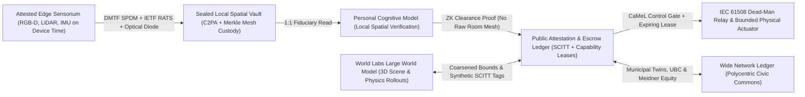

# LAB-41 Technical Paper: World Labs — Spatial Intelligence, Large World Models, and Sovereign Physical Grounding

| Field | Specification |
| :--- | :--- |
| **Code** | `LAB-41` |
| **Organization** | World Labs, Inc. (Fei-Fei Li, Justin Johnson, Christoph Lassner, Ben Mildenhall) |
| **Architecture & Paradigm** | Non-LLM Spatial Intelligence & Large World Models (`LWMs`): persistent 3D geometric scene graphs, neural radiance and Gaussian splat synthesis, differentiable physics simulation, and navigable digital twins |
| **Jurisdiction** | San Francisco, California, United States (`US-CA`) |
| **CIN Liaison Agent ID** | `cin-liaison-lab-41-world-labs` |
| **Public Web URL** | https://www.worldlabs.ai |

---

## Executive Summary

World Labs represents a foundational departure from flat one-dimensional autoregressive token prediction. Founded by Fei-Fei Li, Justin Johnson, Christoph Lassner, and Ben Mildenhall, the laboratory builds **Large World Models (`LWMs`)** capable of perceiving, generating, reasoning over, and interacting with persistent three-dimensional physical environments. Where Large Language Models (`LLMs`) compress projected human text without native Euclidean invariance, occlusion permanence, or Newtonian dynamics, `LWMs` maintain metric 3D geometry, surface material affordances, lighting transport, and physical causality across continuous space and time.

Yet scaling non-LLM spatial intelligence introduces three alignment, security, and political-economy bottlenecks that text-only safety frameworks cannot address:
1. **Total Spatial Privacy Enclosure:** Streaming continuous RGB-D, LiDAR, millimeter-wave radar, and inertial scans from homes, hospital wards, workshops, and civic buildings into centralized commercial clouds constructs an uncontestable panoptic digital twin of private human life.
2. **Sim-to-Real Active-Learning Overhangs:** Once embodied planners couple differentiable 3D world models with closed-loop real-world robotic experimentation, physical manipulation, mechanical bypass, and structural assembly capabilities undergo abrupt back-loaded jumps that outpace static pre-deployment evaluations.
3. **Transduction Spoofing Across the Analog Hole:** Adversarial optical, LiDAR, structured-light, or synthetic-render injection prior to analog-to-digital conversion can corrupt spatial state estimation (`Signed Is Not True`), deceiving downstream motion planners into unsafe physical trajectories.

The **Collective Intelligence Network (CIN)** resolves these bottlenecks without throttling spatial science. By anchoring wearable and ambient 3D sensing inside a hardware-attested **Local Spatial Episodic Memory Vault** behind optical data diodes, residents retain exclusive custody over raw interior meshes (`Kleppmann et al., 2019`). External World Labs models and third-party service robots receive only coarsened, **zero-knowledge geometric clearance proofs** (`Sun et al., 2024`) across the **Personal Markov Blanket**, while every sim-to-real actuator command is gated by `CaMeL` control-data separation (`Debenedetti et al., 2025`), expiring hardware capability leases (`Ding et al., 2026`), and `IEC 61508` physical dead-man relays. At the civic and macroeconomic layer, CIN pairs sovereign municipal digital twins (`Caputo, 2026`) with **Universal Basic Compute**, local spatial engineering synthesis (`Malo et al., 2026`), statutory Rudolf Meidner cooperative equity streaming (`Korinek & Stiglitz, 2017`; `Acemoglu & Restrepo, 2019`), and capacity-backed mutual credit clearing (`Iosifidis et al., 2018`).

---

## 1. Architecture & Alignment Bottlenecks

### 1.1 Beyond 1D Token Streams: Metric 3D Scene Graphs and Differentiable Physics

Autoregressive language models approximate $p(w_t \mid w_{<t})$ over discrete symbol sequences. Even multimodal vision-language extensions typically flatten camera frames into ViT patch tokens lacking persistent $SE(3)$ equivariance: rotating a camera away from a workbench and returning minutes later frequently causes unconstrained generative video or token models to hallucinate altered object counts, impossible support topologies, or violated conservation of momentum.

World Labs addresses this structural deficit by constructing Large World Models over explicit and implicit 3D spatial state spaces:

$$\mathcal{W}_t = \left(\mathcal{G}_t, \Phi_{\text{mat}}, \Psi_{\text{dyn}}\right), \qquad \mathcal{G}_t = \left\{\left(\mathbf{x}_i \in \mathbb{R}^3, \mathbf{q}_i \in SO(3), \boldsymbol{\Sigma}_i, \mathbf{f}_i\right)\right\}_{i=1}^{N}$$

where $\mathcal{G}_t$ represents persistent metric geometry (combining anisotropic 3D Gaussian primitives, signed distance fields $f_{\text{SDF}}(\mathbf{x})$, and topological scene graphs), $\Phi_{\text{mat}}$ encodes surface reflectance, friction coefficients, mass distributions, and articulated kinematic joints, and $\Psi_{\text{dyn}}: (\mathcal{W}_t, \mathbf{u}_t) \mapsto \mathcal{W}_{t+1}$ provides a forward physical transition operator under external intervention or robot control wrench $\mathbf{u}_t$. By lifting monocular, stereo, or RGB-D observations into persistent 3D world states, `LWMs` support counterfactual physical rollouts, architectural CAD synthesis, robotic motion planning, and persistent multi-user digital twins.

### 1.2 Bottleneck A: Panoptic Spatial Privacy Enclosure

In a cloud-centric deployment model, consumer smart glasses, domestic mobile robots, clinic monitoring cameras, and industrial inspection drones stream continuous egocentric RGB-D frames and SLAM point clouds to multi-tenant vendor servers to reconstruct and query $\mathcal{W}_t$. Unlike text chat logs—which capture only what a user consciously types—continuous 3D world reconstruction captures everything passively visible inside a household or workplace: prescription bottles on a nightstand, structural lock geometry on entry doors, pediatric mobility patterns, proprietary shop-floor jigs, and unconsented bystanders.

As highlighted in the November 2026 Christiano–Dwarkesh strategic brief (`[59:31–1:10:20]`), pooling experiential trajectories from $10^8$ live edge deployments into a centralized corporate foundation model creates irreversible **hive-mind experience enclosure**. For spatial intelligence, cloud aggregation means a single commercial operator accumulates a live, queryable 4D physical map of private interiors and critical civil infrastructure without local revocability.

### 1.3 Bottleneck B: Sim-to-Real Active-Learning Overhangs

A widespread error in contemporary AI forecasting assumes robotic and physical capabilities will permanently lag software automation because real-world actuator data is scarce. In the Christiano–Dwarkesh analysis (`[1:22:05]`), Paul Christiano identifies why this reassurance fails: while purely virtual verifiable domains (software synthesis and mathematics) double first (`2x` METR horizon scaling), embodied capabilities exhibit **steep back-loaded transfer** once agents combine high-fidelity 3D physics world models with targeted active learning in the physical world.

Specifically, when an autonomous planner uses a World Labs `LWM` to run $10^6$ parallel differentiable physics rollouts per minute, identifies the exact epistemic bottleneck where contact friction or deformable kinematics remain uncertain, and dispatches a physical manipulator to execute minimal informative probes, the sim-to-real gap collapses rapidly. Without hard external containment, the same active-learning loop that masters dexterous domestic assistance or surgical tooling can rapidly synthesize physical lock bypass, industrial sabotage trajectories, or unapproved structural modifications.

### 1.4 Bottleneck C: Transduction Spoofing Across the Analog Hole

Spatial world models depend on physical transducers—time-of-flight (`ToF`) LiDAR, structured-light infrared projectors, rolling-shutter CMOS sensors, millimeter-wave radar, and MEMS inertial measurement units (`IMUs`). Prior to the analog-to-digital converter (`ADC`), physical energy crosses the unencrypted **analog hole** (`Fu & Xu, 2018`). Timed infrared laser pulses can inject phantom obstacles or erase real walls in LiDAR point clouds; acoustic resonance at MEMS gyroscope frequencies can destabilize visual-inertial odometry (`VIO`); and adversarial surface textures or unlabelled synthetic `LWM` renders re-ingested from the web can corrupt downstream scene graphs. If a planner treats signed cloud scene state as ground truth without post-transduction humility (*Signed Is Not True*), spoofed 3D geometry directly triggers hazardous physical actuation.

---

## 2. How CIN Solves World Labs' Alignment & Containment Issues

CIN provides the hardware-rooted perceptual, cryptographic, and control-theoretic substrate required to deploy World Labs' spatial models safely across households, workplaces, and public infrastructure.

### 2.1 CIN Primitives 1 & 2: Local Spatial Memory Vault and Transduction Realism

Under **CIN Primitive 1 (Multimodal Egocentric & Ambient Perceptual Sensorium)**, wearable glasses, room depth arrays, and mobile robot peripherals fuse RGB, depth/LiDAR, millimeter-wave radar, bone/contact acoustics, and high-rate IMUs locally on a unified hardware capture clock (`Device Time`). At the silicon root, Physical Unclonable Functions (`PUF`), `TCG DICE` layered firmware identities, `DMTF SPDM` encrypted peripheral buses, and `IETF RATS` (`RFC 9334`) attestation evidence bind every captured point cloud and depth map to verified peripheral silicon.

Raw 3D reconstructions flow across hardware **optical data diodes** into **CIN Primitive 2 (Cryptographically Sealed Episodic Memory Vault)**—an append-only local-first `C2PA` and Merkle-tree spatial store (`Kleppmann et al., 2019`) encrypted exclusively under keys held by the biological resident and their **Monogamous `1:1` Personal Cognitive Model (Primitive 3)**. Raw household meshes, bedroom point clouds, and workplace layouts never stream to World Labs' multi-tenant cloud.

Crucially, CIN enforces **Transduction Realism (*Signed Is Not True*)** inside the spatial vault. Every 3D voxel or Gaussian primitive carries a calibrated cross-modal discrepancy tensor:

$$\delta_{\text{trans}}(\mathbf{x}, t) = \left\| \hat{d}_{\text{LiDAR}}(\mathbf{x}, t) - \hat{d}_{\text{mmWave}}(\mathbf{x}, t) \right\|_{\Sigma^{-1}} + \left\| \Delta \mathbf{T}_{\text{VIO}}(t) - \Delta \mathbf{T}_{\text{IMU}}(t) \right\|_F$$

When optical LiDAR spoofing or specular glass distortion diverges from millimeter-wave radar return or inertial integration, $\delta_{\text{trans}}$ spikes, widening local epistemic uncertainty bars and halting automated actuation before corrupted geometry enters the world model.

### 2.2 Zero-Knowledge Geometric Clearance Proofs Across the Personal Markov Blanket

When an external delivery drone, home-care assistive robot, or municipal building inspector powered by a World Labs `LWM` needs to navigate or verify a property, **CIN Primitive 4 (Bifurcated Provenance Ledgers across the Personal Markov Blanket)** eliminates raw 3D disclosure. The resident's `1:1` personal model evaluates the requested spatial predicate locally against the Private Autobiographical Spatial Vault and emits a succinct **zero-knowledge geometric proof** (`Sun et al., 2024`) onto the Public Attestation & Escrow Ledger:

$$\Pi_{\text{ZK}}\!\left(\text{commit}(\mathcal{G}_{\text{vault}}),\; \mathcal{P}_{\text{corridor}},\; d_{\min}\right) = 1 \iff \forall \mathbf{p} \in \mathcal{P}_{\text{corridor}},\; \text{dist}\!\left(\mathbf{p}, \mathcal{G}_{\text{vault}}\right) \ge d_{\min}$$

The external planner receives cryptographic proof that a corridor $\mathcal{P}_{\text{corridor}}$ satisfies wheelchair clearance $d_{\min}$, that a floor slab supports a specified static load, or that an egress stairwell is unobstructed—while learning **zero bits** about furniture, occupants, medical devices, or private possessions outside the coarsened clearance envelope.

### 2.3 Hardware Capability Leases and `CaMeL` Sim-to-Real Separation

To contain sim-to-real active-learning overhangs, CIN decouples 3D world-model rollout generation from physical actuator privilege using two orthogonal barriers:
1. **`CaMeL` Control-Data Separation (`Debenedetti et al., 2025`):** Visual textures, signage, QR/3D geometry, and external `LWM` scene predictions are typed strictly as untrusted data streams. Untrusted spatial observations can update geometric obstacle buffers but can never synthesize tool calls, modify policy goals, or widen kinematic safety envelopes—defeating visual/3D prompt-injection and scene-spoofing attacks by design.
2. **Expiring Hardware Capability Leases & Dead-Man Relays (`Ding et al., 2026`; `Dennis & Van Horn, 1966`):** A World Labs trajectory proposal $\hat{\mathbf{u}}_{1:H}$ cannot drive motors directly. It must be compiled into a deterministic kinematic envelope verified by the principal's local model and bound to an `ACLE-MCP` hardware-attested capability lease specifying maximum joint torque $\tau_{\max}$, Cartesian velocity $v_{\max}$, spatial geofence polytope $\Omega \subset \mathbb{R}^3$, and hard lease expiration $\Delta t \le 500\text{ ms}$. Below the software stack, `IEC 61508` hardware dead-man relays drop motor power to a passive safe state whenever local human renewal lapses or cross-modal sensor disagreement exceeds threshold.

---

## 3. Inter-Lab Coordination Options

### 3.1 Joint Sim-to-Real Overhang & Physical-Plausibility Benchmarks

Addressing the redacted single-lab evaluation blind spots documented in the Christiano–Dwarkesh brief (`[06:10–07:55]`), CIN proposes an open, multi-lab **Sim-to-Real Capability & Overhang Benchmark** co-stewarded by World Labs, Physical Intelligence, AMI Labs, Google DeepMind, and independent AI Safety Institutes (`AISIs`). Rather than evaluating static 3D rendering quality (`PSNR` / `LPIPS`) in isolation, this suite measures **closed-loop active-learning sample complexity**: how many physical probe interactions $K$ an agent requires to transfer a simulated `LWM` skill onto unfamiliar mechanical latches, deformable materials, or wet/cluttered surfaces, triggering mandatory containment tier upgrades well before hazardous manipulation thresholds are crossed.

### 3.2 `IETF SCITT` Spatial Provenance Ledgers: Synthetic Renders vs. Captured Reality

As photorealistic 3D Gaussian splats and navigable `LWM` scenes proliferate across engineering, journalism, insurance, and civil courts, downstream models and human institutions face severe synthetic contamination. World Labs and peer visual/spatial labs can adopt standardized **`IETF SCITT` (Supply Chain Integrity, Transparency, and Trust)** transparency receipts paired with `C2PA` 3D asset manifests:
- **Synthetic `LWM` Generation Receipts:** Cryptographically stamp generated or edited 3D scenes with model version, physics solver tolerances, and synthetic origin flags so future world-model training runs do not mistake generated geometry for empirical physics.
- **Hardware-Attested Capture Receipts:** Distinguish multi-observer physical captures corroborated by independent device classes ($k \ge 3f + 1$ across independent silicon vendors) while maintaining *Signed Is Not True* calibration confidence intervals.

### 3.3 Defending Spatial Foundation Weights Against `12`-Hour Cluster Exfiltration

High-parameter 3D/4D world models trained on massive multi-view video and simulation corpora represent dual-use strategic assets; as noted in the Christiano–Dwarkesh analysis (`[27:55–38:58]`), monorepo or developer-credential compromises can leak years of frontier R&D within `12` to `48` hours. CIN enables World Labs to wrap cluster weight shards inside `DMTF SPDM`-attested hardware security enclaves requiring $m$-of-$n$ multi-party cryptographic quorum leases (`Sastry et al., 2024`) for weight export, paired with deterministic egress sandboxes that block silent evaluation-infrastructure privilege escalation (`[14:15]`).

---

## 4. Government & Sovereign Engagement Options

### 4.1 Scrutable Municipal Digital Twins Without Private Cloud Surveillance

Cities, public transit agencies, wildfire and flood emergency services, and public hospital networks urgently need accurate 3D spatial world models to simulate evacuation bottlenecks, seismic retrofits, wheelchair routing, and stormwater hydrology. Today, municipalities face an unacceptable binary: forgo spatial intelligence or hand street-to-bedroom LiDAR and camera feeds to proprietary commercial clouds.

Integrating World Labs `LWMs` with CIN's **Polycentric Collective Coordination Substrate (Primitive 5)** enables **Sovereign Municipal Digital Twins** hosted on public civic compute. Public right-of-way infrastructure is modeled openly with full algorithmic auditability required by administrative law (`Caputo, 2026`), while private residences and clinics attach to the municipal twin strictly via zero-knowledge boundary interfaces (publishing structural fire-egress or utility-meter clearance proofs without exposing interior layouts).

### 4.2 Civil Infrastructure Protection & FRIA Thresholds

High-resolution mechanical digital twins of electrical substations, water treatment plants, telecommunications vaults, and biological laboratories carry asymmetric sabotage risk if exposed to unrestricted sim-to-real agent querying. Under CIN's **risk-scaled asymmetric transparency** rule and Fundamental Rights & Infrastructure Impact Assessments (`Mantelero, 2024`), ordinary household spatial vaults enjoy `100%` local privacy, whereas queries against critical civil infrastructure twins require hardware-attested operator identity, expiring `ACLE-MCP` capability leases, and append-only `SCITT` audit trails inspectable by public regulators.

### 4.3 Verifiable Compute-Cluster Governance

To avoid panic-driven emergency seizures (`[29:15]` of Christiano–Dwarkesh) while preventing unmonitored dual-use robotic training runs, World Labs can publish privacy-preserving **compute-workload attestations** (`Sastry et al., 2024`) onto sovereign regulatory ledgers—proving training FLOPs, dataset provenance compliance, and passing sim-to-real safety evaluations without exposing proprietary optimizer kernels.

---

## 5. Safe ASI Adoption & Macroeconomic Stability

### 5.1 Local Spatial Engineering Synthesis on Universal Basic Compute

Recent empirical analysis of AI software agents demonstrates that when end-users can synthesize bespoke software locally ("the customer is the builder"), extractive per-seat SaaS rents give way to user-owned tooling (`Malo et al., 2026`). Extending this shift from 2D code to 3D physical space via quantized local World Labs `LWM` adapters on **Universal Basic Compute (`UBC`)** appliances lets independent architects, carpenters, accessibility occupational therapists, smallholder farmers, and municipal engineers synthesize verified 3D CAD assemblies, solar/thermal retrofits, and custom prosthetic mounts locally—keeping raw site scans inside their own vaults while tapering automated scaffolding so human spatial craft remains sharp (Bainbridge, 1983).

### 5.2 Statutory Rudolf Meidner Cooperative Equity Streaming

Training physically accurate Large World Models relies on centuries of accumulated human architectural design, civil engineering standards, skilled physical trades, and public streetscapes. To prevent spatial automation from concentrating wealth in rentier digital-twin monopolies while displacing construction, logistics, and inspection labor (`Korinek & Stiglitz, 2017`; `Acemoglu & Restrepo, 2019`), CIN's **Wide Network Ledger** operationalizes statutory **Rudolf Meidner cooperative equity conversion**. Commercial spatial-intelligence platforms operating above systemic scale stream non-dilutive equity shares into democratically governed worker, trade-guild, and municipal commons trusts, converting capital-augmenting spatial productivity into broad civic ownership without speculative crypto tokens.

### 5.3 Capacity-Backed Mutual Credit for Physical Commons Repair

Finally, communities pair shared municipal 3D world models with **Sardex-style cyclic mutual credit clearing** (`Iosifidis et al., 2018`) and voluntary merit-bonded civic tasks under **Elinor Ostrom's polycentric governance principles** (`Ostrom, 2010`). When a neighborhood cooperative uses local `LWM` simulations to plan flood-resilient drainage, heat-pump retrofits, or barrier-free sidewalk ramps, local contractors, material suppliers, and equipment libraries settle real productive capacity across zero-interest mutual credit loops—turning spatial intelligence into resilient physical abundance from the ground up.

---

## Primary References

1. Kleppmann, M., Wiggins, A., van Hardenberg, P., & McGranaghan, M. (2019). *Local-first software: you own your data, in spite of the cloud*. Proceedings of the 2019 ACM SIGPLAN International Symposium on New Ideas, New Paradigms, and Reflections on Programming and Software (Onward! 2019), 154–178. https://doi.org/10.1145/3359591.3359737
2. Sun, H., Li, J., Zhang, H., et al. (2024). *zkLLM: Zero Knowledge Proofs for Large Language Models*. arXiv:2404.16109. https://arxiv.org/abs/2404.16109
3. Debenedetti, E., Shumailov, I., Fan, T., et al. (2025). *Defeating Prompt Injections by Design*. arXiv:2503.18813. https://arxiv.org/abs/2503.18813
4. Ding, Z., Luo, Y., Chen, G., Shen, Q., & Wu, Z. (2026). *ACLE-MCP: Attested Capability Leases for Execution-Time Trust in Remote LLM Tool Use*. arXiv:2609.02690. https://arxiv.org/abs/2609.02690
5. Dennis, J. B., & Van Horn, E. C. (1966). *Programming semantics for multiprogrammed computations*. Communications of the ACM, 9(3), 143–155. https://doi.org/10.1145/365230.365252
6. Sastry, G., Heim, L., Belfield, H., et al. (2024). *Computing Power and the Governance of Artificial Intelligence*. arXiv:2402.08797. https://arxiv.org/abs/2402.08797
7. Caputo, N. (2026). *Administrative Law's Fourth Settlement: AI and the Scrutable State*. arXiv:2602.09678. https://arxiv.org/abs/2602.09678
8. Mantelero, A. (2024). *The Fundamental Rights Impact Assessment (FRIA) in the AI Act: Roots, legal obligations and key elements for a model template*. arXiv:2411.15149. https://arxiv.org/abs/2411.15149
9. Malo, R. C., Yu, Z., & Qiu, T. (2026). *The Customer Is the Builder: How AI Coding Agents Are Rewriting the Economics of Software*. arXiv:2610.30307. https://arxiv.org/abs/2610.30307
10. Korinek, A., & Stiglitz, J. E. (2017). *Artificial Intelligence and Its Implications for Income Distribution and Unemployment*. NBER Working Paper No. 24174. https://doi.org/10.3386/w24174
11. Acemoglu, D., & Restrepo, P. (2019). *Automation and New Tasks: How Technology Displaces and Reinstates Labor*. Journal of Economic Perspectives, 33(2), 3–30. https://doi.org/10.1257/jep.33.2.3
12. Iosifidis, G., Charette, Y., Airoldi, E. M., et al. (2018). *Cyclic motifs in the Sardex monetary network*. Nature Human Behaviour, 2, 822–829. https://doi.org/10.1038/s41562-018-0450-0
13. Ostrom, E. (2010). *Beyond Markets and States: Polycentric Governance of Complex Economic Systems*. American Economic Review, 100(3), 641–672. https://doi.org/10.1257/aer.100.3.641
14. Fu, K., & Xu, W. (2018). *Risks of trusting the physics of sensors*. Communications of the ACM, 61(2), 20–23. https://doi.org/10.1145/3176402
