# CIN Per-Lab Technical Papers: Alignment, Inter-Lab Coordination, Sovereign Governance & Safe ASI Macroeconomic Stability

- **Canonical Corpus Directory:** `knowledge\lab_papers\`
- **Public Web Surface (`cintnet.org`):** `site\content\labs\lab-papers\` -> `https://cintnet.org/labs/lab-papers/`
- **Interactive 93-Entity Workbench:** `https://cintnet.org/labs/lab-overlays/` (`43` Main AI & General-Intelligence Labs `LAB-01..LAB-43` + `50` Safety Institutes & Alignment Research Groups `SAF-01..SAF-50`)
- **Upstream Schema & Generator:** [`research/institutions/lab_engagement_overlays.py`](research/institutions/lab_engagement_overlays.py)

---

## 1. Purpose & Structural Premise

Across both Large Language Model (`LLM`) labs and non-LLM General Intelligence (`GI`) labs—spanning 3D spatial world models, Joint-Embedding Predictive Architectures (`JEPA`), Bayesian Active Inference, continuous-time state-space models, and embodied Vision-Language-Action (`VLA`) robotics—internal alignment techniques repeatedly collide with four external structural traps:

1. **The "Saintly Monolith" & Grader-Hacking Trap:** Training a single centralized model to wield open-ended tools, shell credentials, or physical actuators while policing itself via internal RL graders or differentiable cost modules invites reward hacking, in-context scheming, and latent out-of-distribution exploits.
2. **The `100M`-Instance Experience Enclosure & `12`-Hour Leak Trap:** Hosting persistent autobiographical memory for hundreds of millions of human workers inside one corporate cloud creates an unaccountable intelligence asymmetry, while human-in-the-loop Slack/monorepo workflows leave frontier weights vulnerable to rapid exfiltration.
3. **The Unilateral Transparency Penalty Between Rivals & Blocs:** Labs redact internal R&D speedup curves (`2x+` researcher acceleration) and race past safety thresholds because voluntary unilateral candor penalizes conscientious teams unless paired with zero-knowledge / `IETF SCITT` reciprocal verification.
4. **Post-Labor Demand Collapse & Panic Emergency Overreach:** Without a signed Second Road separating agent traffic from the human web, cyber crises push states toward emergency internet shutdowns; without local `1:1` specialist distillation, **Universal Basic Compute**, customer-built software (`arXiv:2610.30307`), Meidner cooperative equity streaming, and capacity-backed mutual credit, rapid ASI automation hollows out household purchasing power and SaaS/labor markets simultaneously.

Each paper in this series provides a **tailored 5-section engineering and strategic blueprint** for a specific AI lab:
1. **Architecture & Alignment Bottlenecks** (specific to that lab's model class, training loop, and business structure)
2. **CIN Technical Alignment & Containment Integration** (`1:1` principal-bound local models, C2PA/Merkle home memory vaults, hardware capability leases, `CaMeL` control-data taint separation, optical data diodes, and `IEC 61508` dead-man relays)
3. **Inter-Lab Verifiable Coordination Options** (`IETF SCITT` & `zkLLM` R&D speedup and safety receipts, joint pre-deployment tripwires, zero-Slack sealed training vaults)
4. **Government & Sovereign Engagement Options** (public-compute safety enclaves via `NAIRR`/`EuroHPC`/`UK AIRR`, signed Second Road transport, cross-border substation megawatt proofs)
5. **Safe ASI Adoption & Macroeconomic Stability Playbook** (`4`-day specialist distillation onto local hardware + Universal Basic Compute, local `1:1` software synthesis, statutory Meidner cooperative shares, and Sardex-style mutual-credit clearing)

```mermaid
flowchart LR
  subgraph Paradigms["43 AI & General-Intelligence Labs (LAB-01..LAB-43)"]
    P1["Frontier Reasoning & Cloud LLMs (OpenAI, Anthropic, DeepMind, SSI)"]
    P2["Open-Weight & Sovereign Ecosystems (Meta, DeepSeek, Qwen, Mistral)"]
    P3["Non-LLM World Models, Robotics & Active Inference (PI, World Labs, AMI, VERSES)"]
  end
  subgraph CIN["CIN 5-Primitive Structural Integration"]
    C1["1:1 Fiduciary Local Agent & Encrypted Home Vault"]
    C2["Hardware Capability Airlocks, Optical Diodes & Dead-Man Relays"]
    C3["Bifurcated Private vs. Public SCITT / ZK Ledgers on Second Road"]
  end
  subgraph Outcomes["Verifiable Coordination & Economic Stability"]
    O1["Zero-Knowledge Inter-Lab Speedup & Red-Line Receipts"]
    O2["Sovereign Public-Compute Treaties Without Panic Shutdowns"]
    O3["Universal Basic Compute, Local Software Synthesis & Meidner Co-op Equity"]
  end
  Paradigms --> CIN
  CIN --> Outcomes
```

---

## 2. Tier-1 Flagship Technical Papers (`12` Published Full Dossiers)

| Code | Lab | Paradigm & Core Models | Canonical Markdown Specification | Public `cintnet.org` Route |
| :--- | :--- | :--- | :--- | :--- |
| `LAB-01` | **Anthropic** | Constitutional AI, `ASL` tiers, `MCP`, sparse interpretability | [`LAB-01-anthropic.md`](knowledge/lab_papers/LAB-01-anthropic.md) | `/labs/lab-papers/anthropic/` |
| `LAB-02` | **Google DeepMind** | Alpha-series search + Gemini multimodal & wet-lab discovery | [`LAB-02-google-deepmind.md`](knowledge/lab_papers/LAB-02-google-deepmind.md) | `/labs/lab-papers/google-deepmind/` |
| `LAB-03` | **OpenAI** | `o`-series RL over graders, consumer memory cloud & Operator | [`LAB-03-openai.md`](knowledge/lab_papers/LAB-03-openai.md) | `/labs/lab-papers/openai/` |
| `LAB-05` | **Meta AI (FAIR & Llama)** | Open-weight frontier diffusion & wearable consumer ecosystems | [`LAB-05-meta-ai.md`](knowledge/lab_papers/LAB-05-meta-ai.md) | `/labs/lab-papers/meta-ai/` |
| `LAB-06` | **Mistral AI** | Sparse MoE open/enterprise weights & European sovereign stack | [`LAB-06-mistral-ai.md`](knowledge/lab_papers/LAB-06-mistral-ai.md) | `/labs/lab-papers/mistral-ai/` |
| `LAB-08` | **Safe Superintelligence (SSI)** | Non-commercial straight-shot superintelligence research vault | [`LAB-08-safe-superintelligence.md`](knowledge/lab_papers/LAB-08-safe-superintelligence.md) | `/labs/lab-papers/safe-superintelligence/` |
| `LAB-14` | **DeepSeek** | `MLA` + fine-grained MoE + pure `RLVR` open-weight reasoning | [`LAB-14-deepseek.md`](knowledge/lab_papers/LAB-14-deepseek.md) | `/labs/lab-papers/deepseek/` |
| `LAB-15` | **Alibaba Cloud Qwen** | `0.5B–72B+` open edge weights + Asia-Pacific cloud hyperscaler | [`LAB-15-alibaba-qwen.md`](knowledge/lab_papers/LAB-15-alibaba-qwen.md) | `/labs/lab-papers/alibaba-qwen/` |
| `LAB-27` | **Physical Intelligence** | Generalist `VLA` (`pi0` flow-matching) physical robotics | [`LAB-27-physical-intelligence.md`](knowledge/lab_papers/LAB-27-physical-intelligence.md) | `/labs/lab-papers/physical-intelligence/` |
| `LAB-41` | **World Labs** | Non-LLM 3D spatial intelligence & persistent Large World Models | [`LAB-41-world-labs.md`](knowledge/lab_papers/LAB-41-world-labs.md) | `/labs/lab-papers/world-labs/` |
| `LAB-42` | **AMI Labs** | Non-LLM objective-driven `JEPA` & energy-based latent planners | [`LAB-42-ami-labs.md`](knowledge/lab_papers/LAB-42-ami-labs.md) | `/labs/lab-papers/ami-labs/` |
| `LAB-43` | **VERSES AI** | Non-LLM Bayesian Active Inference (`Genius`) & Spatial Web | [`LAB-43-verses-ai.md`](knowledge/lab_papers/LAB-43-verses-ai.md) | `/labs/lab-papers/verses-ai/` |

---

## 3. Complete 43-Lab Roster & Tier-2/3 Expansion Matrix (`LAB-01..LAB-43`)

All `43` Main AI & General-Intelligence Labs are live today with 6-scenario structural overlays in [`/labs/lab-overlays/`](site/content/labs/lab-overlays.html). Below is the complete mapping of the remaining `31` labs queued for standalone Tier-2 and Tier-3 technical papers:

| Code | Lab | Region | Paradigm Class | Primary Alignment Bottleneck & CIN Integration Focus |
| :--- | :--- | :--- | :--- | :--- |
| `LAB-04` | **Cohere** | Canada | Enterprise RAG (`Command`, `Aya`) | Employer-only audit logs -> Zero-knowledge worker/citizen contestability receipts in air-gapped enclaves |
| `LAB-07` | **xAI** | United States | Megacluster RL (`Grok`, `Colossus`) | Real-time social-feed coupling & megawatt opacity -> Second-Road swarm separation & substation megawatt proofs |
| `LAB-09` | **Thinking Machines Lab** | United States | Customizable human-AI post-training | Enterprise cloud customization lock-in -> Local `1:1` fiduciary post-training over user-held vaults |
| `LAB-10` | **Microsoft AI** | United States | OS/Cloud Copilot (`Azure`, `Windows`) | OS-wide `Recall`/Graph memory concentration -> Hardware-enforced local vault separation & `ACLE-MCP` leases |
| `LAB-11` | **Amazon AGI** | United States | Cloud & fulfillment (`Nova`, `Bedrock`) | Warehouse algorithmic pacing & cloud lock-in -> Worker-audited kinematic receipts & multi-vendor lease portability |
| `LAB-12` | **Apple MLR** | United States | Silicon-attested edge (`PCC`) | Closed ecosystem gatekeeping -> Open third-party `1:1` fiduciary agent parity on Private Cloud Compute |
| `LAB-13` | **NVIDIA Research** | United States | Silicon, `Cosmos` world models, `Isaac` | Foundry/GPU telemetry & sim-to-real robotics -> `DMTF SPDM` open attestation roots & `IEC 61508` actuator gates |
| `LAB-16` | **Moonshot AI** | Asia-Pacific | Long-context RL (`Kimi k1.5`) | Multi-million-token cloud context retention -> Stateless encrypted chunked reasoning over local vaults |
| `LAB-17` | **Zhipu AI** | Asia-Pacific | Autonomous UI agents (`AutoGLM`) | Unleased mobile/browser UI clicking -> Hardware-signed per-action UI capability leases |
| `LAB-18` | **ByteDance Seed** | Asia-Pacific | Attention-coupled consumer AI (`Doubao`) | Engagement-optimizing recommender coupling -> Strict decoupling of `1:1` fiduciary agents from feed ranking |
| `LAB-19` | **Tencent Hunyuan** | Asia-Pacific | Super-app mini-program agents (`WeChat`) | Payment/identity super-app bundling -> Zero-knowledge bilateral transaction receipts without social-graph lock-in |
| `LAB-20` | **Baidu Research** | Asia-Pacific | Search + autonomous fleet (`ERNIE`, `Apollo`) | Cloud-commanded robotaxi fleet overrides -> Local kinematic dead-man relays & municipal flight recorders |
| `LAB-21` | **01.AI** | Asia-Pacific | Frugal bilingual reasoning (`Yi`) | Enterprise API pivoting vs. open weights -> Audited compact local checkpoints for SMEs & cooperatives |
| `LAB-22` | **MiniMax** | Asia-Pacific | Linear-attention `4M`-context & voice | Real-time voice cloning & long-horizon drift -> C2PA voice-consent leases & step-bounded execution |
| `LAB-23` | **StepFun** | Asia-Pacific | Native multimodal UI/video reasoning | Ambient camera/screen streaming -> Optical data diodes & local-only screen parsing (`CaMeL`) |
| `LAB-24` | **Allen Institute for AI (AI2)** | United States | Fully open data+code+weights (`OLMo`, `Tulu`) | Dual-use misuse of fully open training recipes -> Defensive societal airlocks & public-compute `NAIRR` commons |
| `LAB-25` | **Hugging Face** | Global | Open model/dataset hub & `smolagents` | Supply-chain pickle/adapter poisoning -> Sigstore/SCITT build provenance & sandboxed `WASI` tool leases |
| `LAB-26` | **Sakana AI** | Asia-Pacific | Evolutionary model merging & `AI Scientist` | Recursive self-modifying research loops -> Airlocked formal-verifier gates & zero-egress lab sandboxes |
| `LAB-28` | **Liquid AI** | United States | Non-Transformer continuous-time `LFM`s | Proprietary embedded defense/auto weights -> Inspectable constant-memory offline `1:1` wearable guards |
| `LAB-29` | **Aleph Alpha** | European Union | Sovereign public-law OS (`PhariaAI`) | Agency-only auditability -> Direct zero-knowledge citizen appeal receipts (`Scrutable State`) |
| `LAB-30` | **AI21 Labs** | Global | Hybrid SSM-Transformer (`Jamba`, `Maestro`) | Mechanistic opacity of hybrid SSM layers -> Deterministic `Maestro` constraint monitors over capability leases |
| `LAB-31` | **Contextual AI** | United States | Attribution-grounded `RAG 2.0` (`GritLM`) | Indirect prompt injection inside retrieved docs -> `CaMeL` control-data quarantine + hashed span receipts |
| `LAB-32` | **Poolside** | United States | RL from code-execution feedback (`RLCEF`) | Autonomous repo/CI self-escalation -> Ephemeral air-gapped compiler sandboxes & signed build leases |
| `LAB-33` | **Magic** | United States | Ultra-long-context codebase synthesis | Full-monorepo cloud ingestion & cyber dual-use -> Local enclave synthesis & defensive formal verification |
| `LAB-34` | **Reka AI** | United States | Edge multimodal video/audio (`Reka Edge`) | Continuous workplace/retail video indexing -> Local vault custody & zero-knowledge anomaly proofs |
| `LAB-35` | **Writer** | United States | Graph-grounded enterprise workflows (`Palmyra`) | Unilateral corporate workflow automation -> Bilateral employee delegation receipts & cooperative tasking |
| `LAB-36` | **Runway** | United States | Generative video world simulators (`Gen-3/4`) | Synthetic media provenance & studio labor squeeze -> Hardware C2PA capture vs. synthesis proofs & creator co-ops |
| `LAB-37` | **Kyutai** | European Union | Open full-duplex speech (`Moshi`) | Sub-200ms affective voice persuasion -> Calibrated prosody boundaries & local-only voice vaults |
| `LAB-38` | **Databricks Mosaic** | United States | Enterprise data-lake pretraining (`DBRX`) | Tenant data-governance opacity -> Zero-knowledge training-lineage & contributor attribution proofs |
| `LAB-39` | **Nous Research** | Global | User-steerable open post-training (`Hermes`, `DisTrO`) | Unfiltered dual-use capability diffusion -> Network-enforced capability airlocks paired with sovereign local user control |
| `LAB-40` | **Prime Intellect** | Global | Decentralized RL & `TOPLOC` verifiable compute | Shadow-ledger compute pooling -> Substation megawatt cross-checks + `TOPLOC` cooperative GPU clearing |
