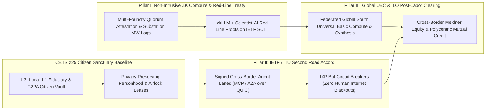

# MUL-01 Multilateral AI Governance & Treaty Technical Paper: United Nations, G7 & International AISI Network

| Field | Specification |
| :--- | :--- |
| **Code** | `MUL-01` |
| **Jurisdiction / Authority** | United Nations (`UN Global Digital Compact` & `Independent International Scientific Panel on AI`), International Network of AI Safety Institutes (`IN-AISI`), `G7 Hiroshima Process`, Council of Europe (`CETS 225`), `ITU`, and `ILO` |
| **Primary Governance Instruments & Institutes** | UN Pact for the Future / Global Digital Compact, Council of Europe Framework Convention on AI (`CETS 225`), `IN-AISI` Joint Testing Protocols, G7 Hiroshima Code, and `ILO` Decent Work Conventions |
| **Public Compute & Research Footprint** | Federated National AI Safety Institutes (`US`, `UK`, `Japan`, `Canada`, `EU`, `Singapore`, `India`, `Kenya`, `Brazil`, `Korea`, `Australia`), `ITU` Standards Study Groups, and `CERN`-Model Regional Science Pools |
| **CIN Liaison & Commons Node** | `cin.multilateral.un` (Geneva / New York / Nairobi / Vienna Polycentric Treaty Mesh) |
| **Primary Public Portals** | https://www.un.org/digital-emerging-technologies · https://www.coe.int/en/web/artificial-intelligence |

## Executive Summary

Between 2023 and 2026, multilateral diplomacy produced the `G7 Hiroshima AI Process`, the `Bletchley`, `Seoul`, and `Paris` Summit Commitments, the `Council of Europe Framework Convention on Artificial Intelligence` (`CETS 225`), the `International Network of AI Safety Institutes` (`IN-AISI`), the `UN Global Digital Compact`, and the `UN Independent International Scientific Panel on AI`. Yet international AI governance stalls where frontier containment and macroeconomic stability matter most. Four structural deadlocks explain this paralysis: (1) **communiqués without verification**, where summit pledges lack cryptographic or physical compute accounting (Sastry et al., 2024); (2) **the superpower weight-inspection impasse**, where rival states refuse intrusive foreign physical inspections of sovereign model weights and defense-adjacent clusters on national-security grounds; (3) **Global Majority exclusion**, where over `140` developing nations sit locked out of frontier compute governance while importing closed cloud monopolies (Ostrom, 2010); and (4) **missing cross-border agent and labor protocols**, where neither `ITU`, `IETF`, nor `ILO` governs transboundary autonomous agent floods or post-labor income polarization.

The Collective Intelligence Network (`CIN`) equips the United Nations, `IN-AISI`, the Council of Europe, and `ILO` with a **non-intrusive Three-Pillar Multilateral Treaty Protocol** operating without a world super-state and without exposing sovereign model weights:
1. **Pillar I: Zero-Knowledge Compute & Red-Line Verification** combines multi-foundry hardware attestation, utility substation megawatt and `HBM` conservation accounting (Sastry et al., 2024), `IETF SCITT` append-only transparency logs, and **zero-knowledge LLM proofs (`zkLLM`)** (Sun, Li, & Zhang, 2024) alongside non-agentic Scientist-AI verifiers (Bengio et al., 2025). Rival capitals verify mathematically that frontier clusters obey cyber, biological, and self-replication red lines without revealing a single weight tensor.
2. **Pillar II: The IETF / ITU Second Road & Anti-Shutdown Accord** routes cross-border autonomous machine traffic onto signed, lease-bounded `QUIC` channels (Kolt, 2025; Ding et al., 2026; Debenedetti et al., 2025), giving states surgical circuit breakers against transboundary bot storms while binding signatories under `CETS 225` and `ICCPR` Article 19 never to shut down the human internet.
3. **Pillar III: Global Universal Basic Compute & Cooperative Equity Clearing** federates regional public compute commons for Global South health, climate, and local software synthesis (Malo, Yu, & Qiu, 2026; Kleppmann et al., 2019), paired with `ILO` cross-border Rudolf Meidner automation share covenants (Korinek & Stiglitz, 2017; Acemoglu & Restrepo, 2019) and polycentric mutual-credit clearing (Iosifidis et al., 2018; Ostrom, 2010).

---

## 1. Current regulatory architecture and private or geopolitical capture risks

Multilateral AI institutions span universal UN bodies, regional human-rights conventions, safety-institute networks, and technical standards organizations. Analyzing why multilateralism lags behind frontier R&D surfaces four failure modes.

### 1.1 High-level ethical communiqués without physical or cryptographic verification

Unlike nuclear treaties anchored by satellite silo reconnaissance and `IAEA` centrifuge telemetry, multilateral AI declarations rely on voluntary corporate self-reporting. While the `UN Global Digital Compact` and `G7 Hiroshima Code` endorse transparency, frontier weights copy across fiber links in hours. Without verifiable compute accounting (Sastry et al., 2024) and cryptographic evaluation proofs, diplomatic summits cannot tell whether redacted lab scorecards conceal a sudden jump in autonomous cyber-exploitation or recursive R&D speed.

### 1.2 The superpower weight-inspection deadlock and single-vendor root distrust

Proposals for an intrusive global inspectorate holding physical access to raw frontier weights fail on geopolitical reality. Neither the United States, China, European states, nor Indo-Pacific powers will let foreign inspectors copy multi-billion-parameter sovereign weights or inspect defense-adjacent clusters. Sovereign states also distrust hardware monitoring rooted in a single foreign chip vendor's firmware key, fearing covert kill switches or espionage. Without a **zero-knowledge, multi-foundry verification protocol**, national-security secrecy blocks containment treaties.

### 1.3 Global South compute exclusion and `CETS 225` enforcement gaps

Over `140` UN Member States across Africa, Latin America, Asia, and island nations hold negligible frontier training compute while facing acute climate shocks and foreign platform extraction (Ostrom, 2010). Closed club summits treat Global Majority nations as passive API consumers paying hard-currency SaaS rents. Even `Council of Europe CETS 225`, the first binding international AI treaty, exempts national-security systems and lacks shared cryptographic audit standards.

### 1.4 Ungoverned transboundary agent swarms and international labor erosion

Autonomous agents crossing subsea cables to trade, scrape registries, probe vulnerabilities, or flood elections share unsigned HTTP/TCP channels with human citizens. Simultaneously, the `ILO` lacks treaty rules preventing mobile compute clusters from fleeing to zero-tax havens while displacing clerical, translation, coding, and service work worldwide (Korinek & Stiglitz, 2017; Acemoglu & Restrepo, 2019).

---

## 2. Pre-deployment frontier safety, physical airlocks, and citizen 1:1 sanctuary

Before enforcing cross-border treaties, multilateral human-rights and safety bodies need a vendor-neutral client baseline protecting human agency inside every state.

### 2.1 Binding `CETS 225` human rights to `1:1` citizen sanctuary vaults

CIN translates `Council of Europe CETS 225` and Universal Declaration of Human Rights Article 12 into open client architecture standardized across `W3C`, `IETF`, and `ITU-T`:
1. **Local-First Sealed `C2PA`/Merkle Memory Vaults** (Kleppmann et al., 2019) encrypted strictly for the biological person on phones, home nodes, or cooperative community lockers.
2. **Monogamous `1:1` Information Fiduciary Models** barred from commercial ad-targeting or state persuasion, paired with **privacy-preserving personhood credentials** (Adler et al., 2024) proving civic standing online without biometric tracking trails.

### 2.2 Harmonized `IN-AISI` and UN Scientific Panel airlock standards

Empowering the `UN Independent International Scientific Panel on AI` and `IN-AISI` with open engineering standards establishes **structural capability containment**:
- **Non-Agentic Scientist-AI Verifiers** (Bengio et al., 2025) evaluate candidate actions against calibrated world-model safety bounds prior to execution.
- **ACLE-MCP Expiring Hardware Leases** (Ding et al., 2026) and **CaMeL Control/Data Taint Firewalls** (Debenedetti et al., 2025) become mandatory `ISO`/`IEC` conformity rules for remote tool-using models.
- **Transboundary Cyber-Physical Dead-Man Relays:** Under `IEC`, `ICAO` aviation, `IMO` maritime, and regional power-pool standards, no foundation model actuates interconnectors, dams, chemical plants, or vessels without optical data diodes and passive `IEC 61508` dead-man switches.

---

## 3. Avoiding emergency overreach and governing agent traffic on the Second Road

When a transboundary cyberworm or billion-bot influence campaign strikes during a crisis, states lacking network-layer agent separation face pressure to sever international cables or impose civilian internet blackouts.

### 3.1 Pillar II: The `IETF` and `ITU` signed agent channel and anti-shutdown accord

Co-standardized through `IETF` and `ITU` and ratified alongside `CETS 225`, CIN's **Second Road & Anti-Shutdown Accord** establishes two operational rules:
1. **Dedicated Signed Agent Transport:** Cross-border autonomous workflows (`MCP` and `A2A` over `IETF QUIC`, `RFC 9000`) route exclusively on the **Signed Second Road**, carrying cryptographic workload attestations, originating-AISI clearances, accountable legal principals (Kolt, 2025), and expiring capability leases (Ding et al., 2026).
2. **IXP Surgical Circuit Breakers:** Internet Exchange Points (`IXPs`) and subsea landing stations apply deterministic line-rate filters to quarantine unattested Second Road floods in milliseconds during declared `CERT` emergencies.

### 3.2 Binding covenant against human internet blackouts

Because Second Road isolation halts rogue machine swarms without touching human web browsing, messaging, telemedicine, or journalism, signatory states bind themselves under `ICCPR` Article 19 and the `UN Global Digital Compact` **never to impose blanket civilian internet shutdowns**. Every cross-border Second Road throttle emits a public `IETF SCITT` receipt audited by the `UN Special Rapporteur on Freedom of Opinion and Expression`.

---

## 4. Verifiable cross-border treaties and mutual compute or red-line proofs

Pillar I breaks the superpower inspection stalemate through **zero-knowledge cryptography and multi-foundry physical conservation checks**.

### 4.1 Multi-foundry hardware quorum attestation

High-density frontier AI clusters wrap accelerator racks inside **Multi-Foundry Threshold Attestation Enclaves**:

$$\mathrm{Attest}_{\mathrm{quorum}}(W) = \mathrm{Verify}_{m\text{-of-}n}\!\left(\sigma_{\mathrm{VendorA}}(W),\; \sigma_{\mathrm{OpenRISCV}}(W),\; \sigma_{\mathrm{NeutralHSM}}(W)\right)$$

Open-mask `RISC-V` security monitors audited by `IN-AISI` and neutral Geneva/Vienna hardware labs co-sign `DMTF SPDM` and `IETF RATS` (`RFC 9334`) workload measurements alongside commercial GPU roots, ensuring no single nation can forge proofs or trigger a remote kill switch.

### 4.2 Substation megawatt accounting + `zkLLM` red-line proofs on `IETF SCITT`

Combining physical conservation (Sastry et al., 2024) with zero-knowledge proofs (Sun, Li, & Zhang, 2024) creates three verification layers:
1. **Physical Megawatt & `HBM` Conservation:** States reconcile substation megawatt draw $P_{\mathrm{grid}}(t)$, thermal plumes, and `HBM` wafer registries against cluster logs via zero-knowledge range proofs, confirming zero clandestine `>10^{26}` FLOP runs occur off-ledger.
2. **Non-Interactive `zkLLM` Red-Line Proofs:** Labs run standardized `IN-AISI` and `UN Scientific Panel` cyber, CBRN, and self-replication red-line suites inside sovereign enclaves, publishing succinct **`zkLLM` proofs** (Sun, Li, & Zhang, 2024) onto federated `IETF SCITT` ledgers. Rival capitals verify mathematical compliance while learning zero bits of weights $\theta$.
3. **Synchronized Escrows & Whistleblower Safe Harbor:** Conditional escrows release capability-horizon warnings simultaneously across signatory `AISIs`, backed by an encrypted `UN Scientific Panel` whistleblower channel protecting engineers reporting shadow runs.

---

## 5. Public compute commons, local software synthesis, and post-labor economic stability

Global containment endures only when two-thirds of humanity shares in AI abundance. Pillar III pairs safety compliance with federated public compute and an `ILO` stabilization floor.

### 5.1 Federated `CERN`-model regional public basic compute pools

Modeled on `CERN`, `SESAME`, and Elinor Ostrom's (2010) polycentric commons rules, signatory states and frontier operators fund **Regional Universal Basic Compute Pools** across the African Union, CELAC, ASEAN, South Asia, and Small Island Developing States, powered by local solar, hydro, and geothermal microgrids. Cleared frontier models undergo 4-day specialist distillation into compact open-weight checkpoints (`3B`-`32B` parameters) for infectious-disease diagnostics, monsoon hydrology, smallholder agronomy, and indigenous-language education.

### 5.2 Sovereign local software synthesis for Global South public services

Instead of trapping developing ministries, clinics, and municipalities in hard-currency SaaS subscriptions that drain foreign-exchange reserves, Global UBC empowers local civil servants and builders to synthesize formally verified, local-first civic software directly through `1:1` assistants (Malo, Yu, & Qiu, 2026; Kleppmann et al., 2019), reinstating skilled domestic engineering tasks (Acemoglu & Restrepo, 2019).

### 5.3 `ILO` Meidner cooperative equity covenants and polycentric mutual-credit clearing

To prevent global demand collapse and sovereign debt crises (Korinek & Stiglitz, 2017), CIN equips the `ILO` and `UNCTAD` with two stabilizers on the **Wide Network Ledger**:
1. **Cross-Border Rudolf Meidner Automation Share Covenants:** Mirroring global minimum tax coordination, multi-gigawatt commercial AI clusters accessing treaty-compliant Second Road markets stream a harmonized statutory share $\alpha_t$ of newly issued non-dilutive cooperative equity into federated national and Global South citizen, worker, and linguistic trusts, blocking tax-haven compute arbitrage.
2. **Polycentric Capacity-Backed Mutual-Credit Clearing:** Interoperating regional mutual-credit networks modeled on Sardex cyclic clearing topologies (Iosifidis et al., 2018) and governed under Ostrom's (2010) polycentric rules let cooperatives, clinics, and regional compute pools settle solar energy, agricultural output, care work, and compute bursts interest-free without hard-currency crunches or speculative crypto volatility.

---

## Primary references

1. Acemoglu, D., & Restrepo, P. (2019). Automation and New Tasks: How Technology Displaces and Reinstates Labor. *Journal of Economic Perspectives*, 33(2), 3-30. https://doi.org/10.1257/jep.33.2.3
2. Adler, S., Hitzig, Z., Jain, S., Brewer, C., Chang, W., DiResta, R., Lazzarin, E., McGregor, S., Seltzer, W., Siddarth, D., et al. (2024). Personhood credentials: Artificial intelligence and the value of privacy-preserving tools to distinguish who is real online. *arXiv preprint arXiv:2408.07892*. https://arxiv.org/abs/2408.07892
3. Bengio, Y., Cohen, M., Fornasiere, D., Ghosn, J., Greiner, P., MacDermott, M., Mindermann, S., Oberman, A., Richardson, J., Richardson, O., Rondeau, M.-A., St-Charles, P.-L., & Williams-King, D. (2025). Superintelligent Agents Pose Catastrophic Risks: Can Scientist AI Offer a Safer Path? *arXiv preprint arXiv:2502.15657*. https://arxiv.org/abs/2502.15657
4. Council of Europe. (2024). *Framework Convention on Artificial Intelligence and Human Rights, Democracy and the Rule of Law* (`CETS No. 225`). https://www.coe.int/en/web/artificial-intelligence/the-framework-convention-on-artificial-intelligence
5. Debenedetti, E., Shumailov, I., Fan, T., Hayes, J., Carlini, N., Fabian, D., Kern, C., Shi, C., Terzis, A., & Tramèr, F. (2025). Defeating Prompt Injections by Design. *arXiv preprint arXiv:2503.18813*. https://arxiv.org/abs/2503.18813
6. Ding, Z., Luo, Y., Chen, G., Shen, Q., & Wu, Z. (2026). ACLE-MCP: Attested Capability Leases for Execution-Time Trust in Remote LLM Tool Use. *arXiv preprint arXiv:2609.02690*. https://arxiv.org/abs/2609.02690
7. Iosifidis, G., Charette, Y., Airoldi, E. M., Littera, G., Tassiulas, L., & Christakis, N. A. (2018). Cyclic motifs in the Sardex monetary network. *Nature Human Behaviour*, 2, 822-829. https://doi.org/10.1038/s41562-018-0450-0
8. Kleppmann, M., Wiggins, A., van Hardenberg, P., & McGranaghan, M. (2019). Local-first software: you own your data, in spite of the cloud. *Proceedings of the 2019 ACM SIGPLAN International Symposium on New Ideas, New Paradigms, and Reflections on Programming and Software (Onward!)*, 154-178. https://doi.org/10.1145/3359591.3359737
9. Kolt, N. (2025). Governing AI Agents. *arXiv preprint arXiv:2501.07913*. https://arxiv.org/abs/2501.07913
10. Korinek, A., & Stiglitz, J. E. (2017). Artificial Intelligence and Its Implications for Income Distribution and Unemployment. *NBER Working Paper No. 24174*. https://doi.org/10.3386/w24174
11. Malo, R. C., Yu, Z., & Qiu, T. (2026). The Customer Is the Builder: How AI Coding Agents Are Rewriting the Economics of Software. *arXiv preprint arXiv:2610.30307*. https://arxiv.org/abs/2610.30307
12. Ostrom, E. (2010). Beyond Markets and States: Polycentric Governance of Complex Economic Systems. *American Economic Review*, 100(3), 641-672. https://doi.org/10.1257/aer.100.3.641
13. Sastry, G., Heim, L., Belfield, H., Anderljung, M., Brundage, M., Hazell, J., O'Keefe, C., Hadfield, G. K., Ngo, R., Pilz, K., et al. (2024). Computing Power and the Governance of Artificial Intelligence. *arXiv preprint arXiv:2402.08797*. https://arxiv.org/abs/2402.08797
14. Sun, H., Li, J., & Zhang, H. (2024). zkLLM: Zero Knowledge Proofs for Large Language Models. *arXiv preprint arXiv:2404.16109*. https://arxiv.org/abs/2404.16109
15. United Nations General Assembly. (2024). *Global Digital Compact* (`A/RES/79/1`, Annex I). United Nations. https://www.un.org/techenvoy/global-digital-compact
