# CIN Sovereign & Multilateral AI Governance Papers: Safety Teeth, Public Interest Over Private Capture, Cross-Bloc Treaties & Post-Labor Stability

- **Canonical Corpus Directory:** `knowledge\sovereign_papers\`
- **Public Web Hub (`cintnet.org`):** `site\content\labs\sovereign-papers\` -> `https://cintnet.org/labs/sovereign-papers/`
- **Interactive 30-Authority Workbench:** `https://cintnet.org/labs/sovereign-authorities/` (`20` Leading National & Supranational Jurisdictions `SOV-01..SOV-20` + `10` Global & Multilateral Bodies `MUL-01..MUL-10`)
- **Upstream Schema & Generator:** [`research/institutions/sovereign_authority_overlays.py`](research/institutions/sovereign_authority_overlays.py)
- **Paired AI-Lab Series:** [`knowledge/lab_papers/README.md`](knowledge/lab_papers/README.md) (`43` AI & General-Intelligence Labs + `12` Flagship Lab Papers at `/labs/lab-papers/`)

---

## 1. Core Question: Safety Teeth AND Public Interest Ahead of Private or Authoritarian Capture

Evaluating AI labs alone leaves half the governance equation unexamined. Across the United States, China, the European Union, the United Kingdom, Canada, Japan, India, and multilateral bodies, state AI policy currently fails along two opposite edges:

1. **Private Regulatory Capture & Voluntary Drift:** Where frontier compute is concentrated in private corporations, lobbying weakens statutory pre-deployment gates into voluntary self-grading, channels public "sovereign compute" budgets into commercial cloud rentiers, and leaves governments with zero surgical circuit breakers—until a cyber or infrastructure crisis tempts executives into emergency internet shutdowns or martial-law overreach.
2. **Centralized Surveillance & Zero-Sum Arms-Race Opacity:** Where state control is strong or geopolitical chip embargoes compress frontier catch-up windows to 6–12 months, authorities prioritize political content filtering or classified military lock-in over encrypted citizen memory vaults, while mutual distrust blocks cross-border safety verification.

CIN evaluates **30 National & Global Sovereign Authorities** across **five symmetric public-interest axes** (`AX-01` through `AX-05`):
- **`AX-01` · Pre-Deployment Frontier Safety & Airlock Teeth**
- **`AX-02` · Public Interest Over Private Lobbying Capture**
- **`AX-03` · Citizen `1:1` Privacy vs. Surveillance & Shutdowns**
- **`AX-04` · Public Compute Commons & Cooperative Economy**
- **`AX-05` · Verifiable Cross-Bloc Treaties & Signed Agent Roads**

```mermaid
flowchart LR
  subgraph States["30 National & Multilateral Authorities (SOV-01..20, MUL-01..10)"]
    N1["Superpower Compute Poles (United States, China)"]
    N2["Statutory & Safety-Institute Democracies (EU, UK, Canada, Japan)"]
    N3["DPI, Global South & Multilateral Treaties (India, UN, IN-AISI, CoE, ILO)"]
  end
  subgraph CIN["CIN 5-Part Sovereign Governance Architecture"]
    G1["Statutory Hardware Airlock Certification & Passive Relays"]
    G2["Scrutable State Procurement & Citizen 1:1 Encrypted Vaults"]
    G3["Signed Second Road Agent Transport (Zero Human Web Shutdowns)"]
    G4["Zero-Knowledge SCITT / Substation Megawatt Cross-Bloc Treaties"]
    G5["Universal Basic Compute, Local Software Synthesis & Meidner Equity"]
  end
  States --> CIN
```

---

## 2. Eight Flagship Sovereign & Multilateral Technical Papers

| Code | Authority | Core Statutory & Infrastructure Stack | Canonical Markdown Specification | Public `cintnet.org` Route |
| :--- | :--- | :--- | :--- | :--- |
| `SOV-01` | **United States** | `NIST CAISI`, `OMB M-24-10`, `BIS` controls, `NSF NAIRR`, state safety laws | [`SOV-01-united-states.md`](knowledge/sovereign_papers/SOV-01-united-states.md) | `/labs/sovereign-papers/united-states/` |
| `SOV-02` | **China** | `CAC` registries, `TC260` safety standards, National Compute Grid | [`SOV-02-china.md`](knowledge/sovereign_papers/SOV-02-china.md) | `/labs/sovereign-papers/china/` |
| `SOV-03` | **European Union** | `EU AI Act (Reg. 2024/1689)`, `EU AI Office`, `GDPR`, `EuroHPC` | [`SOV-03-european-union.md`](knowledge/sovereign_papers/SOV-03-european-union.md) | `/labs/sovereign-papers/european-union/` |
| `SOV-04` | **United Kingdom** | `DSIT`, `UK AISI` (`Inspect`/`ControlArena`), `AIRR` (`Isambard-AI`/`Dawn`) | [`SOV-04-united-kingdom.md`](knowledge/sovereign_papers/SOV-04-united-kingdom.md) | `/labs/sovereign-papers/united-kingdom/` |
| `SOV-05` | **Canada** | `ISED`, `CAISI`, Treasury Board ADM Directive, Sovereign Compute Strategy | [`SOV-05-canada.md`](knowledge/sovereign_papers/SOV-05-canada.md) | `/labs/sovereign-papers/canada/` |
| `SOV-06` | **Japan** | `J-AISI` (`IPA`), AI Promotion Act, `Fugaku`/`ABCI`, Hiroshima Process | [`SOV-06-japan.md`](knowledge/sovereign_papers/SOV-06-japan.md) | `/labs/sovereign-papers/japan/` |
| `SOV-09` | **India** | `IndiaAI` GPU Mission, `Bhashini`, Digital Public Infrastructure (`DPI`) | [`SOV-09-india.md`](knowledge/sovereign_papers/SOV-09-india.md) | `/labs/sovereign-papers/india/` |
| `MUL-01` | **UN, G7 & IN-AISI Network** | `Global Digital Compact`, `IN-AISI`, `CETS 225`, `ILO` Tripartite Standards | [`MUL-01-un-multilateral.md`](knowledge/sovereign_papers/MUL-01-un-multilateral.md) | `/labs/sovereign-papers/un-multilateral/` |

---

## 3. Complete 30-Authority Matrix (`SOV-01..SOV-20` & `MUL-01..MUL-10`)

All `30` National and Multilateral Authorities are evaluated across the 5 Public-Interest Axes in [`/labs/sovereign-authorities/`](site/content/labs/sovereign-authorities.html):

| Code | Authority | Cohort | Primary Public-Interest Strength vs. Key Deviation |
| :--- | :--- | :--- | :--- |
| `SOV-01` | **United States** | National | World-leading `CAISI`/`NIST` measurement vs. voluntary frontier gates & private lobbying capture |
| `SOV-02` | **China** | National | Binding `CAC`/`TC260` rules & grid compute planning vs. state surveillance & race opacity |
| `SOV-03` | **European Union** | Supranational | Binding `EU AI Act` & `EuroHPC` public compute vs. paper-heavy compliance favoring cloud incumbents |
| `SOV-04` | **United Kingdom** | National | Deepest public red-team capacity (`UK AISI`) & `AIRR` vs. non-statutory lab memoranda |
| `SOV-05` | **Canada** | National | Pioneering ADM Directive & `Mila`/`CAISI` science vs. private cloud subsidy pass-throughs |
| `SOV-06` | **Japan** | National | Hiroshima Process & robotics engineering vs. soft-law voluntary safety stop-orders |
| `SOV-07` | **South Korea** | National | Statutory AI Basic Act & Korea AISI vs. chaebol compute concentration |
| `SOV-08` | **Singapore** | National | Practical `AI Verify` & Agentic AI Governance vs. executive speech/surveillance powers |
| `SOV-09` | **India** | National | Subsidized `IndiaAI` GPUs & multilingual `Bhashini` vs. centralized biometric DPI honeypots |
| `SOV-10` | **France** | National | `Jean Zay` open science & `INESIA` vs. domestic champion regulatory exemptions |
| `SOV-11` | **Germany** | National | `BetrVG` worker co-determination & `JUPITER` exascale vs. slow municipal software modernization |
| `SOV-12` | **Switzerland** | National | `CSCS Alps` public supercomputing & `CoE` rights convention vs. light private-finance oversight |
| `SOV-13` | **Australia** | National | Public-service automation inquiries (`Robodebt` reforms) & `AU AISI` vs. foreign cloud dependence |
| `SOV-14` | **Brazil** | National | Worker/rights-centric `PL 2338` & `PBIA` compute plan vs. hyperscaler infrastructure reliance |
| `SOV-15` | **United Arab Emirates** | National | Open-weight `Falcon` public funding vs. sovereign-wealth opacity & domestic surveillance |
| `SOV-16` | **Taiwan** | National | `vTaiwan` participatory democracy & foundry root-of-trust vs. cross-strait cyber siege pressure |
| `SOV-17` | **Nordic-Baltic Coalition** | Regional | `LUMI` hydro public compute, `X-Road` citizen audit logs & union funds vs. frontier scale gap |
| `SOV-18` | **Kenya & African Union** | Continental | Data-worker labor enforcement & AU Sovereignty Strategy vs. acute compute/bandwidth deficit |
| `SOV-19` | **Mexico & Santiago Accord** | Regional | Regional language commons & anti-monopoly procurement vs. underfunded safety evaluation |
| `SOV-20` | **Israel** | National | Cryptographic/formal-verification depth vs. acute military autonomous-targeting accountability gaps |
| `MUL-01` | **United Nations** | Multilateral | Universal 193-state representation & Scientific Panel vs. zero binding enforcement teeth |
| `MUL-02` | **IN-AISI Network** | Multilateral | Shared `Inspect`/red-team technical harnesses vs. incomplete cross-bloc statutory mandates |
| `MUL-03` | **G7 Hiroshima Process** | Multilateral | Frontier reporting code of conduct vs. voluntary self-attestation without ZK verification |
| `MUL-04` | **OECD AIGO** | Multilateral | Standardized incident & policy telemetry vs. consensus dilution by corporate advisories |
| `MUL-05` | **Council of Europe** | Multilateral | First legally binding AI human-rights treaty (`CETS 225`) vs. private-sector opt-out clauses |
| `MUL-06` | **ILO Tripartite Body** | Multilateral | Formal worker-employer-state bargaining seat vs. lack of compute/equity tax jurisdiction |
| `MUL-07` | **IETF, W3C & C2PA** | Standards | Open `QUIC`, `WIMSE`, `SCITT`, and provenance wire protocols vs. hyperscaler chair capture risk |
| `MUL-08` | **ISO/IEC & IEEE** | Standards | Functional safety (`IEC 61508`) & ethical design (`IEEE 7000`) vs. paywalled standards access |
| `MUL-09` | **BRICS+ & Global South** | Multilateral | Multipole counterweight to cloud monopoly vs. uneven domestic civil-liberties protections |
| `MUL-10` | **ITU** | Multilateral | Global telecom/spectrum coordination vs. historical splits over centralized internet governance |
