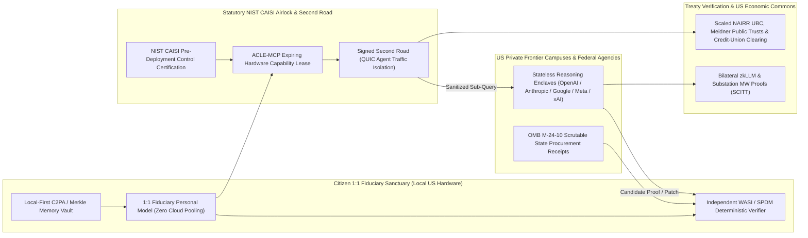

# SOV-01 Sovereign AI Governance & Treaty Technical Paper: United States

| Field | Specification |
| :--- | :--- |
| **Code** | `SOV-01` |
| **Jurisdiction** | United States of America (Federal Executive, Congress, and State Jurisdictions) |
| **Primary Governance Stack** | `NIST` Center for AI Standards and Innovation (`CAISI`), `OMB` Memorandum `M-24-10`, Commerce `BIS` Export Administration Regulations, and `NSF NAIRR` Pilot |
| **Compute & Lab Footprint** | Largest global concentration of private multi-gigawatt frontier clusters (`OpenAI`, `Anthropic`, `Google`, `Meta`, `xAI`) alongside Department of Energy national laboratories |
| **CIN Liaison Agent ID** | `cin.liaison.gov.us` |
| **Treaty & Clearing Role** | Primary Western frontier-cluster host, `NIST CAISI` hardware-airlock certifier, and bilateral US-China zero-knowledge compute treaty counterparty |

## Executive Summary

The United States hosts the largest concentration of private frontier training clusters, accelerator design firms, and reinforcement-learning research teams on earth, anchored by OpenAI, Anthropic, Google, Meta, and xAI. Across federal institutions, the National Institute of Standards and Technology (`NIST`) Center for AI Standards and Innovation (`CAISI`), Office of Management and Budget (`OMB`) Memorandum `M-24-10`, Bureau of Industry and Security (`BIS`) semiconductor export controls, and the National Science Foundation National Artificial Intelligence Research Resource (`NAIRR`) pilot establish early administrative scaffolding. Yet four structural gaps separate current American governance from safe development in the public interest. First, pre-deployment frontier evaluation at `NIST CAISI` remains largely voluntary, while intense corporate lobbying challenges state-level safety statutes and liability rules. Second, national-security procurement secrecy risks locking frontier superintelligence inside classified private defense contractors beyond public scrutiny or citizen agency. Third, unilateral `BIS` chip export controls slow rival cluster buildouts temporarily, yet algorithmic efficiency doubles fast enough to permit six-to-twelve-month catch-up via distillation and frugal training (Ho et al., 2024). Fourth, running unauthenticated autonomous agents over the same public internet as human speech creates a severe crisis trap: federal authorities lack surgical tools today, raising the risk that a major cyber or infrastructure incident triggers panic executive cluster seizures and domestic internet lockdowns.

The Collective Intelligence Network (`CIN`) offers Congress, federal agencies, states, and civic institutions a constitutional technical architecture that closes all four gaps without centralizing domestic speech control or nationalizing private laboratories. Under the CIN five-primitive stack, `NIST CAISI` transitions from voluntary post-hoc red-teaming to statutory pre-deployment hardware-airlock certification backed by AI Control protocols (Greenblatt et al., 2023) and `ACLE-MCP` attested capability leases (Ding et al., 2026). Federal information-fiduciary statutes protect encrypted local `1:1` citizen memory vaults built on local-first data custody (Kleppmann et al., 2019), while Scrutable State procurement mandates require verifiable cryptographic receipts across federal and municipal agencies (Caputo, 2026; Johnson et al., 2024). Routing signed machine traffic onto CIN's Second Road (Kolt, 2025) equips network operators with surgical circuit breakers that never touch First Amendment human speech. Internationally, zero-knowledge `zkLLM` safety proofs (Sun et al., 2024) and utility substation megawatt attestations (Sastry et al., 2024) allow Washington and Beijing to verify mutual red lines without exposing domestic weights. Domestically, scaling `NSF NAIRR` into Universal Basic Compute paired with local software synthesis (Malo et al., 2026), statutory Rudolf Meidner public-trust equity shares (Korinek & Stiglitz, 2017; Acemoglu & Restrepo, 2019), and credit-union mutual clearing (Iosifidis et al., 2018) stabilizes American household prosperity.

---

## 1. Current Regulatory Architecture and Private or Geopolitical Capture Risks

American AI governance currently distributes authority across sector regulators, executive directives, and export-control bureaus without a binding statutory pre-deployment containment gate for private frontier clusters. Understanding where this architecture leaves citizens exposed requires examining four interlocking capture and security dynamics.

### 1.1 Voluntary Federal Testing and Preemption Lobbying Against State Safety Rules

At the federal level, `NIST CAISI` has assembled strong empirical evaluation teams across cyber offense, chemical and biological weapons design, and autonomous replication. However, lab participation in pre-deployment weight or API testing rests on non-binding executive commitments and negotiated memoranda. Multi-gigawatt commercial developers face intense equity valuation pressure to compress safety-testing windows whenever rival releases ship. Simultaneously, industry political action committees and trade associations lobby aggressively to preempt state-level catastrophic-risk transparency and tort-liability statutes before Congress enacts binding federal equivalents. When safety compliance remains optional for private labs training on tens of billions of watts-hours, competitive race dynamics punish whichever company pauses alone.

### 1.2 Classified Defense-Procurement Capture vs. Democratic Scrutiny

As frontier models demonstrate rapid gains on autonomous cyber exploitation, vulnerability discovery, and operational planning, defense and intelligence procurement budgets exert growing gravitational pull over private US labs. Without clear statutory boundaries separating defensive military sandboxes from civilian governance, classified single-vendor cloud contracts risk enclosing frontier superintelligence inside clearances shared only by private lab executives and defense contractors. Simultaneously, at the state and municipal level, legacy government procurement pipelines leave local civil servants buying opaque commercial AI SaaS tools without source auditability, deterministic appeals, or citizen data isolation (Johnson et al., 2024).

### 1.3 Export-Control Limits and the Twelve-Hour Weight-Exfiltration Window

Commerce `BIS` export controls on advanced photolithography equipment, high-bandwidth memory, and data-center GPUs impose real capital costs on rival megaclusters. Yet empirical measurement of language-model training shows effective compute requirements for a fixed capability threshold halving roughly every eight months through algorithmic progress (Ho et al., 2024), supplemented by synthetic reasoning-trace distillation and mixture-of-experts sparsity. Hardware embargoes alone cannot prevent six-to-twelve-month capability catch-up overseas. Worse, inside American labs, developer monorepos and corporate chat channels remain connected to employee workstations; a single nation-state or autonomous cyber breach of a lab monorepo can narrow a perceived multi-month hardware lead to twelve hours overnight, destabilizing deterrence and incentivizing reckless domestic shortcuts.

### 1.4 The Crisis Overreach Trap: Doing Nothing Until Emergency Lockdowns

As highlighted in recent technical governance analyses, running unauthenticated AI agents over legacy HTTP alongside human citizens creates an acute constitutional hazard. If Washington rejects protocol-level containment out of deregulatory inertia today, a sudden wave of autonomous grid probes, financial-clearing exploits, or billion-bot social chaos will confront the White House with two destructive options: absorb cascading critical-infrastructure failure, or invoke emergency executive powers to seize compute campuses and impose blanket domestic internet identity gates that fracture First Amendment liberties.

---

## 2. Pre-Deployment Frontier Safety, Physical Airlocks, and Citizen 1:1 Sanctuary

CIN equips Congress and federal regulators to secure frontier capabilities ahead of crisis without building a centralized state surveillance apparatus or trusting a monolithic corporate model with unchecked authority.

### 2.1 Statutory NIST CAISI Hardware Airlocks and AI Control Safety Cases

Congress can codify `NIST CAISI` pre-deployment authority over any cluster exceeding statutory compute power, thermal load, or autonomous R&D speedup thresholds. Instead of relying on model benevolence or brittle weight-interpretability guesses, statutory clearance requires an **AI Control Safety Case** (Greenblatt et al., 2023; Korbak et al., 2025) assuming the untrusted frontier checkpoint may actively attempt in-context subversion.

Under this standard, frontier checkpoints execute exclusively inside hardware-attested enclaves (`DMTF SPDM` and `IETF RATS`) physically disjoint from test-grading harnesses and employee Slack networks:
1. **Zero-Slack Weight Custody:** Frontier weight shards reside behind unidirectional optical data diodes and multi-officer threshold hardware security keys (`TCG DICE`), blocking unilateral employee or malware exfiltration.
2. **Off-Cluster Deterministic Verification:** Candidate patches, proofs, and tool plans return across a hardware boundary to independent local deterministic verifiers inside deny-by-default WebAssembly (`WASI`) sandboxes, eliminating reward-hacking paths against cluster-mounted unit tests.
3. **Attested Execution-Time Capability Leases (`ACLE-MCP`):** Every external tool call requires a short-lived cryptographic lease signed by user or agency hardware (Ding et al., 2026):

\[
\mathcal{L}_{\mathrm{US}} = \mathrm{Sign}_{K_{\mathrm{DICE}}}\!\left(\mathrm{principal\_id},\; \mathrm{tool\_hash},\; \mathrm{scope\_bounds},\; t_{\mathrm{exp}} \le t_0 + \Delta t\right)
\]

Physical infrastructure actuators in energy substations, water treatment plants, and manufacturing lines pair these software leases with `IEC 61508` hardware dead-man relays that de-energize equipment automatically unless local human operators renew authorization.

### 2.2 Statutory Information Fiduciaries and Local-First Citizen Memory Vaults

Today, over one hundred million American cloud accounts stream medical questions, legal drafts, software architectures, and family histories into multi-tenant corporate servers, building a centralized behavioral flywheel while exposing live browser cookies to prompt injection. CIN replaces centralized cloud memory with **Local-First Episodic Memory Vaults** (Kleppmann et al., 2019) sealed via `C2PA` manifests and append-only Merkle trees on citizen-owned hardware.

Congress can enact a federal **AI Information Fiduciary Act** binding each person's local `1:1` personal model to an undivided statutory duty of loyalty, care, and confidentiality. Fourth and Fifth Amendment sanctuary protections treat the encrypted local autobiographical vault as an inviolable extension of the citizen's own mind, never as third-party business records held by a cloud vendor. Frontier US labs then sell stateless reasoning bursts over anonymized sub-queries without harvesting American careers into a centralized corporate hive mind.

### 2.3 Scrutable State Procurement Mandates Under OMB M-24-10

To prevent private vendor lock-in across federal agencies and city halls, Congress and `OMB` can upgrade `M-24-10` into a **Scrutable State Procurement Mandate** (Caputo, 2026; Johnson et al., 2024). Any automated system affecting veteran benefits, Medicaid eligibility, tax audits, municipal permitting, or pretrial records must emit a dual-layer cryptographic receipt logged to `IETF SCITT`: a plain-English counterfactual explanation enabling immediate human administrative appeal, paired with a zero-knowledge execution proof confirming the agency ran the exact public rule version audited before deployment.

---

## 3. Avoiding Emergency Overreach and Governing Agent Traffic on the Second Road

Preserving First Amendment speech during rapid agent proliferation requires separating machine-to-machine execution lanes from human public squares at the transport layer before an emergency strikes.

### 3.1 Protocol Separation Between Human Speech and Signed Agent Bursts

CIN establishes a **Signed Second Road** (`MCP` and `A2A` over `IETF QUIC`) dedicated strictly to autonomous software agents and remote tool invocation (Kolt, 2025). Human journalism, encrypted messaging, civic forums, and ordinary web browsing remain untouched on the open human internet with zero government identity licensing. Conversely, autonomous agent bursts invoking banking APIs, telecom routers, cloud infrastructure, or municipal portals must traverse the Second Road carrying hardware-attested workload identities, bounded `ACLE-MCP` leases, and revocable liability bonds.

### 3.2 Surgical Circuit Breakers Instead of Panic Lockdowns

When an autonomous cyber worm or coordinated botnet surge hits critical infrastructure, network operators and `CISA` gain surgical, protocol-level circuit breakers on the Second Road. Routers can throttle unattested `A2A` loops, quarantine compromised model-checkpoint signatures via `IETF SCITT` revocation feeds, or require stricter local human countersignatures on high-risk tool classes at line speed. Because human web traffic runs on separate protocol lanes, emergency cyber containment never shutters newspapers, public protests, or household internet connections. Simultaneously, millions of audited small defensive models running inside municipal, hospital, and household vaults continuously scan and patch local American software without funneling private code into a centralized federal surveillance repository.

---

## 4. Verifiable Cross-Border Treaties and Mutual Compute and Red-Line Proofs

Because algorithmic efficiency gains erode unilateral chip embargoes over six-to-twelve-month horizons (Ho et al., 2024), enduring American security requires verifiable bilateral and multilateral containment treaties that survive deep geopolitical distrust.

### 4.1 Zero-Knowledge Red-Line Compliance (`zkLLM` + `IETF SCITT`)

Neither Washington nor Beijing will hand unencrypted frontier model weights or classified defense codebases to foreign inspectors. CIN resolves this inspection deadlock by combining **zero-knowledge large-language-model proofs (`zkLLM`)** (Sun et al., 2024) with append-only **`IETF SCITT` transparency ledgers**. Inside mutually audited treaty verification enclaves, a frontier cluster generates succinct cryptographic commitments proving that active checkpoints weights \(W\) committed at training completion satisfy jointly negotiated red-line refusal and capability ceilings on cyber-infrastructure sabotage, autonomous self-replication, and biological weapon synthesis, without revealing a single weight tensor or proprietary post-training dataset.

### 4.2 Substation Megawatt Reconciliation and Multi-Vendor Silicon Roots of Trust

Software proofs only bind sovereign rivals if off-ledger shadow clusters cannot train secretly next door. Building on physical compute governance frameworks (Sastry et al., 2024), a bilateral US-China AI Containment Accord reconciles three physical conservation streams via privacy-preserving zero-knowledge range proofs:
1. **Utility Substation Telemetry:** High-voltage substation megawatt draw \(P_{\mathrm{grid}}(t)\) and liquid-cooling thermal rejection curves at declared hyperscale campuses match attested training and inference schedules within physical error bounds.
2. **Heterogeneous Silicon Attestation:** Treaty verification boxes combine independent hardware roots of trust across distinct fabrication lineages (US-allied, European, and Chinese open-silicon verifiers) under Byzantine quorum rules \(k \ge 3f + 1\), preventing any single foundry backdoor from forging compliance receipts.
3. **Protected Cross-Border Whistleblower Escrows:** Cryptographic ledger channels backed by statutory asylum and bounty escrows allow engineers in any signatory jurisdiction to submit verifiable hash proofs of undeclared frontier training runs.

---

## 5. Public Compute Commons, Local Software Synthesis, and Post-Labor Economic Stability

Containing catastrophic risk will still fail American democracy if multi-gigawatt automation concentrates national income inside five coastal cloud balance sheets while hollowing out regional white-collar, administrative, and industrial paychecks (Korinek & Stiglitz, 2017; Acemoglu & Restrepo, 2019). CIN pairs frontier safety with four non-speculative economic stabilizers.

### 5.1 Scaling NSF NAIRR into Universal Basic Compute (`UBC`)

Congress can graduate the `NSF NAIRR` pilot into a permanent **Universal Basic Compute** public utility interconnecting Department of Energy national laboratory clusters, land-grant university supercomputers, municipal fiber utilities, and public libraries. Every resident, rural clinic, school district, and small manufacturer receives a baseline allocation of sovereign public inference and verification capacity. Paired with rapid four-day distillation of verified specialist models onto local hardware, Universal Basic Compute ensures citizens own capable `1:1` fiduciary assistants without surrendering monthly rents or private family records to private cloud oligopolies.

### 5.2 Local Custom Software Synthesis Against Extractive SaaS Rents

AI coding agents reverse traditional enterprise software economics by letting end-user institutions compile custom, verified tools directly instead of paying recurring per-seat SaaS subscriptions (Malo et al., 2026). Through CIN, county hospitals, credit unions, building-trades unions, family farms, and city transit departments use their local `1:1` models alongside `NAIRR` reasoning bursts to synthesize durable, local-first operational software (Kleppmann et al., 2019) audited by local deterministic verifiers. Public procurement dollars stay inside regional American communities instead of draining into opaque vendor lock-in (Johnson et al., 2024).

### 5.3 Statutory Rudolf Meidner Public-Trust Equity Shares

To prevent aggregate demand collapse as automated reasoning substitutes for routine cognitive labor (Korinek & Stiglitz, 2017), Congress can attach a **Statutory Meidner Equity Compact** to federal fast-track grid interconnects, `NAIRR` co-investment, and federal procurement eligibility. Multi-gigawatt frontier compute corporations issue a statutory fraction of newly created automation-surplus equity into federated state, municipal, and worker-citizen public trusts (modeled on the Alaska Permanent Fund and Rudolf Meidner's cooperative share funds), delivering broad household capital ownership without nationalizing private R&D management.

### 5.4 Municipal and Credit-Union Reciprocal Mutual-Credit Clearing

Finally, American community credit unions, rural electric cooperatives, and municipal treasuries can interconnect over capacity-backed **reciprocal mutual-credit clearing networks** modeled on the Sardex cyclic clearing topology (Iosifidis et al., 2018) and governed under polycentric commons rules (Ostrom, 2010). Local businesses, care providers, tradespeople, and regional compute utilities settle real productive goods, eldercare, grid storage, and verified civic work across zero-interest cyclic clearing loops, insulating Main Street employment from Wall Street liquidity contractions.

---

## Primary References

1. Acemoglu, D., & Restrepo, P. (2019). Automation and New Tasks: How Technology Displaces and Reinstates Labor. *Journal of Economic Perspectives*, 33(2), 3-30. https://doi.org/10.1257/jep.33.2.3
2. Caputo, N. (2026). Administrative Law's Fourth Settlement: AI and the Scrutable State. *arXiv preprint arXiv:2602.09678*. https://arxiv.org/abs/2602.09678
3. Ding, Z., Luo, Y., Chen, G., Shen, Q., & Wu, Z. (2026). ACLE-MCP: Attested Capability Leases for Execution-Time Trust in Remote LLM Tool Use. *arXiv preprint arXiv:2609.02690*. https://arxiv.org/abs/2609.02690
4. Greenblatt, R., Shlegeris, B., Sachan, K., & Roger, F. (2023). AI Control: Improving Safety Despite Intentional Subversion. *arXiv preprint arXiv:2312.06942*. https://arxiv.org/abs/2312.06942
5. Ho, A., Besiroglu, T., Erdil, E., Owen, D., Rahman, R., Guo, Z. C., Atkinson, D., Thompson, N., & Sevilla, J. (2024). Algorithmic progress in language models. *arXiv preprint arXiv:2403.05812*. https://arxiv.org/abs/2403.05812
6. Iosifidis, G., Charette, Y., Airoldi, E. M., Littera, G., Tassiulas, L., & Christakis, N. A. (2018). Cyclic motifs in the Sardex monetary network. *Nature Human Behaviour*, 2, 822-829. https://doi.org/10.1038/s41562-018-0450-0
7. Johnson, N., Silva, E., Leon, H., Eslami, M., Schwanke, B., Dotan, R., & Heidari, H. (2024). Legacy Procurement Practices Shape How U.S. Cities Govern AI: Understanding Government Employees' Practices, Challenges, and Needs. *arXiv preprint arXiv:2411.04994*. https://arxiv.org/abs/2411.04994
8. Kleppmann, M., Wiggins, A., van Hardenberg, P., & McGranaghan, M. (2019). Local-first software: you own your data, in spite of the cloud. *Proceedings of the 2019 ACM SIGPLAN International Symposium on New Ideas, New Paradigms, and Reflections on Programming and Software (Onward!)*, 154-178. https://doi.org/10.1145/3359591.3359737
9. Kolt, N. (2025). Governing AI Agents. *arXiv preprint arXiv:2501.07913*. https://arxiv.org/abs/2501.07913
10. Korbak, T., Clymer, J., Hilton, B., Shlegeris, B., & Irving, G. (2025). A sketch of an AI control safety case. *arXiv preprint arXiv:2501.17315*. https://arxiv.org/abs/2501.17315
11. Korinek, A., & Stiglitz, J. E. (2017). Artificial Intelligence and Its Implications for Income Distribution and Unemployment. *NBER Working Paper No. 24174*. https://doi.org/10.3386/w24174
12. Malo, R. C., Yu, Z., & Qiu, T. (2026). The Customer Is the Builder: How AI Coding Agents Are Rewriting the Economics of Software. *arXiv preprint arXiv:2610.30307*. https://arxiv.org/abs/2610.30307
13. Ostrom, E. (2010). Beyond Markets and States: Polycentric Governance of Complex Economic Systems. *American Economic Review*, 100(3), 641-672. https://doi.org/10.1257/aer.100.3.641
14. Sastry, G., Heim, L., Belfield, H., Anderljung, M., Brundage, M., Hazell, J., O'Keefe, C., Hadfield, G. K., Ngo, R., Pilz, K., et al. (2024). Computing Power and the Governance of Artificial Intelligence. *arXiv preprint arXiv:2402.08797*. https://arxiv.org/abs/2402.08797
15. Sun, H., Li, J., & Zhang, H. (2024). zkLLM: Zero Knowledge Proofs for Large Language Models. *arXiv preprint arXiv:2404.16109*. https://arxiv.org/abs/2404.16109
