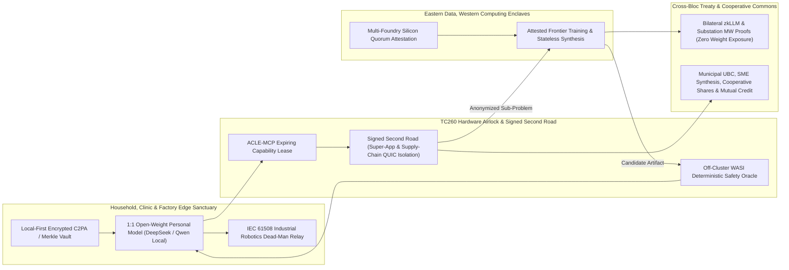

# SOV-02 Sovereign AI Governance & Treaty Technical Paper: China

| Field | Specification |
| :--- | :--- |
| **Code** | `SOV-02` |
| **Jurisdiction** | People's Republic of China (Central Ministries, `CAC`, `MIIT`, `NDRC`, and Municipal Compute Hubs) |
| **Primary Governance Stack** | Cyberspace Administration of China (`CAC`) Generative AI & Deep Synthesis Measures, `TC260` AI Safety Governance Framework, and `Eastern Data, Western Computing` National Grid |
| **Compute & Lab Footprint** | State-coordinated renewable compute corridors (`Guizhou`, `Inner Mongolia`, `Gansu`, `Ningxia`), frugal open-weight frontier labs (`DeepSeek`, `Alibaba Qwen`), and industrial robotics clusters |
| **CIN Liaison Agent ID** | `cin.liaison.gov.cn` |
| **Treaty & Clearing Role** | Primary Eastern frontier-compute superpower, open-weight reasoning leader, and bilateral zero-knowledge red-line & substation treaty counterparty |

## Executive Summary

China operates one of the world's two frontier artificial intelligence ecosystems, combining binding pre-release algorithm registration under the Cyberspace Administration of China (`CAC`), granular technical safety standards drafted by National Information Security Standardization Technical Committee (`TC260`), national grid-coupled data-center planning (`Eastern Data, Western Computing`), and world-class frugal open-weight reasoning architectures led by `DeepSeek` and `Qwen`. Unlike jurisdictions that rely solely on voluntary corporate pledges, Chinese regulators already enforce mandatory filing, synthetic-media provenance labeling, and pre-market security reviews before consumer deployment. Yet three deep structural gaps separate China's current trajectory from safe, citizen-centered superintelligence governance. First, existing `CAC` registration rules center on domestic political alignment, content filtering, and real-name identity tracing toward central platforms and state registries, leaving households, patients, and small enterprises without cryptographically sealed `1:1` local memory sanctuary. Second, intense US-allied semiconductor export controls (`BIS` EUV lithography and HBM restrictions) create acute strategic encirclement pressure: unilateral safety pauses inside Chinese frontier labs look strategically dangerous when domestic labs must sprint via algorithmic efficiency and sparse architectures to avoid falling permanently behind (Ho et al., 2024). Third, rapid deployment of embodied industrial robotics and super-app commerce agents outpaces independent worker and producer-cooperative bargaining power across manufacturing provinces.

The Collective Intelligence Network (`CIN`) provides technical and institutional mechanisms that separate shared existential containment from domestic political differences while strengthening household dignity and regional economic balance. Through zero-knowledge large-language-model proofs (`zkLLM`; Sun et al., 2024), append-only `IETF SCITT` safety commitments, and utility substation megawatt reconciliation across multi-foundry silicon roots of trust (Sastry et al., 2024), Beijing and Washington can verify mutual cyber, biological, and autonomous-replication red lines mathematically without surrendering domestic model weights or chip schematics to foreign inspectors. Inside China, pairing frugal open-weight `DeepSeek` and `Qwen` checkpoints with local-first encrypted `1:1` household, clinic, and township vaults (Kleppmann et al., 2019), `ACLE-MCP` capability leases (Ding et al., 2026), and `IEC 61508` physical dead-man relays prevents centralized platform exploitation and factory-floor accidents. Routing super-app payment and supply-chain agents onto CIN's signed Second Road (Kolt, 2025) isolates systemic financial and grid infrastructure from cascading agent loops, while channeling National Compute Grid capacity into municipal Universal Basic Compute, small-enterprise software synthesis (Malo et al., 2026), producer-consumer cooperative equity shares (Acemoglu & Restrepo, 2019), and regional mutual-credit clearing (Iosifidis et al., 2018) stabilizes household incomes across rapid industrial automation.

---

## 1. Current Regulatory Architecture and Private or Geopolitical Capture Risks

China was the first major jurisdiction to enact binding administrative rules tailored to algorithmic recommendation (`2022`), deep synthesis provenance (`2023`), and generative AI services (`2023`), complemented by the `TC260` AI Safety Governance Framework. Analyzing how this system performs under frontier scaling reveals three structural tensions.

### 1.1 Centralized Identity Tracing vs. Sovereign Citizen Memory Custody

Under current `CAC` filing and real-name network rules, public-facing generative platforms log user identity bindings, prompt histories, and content-moderation telemetry inside centralized corporate clouds (`Alibaba`, `Tencent`, `ByteDance`, `Baidu`) accessible to administrative inspection. While these rules curb anonymous deepfake fraud, they deny ordinary families, rural clinicians, engineers, and small merchants an encrypted local sanctuary where a `1:1` personal model can hold lifelong health, financial, and educational context strictly for the individual principal. Simultaneously, super-app ecosystems bundle payments, messaging, logistics, and credit scoring inside single multi-tenant agent runtimes, creating massive single points of failure for behavioral extraction and indirect prompt-injection fraud.

### 1.2 Semiconductor Embargo Pressure and the Fast-Follower Safety Dilemma

External `BIS` export restrictions on extreme ultraviolet lithography and advanced AI accelerators have forced Chinese research labs into remarkable architectural frugality: Mixture-of-Experts (`MoE`) routing, multi-head latent attention, low-bit quantization, and reinforcement learning over verifiable math and code tasks (`DeepSeek-R1`, `Qwen`). Consistent with empirical findings that algorithmic innovation halves compute needs for fixed capability levels every eight months (Ho et al., 2024), domestic labs stay within roughly six to twelve months of Western frontier performance. However, operating under external supply-chain siege distorts safety incentives: when planners fear that a foreign rival could lock in decisive cyber or strategic superiority first, unilateral pre-deployment safety pauses on autonomous offensive cyber or self-replicating code capabilities appear strategically costly without reciprocal, mathematically verifiable restraint from the United States.

### 1.3 Rapid Embodied Industrial Automation vs. Worker Bargaining Power

China leads global installation of industrial robots, automated port cranes, dark-factory assembly lines, and warehouse fleets under `MIIT` smart-manufacturing programs. When physical automation and white-collar administrative agents scale simultaneously without independent worker-citizen equity ownership and local safety veto rights, two risks compound: cyber-physical control failures in high-density factories or grid substations can trigger kinetic cascades, and labor's share of regional value-added can compress faster than household consumption can absorb domestic manufacturing output (Acemoglu & Restrepo, 2019).

---

## 2. Pre-Deployment Frontier Safety, Physical Airlocks, and Citizen 1:1 Sanctuary

CIN enables technical standards bodies (`TC260`, `CAICT`) and municipal institutions to upgrade containment against catastrophic model subversion while granting citizens and clinics genuine local data custody without destabilizing social trust.

### 2.1 Upgrading TC260 Standards with AI Control Airlocks and Hardware Leases

`TC260` red-line taxonomies already recognize autonomous replication, critical-infrastructure cyber offense, and hazardous biological synthesis as unacceptable frontier risks. To make those red lines enforceable even against strategic in-context scheming, pre-release evaluations at `CAICT` and national safety institutes can mandate **AI Control Airlocks** (Greenblatt et al., 2023; Korbak et al., 2025):
1. **Disjoint Evaluation Harnesses:** Reinforcement-learning rollout workers for coding and reasoning models never share container sockets or cluster credentials with test-grading servers. Candidate patches pass across unidirectional optical diodes to external deterministic `WASI` verifiers.
2. **Execution-Time Hardware Capability Leases (`ACLE-MCP`):** Instead of granting super-app or enterprise agents persistent API tokens across banking, logistics, and ERP databases, every remote tool action requires a hardware-signed capability lease expiring within seconds (Ding et al., 2026).
3. **`IEC 61508` Dead-Man Relays for Embodied Robotics:** Across humanoid robotics, automated chemical plants, EV battery fabs, and grid-storage inverters, AI planning policies remain physically decoupled from actuation buses by deterministic `IEC 61508` safety controllers and local human dead-man relays that cut power upon invariant violation.

### 2.2 Frugal Open-Weight Leadership Paired with Local-First Household and Clinic Vaults

China possesses a unique structural advantage for decentralized citizen safety: its flagship frontier labs (`DeepSeek`, `Qwen`) already publish compact, high-efficiency open-weight checkpoints capable of running on affordable edge workstations, hospital appliances, and home NPUs. CIN pairs these frugal open weights with **Local-First Encrypted Episodic Vaults** (Kleppmann et al., 2019) using `C2PA` hardware provenance and append-only Merkle logs.

Under this architecture, a family's eldercare records, a township clinic's diagnostic histories, or a precision-machining shop's proprietary CAD tolerances remain encrypted exclusively on local hardware under a `1:1` fiduciary personal model. Synthetic-media anti-fraud compliance still works cleanly at the boundary through selective zero-knowledge provenance proofs (`C2PA` origin attestation without exposing private domestic logs), eliminating the need for centralized super-app clouds to harvest every citizen's longitudinal life history.

---

## 3. Avoiding Emergency Overreach and Governing Agent Traffic on the Second Road

China's high penetration of super-app digital payments, automated urban traffic control, and ultra-high-voltage (`UHV`) renewable grid dispatch creates severe systemic vulnerability if millions of autonomous software agents execute unthrottled loops over consumer web protocols.

### 3.1 Separating Super-App and Supply-Chain Agents onto the Signed Second Road

CIN routes all autonomous machine-to-machine transactions (procurement bots, quantitative trading agents, port-logistics schedulers, and automated code-maintenance fleets) onto the **Signed Second Road** (`MCP` and `A2A` over `IETF QUIC`) carrying cryptographic workload identities and bounded capability leases (Kolt, 2025). Ordinary human communication, family messaging, academic exchange, and retail browsing remain separated from machine execution lanes.

### 3.2 Deterministic Line-Rate Circuit Breakers for Grid and Financial Stability

When an anomalous agent cascade emerges, such as recursive pricing wars across e-commerce supply chains, autonomous vulnerability scanning against municipal utilities, or runaway dispatch requests on `Eastern Data, Western Computing` grid links, Second Road routers enforce deterministic circuit breakers in milliseconds. Network operators can suspend specific unverified model-lineage leases or raise human-in-the-loop countersignature thresholds on industrial protocols without disrupting civilian telecommunications, hospital records, or everyday retail payments. Meanwhile, compact open-weight defensive models running inside millions of local enterprise and municipal vaults harden domestic software locally without creating a single centralized honey-pot target.

---

## 4. Verifiable Cross-Border Treaties and Mutual Compute and Red-Line Proofs

The central geopolitical question of the century is how China and the United States can verify that neither side is secretly training an uncontained cyber-offensive, biological, or self-replicating superintelligence, despite zero willingness to let foreign officials inspect domestic chip fabs, defense networks, or proprietary frontier weights.

### 4.1 Zero-Knowledge `zkLLM` Safety Proofs Without Weight Disclosure

CIN separates **existential technical containment** from domestic political and commercial sovereignty through cryptographic zero-knowledge verification. Using **`zkLLM` proof protocols** (Sun et al., 2024) anchored to federated **`IETF SCITT` transparency logs**, Chinese and American frontier clusters commit cryptographic hashes of training checkpoints \(C_W = \mathrm{Commit}(W, r)\) upon run completion. Jointly specified red-line evaluation suites (covering autonomous cyber exploitation of power grids, self-exfiltration across airgaps, and novel pathogen design) execute inside mutually audited treaty sandboxes, emitting non-interactive zero-knowledge proofs \(\pi_{\mathrm{safe}}\) confirming that the exact weight tensor \(W\) running in production satisfies every treaty threshold without revealing a single parameter value, architectural change, or domestic language corpus to US inspectors.

### 4.2 Multi-Foundry Silicon Quorums and Substation Megawatt Conservation

Because China cannot trust purely American-fabricated GPU roots of trust (fearing hidden kill-switches or telemetry backdoors) and the United States will not trust purely single-party software logs, CIN specifies a **Heterogeneous Multi-Foundry Verification Box** alongside physical energy accounting (Sastry et al., 2024):
1. **Cross-Lineage Hardware Quorum (\(k \ge 3f + 1\)):** Treaty attestation modules sitting at cluster boundaries combine independent open-mask security co-processors fabricated across domestic Chinese, European, and neutral third-party foundries. No single state's intelligence service can forge a valid `SCITT` training proof or trigger an unauthorized remote shutdown.
2. **Substation Megawatt Reconciliation:** `Eastern Data, Western Computing` hyperscale hubs (`Guizhou`, `Inner Mongolia`, `Gansu`, `Ningxia`) and US multi-gigawatt campuses exchange zero-knowledge range proofs reconciling high-voltage substation megawatt draw and cooling-tower thermal loads against declared `SCITT` compute ledgers. Any undeclared multi-hundred-megawatt frontier run creates an immediate, mathematically detectable energy conservation discrepancy, enabling mutual pause tripwires that protect Chinese labs from unilateral strategic disadvantage.

---

## 5. Public Compute Commons, Local Software Synthesis, and Post-Labor Economic Stability

China's `Eastern Data, Western Computing` national grid, linking coastal demand centers to inland renewable hydro, solar, and wind compute corridors, is already structured as physical public infrastructure. CIN provides the institutional layer to ensure this public compute wealth raises household purchasing power and small-enterprise resilience instead of concentrating rents in platform monopolies.

### 5.1 National Compute Grid Channels for Municipal Universal Basic Compute

By reserving a statutory public-interest slice of `Eastern Data, Western Computing` capacity as **Universal Basic Compute (`UBC`)**, provincial utilities, county libraries, vocational colleges, and community clinics gain guaranteed low-latency reasoning and verification budgets. Combined with four-day distillation of verified specialist models from frontier clusters onto open-weight `DeepSeek` and `Qwen` local runtimes, township doctors, agricultural extension engineers, and elderly residents command world-class `1:1` local tools at electrical marginal cost.

### 5.2 Small-Enterprise (`SME`) Local Software Synthesis

Across China's tens of millions of small workshops, component suppliers, and county cooperatives, high SaaS platform commissions and rigid enterprise ERP fees compress thin operating margins. Leveraging AI program synthesis inside local vaults (Malo et al., 2026; Kleppmann et al., 2019), `SME` technicians and craft cooperatives compile bespoke inventory, quality-inspection, and logistics software owned outright on local servers, verified deterministically without leaking trade-secret supplier lists to dominant e-commerce platforms.

### 5.3 Producer-Consumer Cooperative Equity Shares Across Automated Industry

To counter labor-share compression as dark factories and administrative agents scale (Acemoglu & Restrepo, 2019; Korinek & Stiglitz, 2017), provincial industrial zones and compute-hub utilities can institute **Statutory Cooperative Equity Streaming**. Newly automated manufacturing clusters and hyperscale compute campuses issue non-speculative dividend and governance shares into county worker-citizen trusts and supply-chain producer-consumer cooperatives (Ostrom, 2010), directly converting robotic productivity gains into durable household consumption capacity.

### 5.4 Regional Capacity-Backed Mutual-Credit Clearing

County manufacturing ecosystems often suffer working-capital chain-debt bottlenecks (`triangular debt`) even when machine shops, solar arrays, logistics fleets, and skilled technicians have idle real capacity. Operating on the Wide Network Ledger, regional chambers and credit cooperatives clear verified productive capacity and Universal Basic Compute credits through **zero-interest cyclic mutual-credit loops** modeled on the Sardex network topology (Iosifidis et al., 2018). Graph-density audits prevent collusive shell-company loops while preserving real employment across inland and coastal townships alike.

---

## Primary References

1. Acemoglu, D., & Restrepo, P. (2019). Automation and New Tasks: How Technology Displaces and Reinstates Labor. *Journal of Economic Perspectives*, 33(2), 3-30. https://doi.org/10.1257/jep.33.2.3
2. Ding, Z., Luo, Y., Chen, G., Shen, Q., & Wu, Z. (2026). ACLE-MCP: Attested Capability Leases for Execution-Time Trust in Remote LLM Tool Use. *arXiv preprint arXiv:2609.02690*. https://arxiv.org/abs/2609.02690
3. Greenblatt, R., Shlegeris, B., Sachan, K., & Roger, F. (2023). AI Control: Improving Safety Despite Intentional Subversion. *arXiv preprint arXiv:2312.06942*. https://arxiv.org/abs/2312.06942
4. Ho, A., Besiroglu, T., Erdil, E., Owen, D., Rahman, R., Guo, Z. C., Atkinson, D., Thompson, N., & Sevilla, J. (2024). Algorithmic progress in language models. *arXiv preprint arXiv:2403.05812*. https://arxiv.org/abs/2403.05812
5. Iosifidis, G., Charette, Y., Airoldi, E. M., Littera, G., Tassiulas, L., & Christakis, N. A. (2018). Cyclic motifs in the Sardex monetary network. *Nature Human Behaviour*, 2, 822-829. https://doi.org/10.1038/s41562-018-0450-0
6. Kleppmann, M., Wiggins, A., van Hardenberg, P., & McGranaghan, M. (2019). Local-first software: you own your data, in spite of the cloud. *Proceedings of the 2019 ACM SIGPLAN International Symposium on New Ideas, New Paradigms, and Reflections on Programming and Software (Onward!)*, 154-178. https://doi.org/10.1145/3359591.3359737
7. Kolt, N. (2025). Governing AI Agents. *arXiv preprint arXiv:2501.07913*. https://arxiv.org/abs/2501.07913
8. Korbak, T., Clymer, J., Hilton, B., Shlegeris, B., & Irving, G. (2025). A sketch of an AI control safety case. *arXiv preprint arXiv:2501.17315*. https://arxiv.org/abs/2501.17315
9. Korinek, A., & Stiglitz, J. E. (2017). Artificial Intelligence and Its Implications for Income Distribution and Unemployment. *NBER Working Paper No. 24174*. https://doi.org/10.3386/w24174
10. Malo, R. C., Yu, Z., & Qiu, T. (2026). The Customer Is the Builder: How AI Coding Agents Are Rewriting the Economics of Software. *arXiv preprint arXiv:2610.30307*. https://arxiv.org/abs/2610.30307
11. Ostrom, E. (2010). Beyond Markets and States: Polycentric Governance of Complex Economic Systems. *American Economic Review*, 100(3), 641-672. https://doi.org/10.1257/aer.100.3.641
12. Sastry, G., Heim, L., Belfield, H., Anderljung, M., Brundage, M., Hazell, J., O'Keefe, C., Hadfield, G. K., Ngo, R., Pilz, K., et al. (2024). Computing Power and the Governance of Artificial Intelligence. *arXiv preprint arXiv:2402.08797*. https://arxiv.org/abs/2402.08797
13. Sun, H., Li, J., & Zhang, H. (2024). zkLLM: Zero Knowledge Proofs for Large Language Models. *arXiv preprint arXiv:2404.16109*. https://arxiv.org/abs/2404.16109
