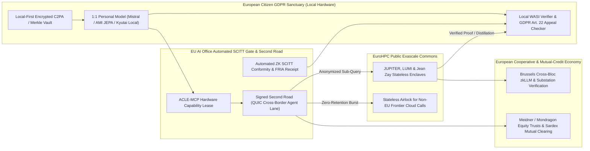

# SOV-03 Sovereign AI Governance & Treaty Technical Paper: European Union

| Field | Specification |
| :--- | :--- |
| **Code** | `SOV-03` |
| **Jurisdiction** | European Union (`27` Member States, European Commission, European Parliament, and National Market Surveillance Authorities) |
| **Primary Governance Stack** | `EU AI Act` (`Regulation (EU) 2024/1689`), `EU AI Office`, General Data Protection Regulation (`GDPR`), Data Governance Act, and `EuroHPC` Joint Undertaking |
| **Compute & Lab Footprint** | Public exascale supercomputers (`JUPITER` in Germany, `LUMI` in Finland, `Jean Zay` in France, `MareNostrum 5` in Spain) alongside European open-science and open-weight labs (`Mistral`, `AMI Labs`, `Kyutai`) |
| **CIN Liaison Agent ID** | `cin.liaison.gov.eu` |
| **Treaty & Clearing Role** | Statutory fundamental-rights standard setter, `EuroHPC` public compute commons operator, and cross-bloc `SCITT` compliance clearing partner |

## Executive Summary

The European Union has enacted the most comprehensive statutory rulebook for artificial intelligence on earth, uniting the `EU AI Act` (`Regulation (EU) 2024/1689`), centralized systemic-risk supervision inside the `EU AI Office`, mature `GDPR` data-protection enforcement, and publicly funded exascale supercomputing under the European High Performance Computing Joint Undertaking (`EuroHPC`, spanning `JUPITER`, `LUMI`, and `Jean Zay`). Alongside strong continental traditions of works-council co-determination (`Mitbestimmung`), Mondragon worker cooperatives, and regional mutual credit (`Sardex`), Europe holds deep institutional assets for democratic technology governance. Yet three structural vulnerabilities threaten to hollow out Europe's statutory ambition in practice. First, Article 51 of the `EU AI Act` anchors systemic-risk general-purpose AI classification to a static `10^25` training FLOP threshold, missing severe cyber, deception, and autonomous tool-use capabilities achieved by smaller distilled models and multi-agent scaffolding as algorithmic efficiency doubles every eight months (Ho et al., 2024). Second, paper-heavy conformity assessments and manual Fundamental Rights Impact Assessments (`FRIAs`; Mantelero, 2024) impose high fixed legal compliance costs that incumbent US hyperscaler legal departments absorb easily while pricing out European municipal utilities, research spinouts, and worker cooperatives. Third, heavy European public-sector and enterprise dependence on foreign multi-tenant cloud platforms drains continental procurement budgets and places citizen memory outside sovereign local custody.

The Collective Intelligence Network (`CIN`) equips the `EU AI Office`, national market-surveillance authorities, `EuroHPC`, and European social partners to close all three gaps simultaneously. By compiling `EU AI Act` Annex IV technical documentation, training-lineage disclosures, and Article 27 Fundamental Rights Impact Assessments (Mantelero, 2024) into **automated zero-knowledge `IETF SCITT` receipts** (`zkLLM`; Sun et al., 2024), small European cooperatives and open-source builders satisfy compliance automatically at near-zero legal overhead while regulators gain mathematical verification over dynamic agentic risk. Across public administration, Scrutable State appeal receipts (Caputo, 2026) enforce `GDPR` Article 22 contestability mathematically. At the infrastructure layer, dedicating `EuroHPC` (`JUPITER`, `LUMI`, `Jean Zay`) as Europe's **Universal Basic Compute** backbone powers sovereign open-weight models (`Mistral`, `AMI Labs` JEPA world models, `Kyutai` speech runtimes) inside encrypted citizen home vaults built on local-first data custody (Kleppmann et al., 2019). Routing autonomous business and public-sector agents onto the signed Second Road (Kolt, 2025) under `ACLE-MCP` hardware capability leases (Ding et al., 2026) prevents cascading Single Market disruptions, while scaling Mondragon and Rudolf Meidner cooperative equity funds (Korinek & Stiglitz, 2017) alongside Sardex-proven mutual-credit clearing (Iosifidis et al., 2018) protects European household prosperity.

---

## 1. Current Regulatory Architecture and Private or Geopolitical Capture Risks

Europe's regulatory strategy relies on ex-ante product-safety conformity harmonized across twenty-seven Member States, pairing risk tiers (`Unacceptable`, `High-Risk`, `GPAI with Systemic Risk`) with turnover-based administrative fines. Examining how frontier AI capabilities interact with this legal structure exposes three concrete failure modes.

### 1.1 Static `10^25` FLOP Thresholds vs. Distilled and Agentic Capability Jumps

Under Article 51 of `Regulation (EU) 2024/1689`, a general-purpose AI model is presumed to carry systemic risk when cumulative training compute exceeds `10^25` floating-point operations. While training compute remains a useful physical proxy for raw pre-training scale (Sastry et al., 2024), algorithmic efficiency improvements halve required training compute roughly every eight months (Ho et al., 2024). Post-training reinforcement learning over verifiable coding environments, synthetic reasoning distillation, and multi-step tool scaffolding allow compact models trained well below `10^25` FLOPs to execute autonomous vulnerability discovery, persuasive manipulation, or multi-host network lateral movement. Relying on a static pre-training FLOP number alone leaves the `EU AI Office` blind to post-deployment agentic capability overhangs until Commission delegated acts catch up months later.

### 1.2 Paperwork Regressive Burden and Incumbent Cloud Regulatory Capture

High-risk system obligations under Articles 9 through 15 (`risk management`, `data governance`, `Annex IV technical files`) and deployer Fundamental Rights Impact Assessments under Article 27 (Mantelero, 2024) are currently drafted and audited largely as thousands of pages of static prose PDFs. In practice, giant non-European cloud providers maintain hundreds of compliance attorneys and Brussels regulatory-affairs specialists to absorb static paperwork costs, then bundle "AI Act compliant" cloud APIs to lock in European banks, hospitals, and ministries. Conversely, a ten-person Stuttgart machine-tool cooperative, a Lyon clinical research lab, or a Bologna municipal software team faces prohibitive legal consulting bills before shipping local tools. Static paperwork without cryptographic automation unintentionally entrenches foreign hyperscaler oligopolies.

### 1.3 Foreign Cloud Custody Drain and Citizen Memory Vulnerability

Despite `GDPR` data-minimization mandates and European Data Spaces initiatives, the vast majority of daily consumer and enterprise AI interactions across Member States flow into multi-tenant US hyperscaler servers. European public administrations pay recurring seat-based subscription rents to foreign vendors while citizens' medical queries, workplace drafts, and municipal records accumulate outside sovereign hardware custody. If geopolitical trade disputes, extraterritorial foreign subpoenas, or sudden API price hikes hit, European public services lack local operational continuity.

---

## 2. Pre-Deployment Frontier Safety, Physical Airlocks, and Citizen 1:1 Sanctuary

CIN turns Europe's statutory rights framework from static PDF checklists into automated, low-cost cryptographic guarantees while anchoring personal AI inside citizen-held European hardware.

### 2.1 Replacing Manual Paperwork with Automated `SCITT` and `FRIA` Receipts

Instead of forcing small European builders to hire external legal consultancies for manual Annex IV dossiers, the `EU AI Office` can publish open-source, deterministic evaluation harnesses that emit **machine-verifiable `IETF SCITT` conformity receipts**. Whenever an open-weight or cooperative developer runs standard safety, robustness, and bias benchmarks inside an attested `EuroHPC` or local `WASI` sandbox, the harness signs a tamper-evident cryptographic receipt linked directly to the model hash and dataset provenance tree.

Similarly, public-sector and high-risk deployers satisfy Article 27 **Fundamental Rights Impact Assessments (`FRIAs`)** (Mantelero, 2024) through structured, cryptographic impact manifests coupled with **Scrutable State administrative receipts** (Caputo, 2026). Every automated decision affecting housing allocation, labor inspection, credit access, or welfare eligibility across the `27` Member States issues the citizen a local cryptographic proof detailing the exact rule version, input weights, and counterfactual path required to contest the outcome under `GDPR` Article 22.

### 2.2 Dynamic Execution-Time Airlocks (`ACLE-MCP`) Beyond Static FLOP Counts

To govern post-training and agentic capability jumps below `10^25` FLOPs, market-surveillance authorities pair `EU AI Office` red-teaming (Greenblatt et al., 2023; Korbak et al., 2025) with **Attested Capability Leases (`ACLE-MCP`)** (Ding et al., 2026). Regardless of how few FLOPs trained a model, no software agent inside the Single Market may execute privileged banking, energy-grid, medical-device, or industrial `PLC` actions without a short-lived capability lease signed by attested user or enterprise hardware (`DMTF SPDM` / `IETF RATS`). Industrial machinery across European factories pairs these software leases with `IEC 61508` physical safety relays, aligning digital agent containment directly with existing EU Machinery Regulation (`2023/1230`) standards.

### 2.3 GDPR Sovereignty Through Local-First Home Vaults and Open European Models

CIN realizes the deepest promise of `GDPR` self-determination by moving longitudinal personal memory out of multi-tenant clouds into **Local-First Encrypted Home Vaults** (Kleppmann et al., 2019). Each resident's autobiographical records, wearable health streams, and work notes stay encrypted inside user-owned `C2PA`/Merkle hardware at home. Over that private vault runs a `1:1` personal assistant powered by open-weight European architectures: `Mistral` reasoning checkpoints, `AMI Labs` Joint-Embedding Predictive Architecture (`JEPA`) physical-world models, and `Kyutai` low-latency multilingual voice models. Whenever heavy external reasoning is needed from `EuroHPC` or a non-EU frontier cluster, the home airlock strips personal identifiers (`GDPR` pseudonymization at the silicon boundary) and enforces zero cloud retention.

---

## 3. Avoiding Emergency Overreach and Governing Agent Traffic on the Second Road

Europe's interconnected Single Market (linking `TARGET2` interbank clearing, continental `ENTSO-E` synchronous power grids, Schengen rail corridors, and cross-border customs) faces acute contagion risk if millions of unauthenticated autonomous agents flood public web APIs.

### 3.1 Routing Single Market Agent Traffic onto the Signed Second Road

CIN complements the EU `NIS2` Directive and Cyber Resilience Act by separating machine-to-machine agent execution onto the **Signed Second Road** (`MCP` and `A2A` over `IETF QUIC`) carrying verifiable European workload credentials and bounded capability leases (Kolt, 2025). Human journalism, multilingual cultural exchange, parliamentary debate, and private citizen communications remain untouched on the open internet without intrusive chat-control scanning or human identity gates.

### 3.2 Proportional, Auditable Circuit Breakers Across ENTSO-E and Financial Lanes

If an autonomous cyber-exploitation wave or runaway algorithmic trading cascade strikes continental infrastructure, national `CSIRTs` and `ENISA` can activate surgical Second Road circuit breakers. Network edges throttle unattested `A2A` agent loops, revoke compromised conformity receipts via real-time `SCITT` transparency feeds, and require local human hardware countersignatures on high-risk infrastructure sockets, while keeping ordinary citizen internet access open across all twenty-seven Member States.

---

## 4. Verifiable Cross-Border Treaties and Mutual Compute and Red-Line Proofs

Although the greatest concentration of private hyperscale clusters sits in the United States and China, the European Union holds decisive diplomatic, regulatory, and semiconductor-supply leverage (anchored by `ASML` lithography systems, Single Market access rules, and `EuroHPC` neutral scientific clusters) to broker verifiable international containment treaties.

### 4.1 Brussels Effect Upgraded to Cryptographic Treaty Verification

Under Article 53 and systemic-risk codes of practice, non-EU frontier providers placing models on the European market must demonstrate red-line safety compliance without exposing proprietary weights to commercial competitors. CIN upgrades paper attestations into **zero-knowledge `zkLLM` evaluation proofs** (Sun et al., 2024) anchored on federated **`IETF SCITT` ledgers**. Foreign frontier labs prove mathematically to the `EU AI Office` that deployed model weights pass mandatory cyber-offense, biological-weapon, and autonomous-replication safety suites inside audited `EuroHPC` verification enclaves, establishing a neutral technical template that both Washington and Beijing can adopt reciprocally.

### 4.2 EuroHPC Neutral Escrows and Substation Megawatt Audits

Europe's publicly governed `EuroHPC` centers (`JUPITER` in Julich, `LUMI` in Kajaani, `Jean Zay` near Paris) can host multilateral treaty verification nodes integrating European, American, and Asian hardware roots of trust under Byzantine quorum rules. Paired with privacy-preserving zero-knowledge proofs of utility substation megawatt draw and accelerator cluster inventories (Sastry et al., 2024), the European Union helps verify global compliance against undeclared frontier runs while protecting cross-border whistleblowers under the EU Whistleblower Directive (`2019/1937`).

---

## 5. Public Compute Commons, Local Software Synthesis, and Post-Labor Economic Stability

Europe's social-market traditions offer proven institutional blueprints (co-determination works councils, the Swedish Rudolf Meidner wage-earner fund design, Basque Mondragon federations, and Sardinia's Sardex mutual-credit network) uniquely suited to prevent AI automation from polarizing continental wealth (Korinek & Stiglitz, 2017; Acemoglu & Restrepo, 2019).

### 5.1 Scaling EuroHPC AI Factories into Continental Universal Basic Compute

By expanding the `EuroHPC` AI Factories mandate from academic and startup batch grants into **Universal Basic Compute (`UBC`)**, Member States provision guaranteed sovereign inference, distillation, and formal-verification capacity to municipal utilities, public hospitals, universities, libraries, and citizen home vaults. Four-day specialist distillation pipelines compress frontier scientific and coding advances into frugal open-weight European checkpoints (`Mistral`, `Kyutai`, `AMI Labs`), ending public-sector dependence on foreign cloud subscriptions.

### 5.2 Municipal and Cooperative Local Software Synthesis (`Public Money, Public Code`)

Across European cities, ministries, and `Mittelstand` industrial firms, AI coding agents invert software procurement economics by enabling end-user institutions to synthesize bespoke, formally verified local-first applications (Malo et al., 2026; Kleppmann et al., 2019). Paired with `EuroHPC` verification enclaves, municipalities and works councils compile open-source administrative, transit, and clinic software audited deterministically in house, turning Europe's *Public Money, Public Code* principle into immediate fiscal savings.

### 5.3 Mondragon and Rudolf Meidner Worker-Citizen Cooperative Share Funds

To ensure multi-gigawatt compute and industrial robotics raise household purchasing power across every European region, Member States and the European Investment Bank can condition data-center grid permits and Single Market procurement on **Statutory Meidner Cooperative Equity Streaming** (Korinek & Stiglitz, 2017). Frontier compute operators and automated industrial groups issue a statutory stream of non-dilutive dividend and governance shares into sectoral worker-citizen trusts and multi-stakeholder cooperatives modeled on Mondragon and Ostrom's polycentric governance principles (Ostrom, 2010), strengthening works-council voice over workplace AI deployment.

### 5.4 Scaling Sardex-Proven Mutual-Credit Clearing Across European Regions

Sardinia's **Sardex** commercial mutual-credit network has already demonstrated empirically across thousands of European small enterprises that zero-interest cyclic credit clearing stabilizes regional trade and employment when bank liquidity tightens (Iosifidis et al., 2018). CIN scales this European innovation onto the Wide Network Ledger: cooperatives, municipal energy communities, care providers, local farmers, and `EuroHPC` regional compute nodes clear real productive capacity and verified civic work across cyclic zero-interest loops without speculative crypto tokens or inflationary debt.

---

## Primary References

1. Acemoglu, D., & Restrepo, P. (2019). Automation and New Tasks: How Technology Displaces and Reinstates Labor. *Journal of Economic Perspectives*, 33(2), 3-30. https://doi.org/10.1257/jep.33.2.3
2. Caputo, N. (2026). Administrative Law's Fourth Settlement: AI and the Scrutable State. *arXiv preprint arXiv:2602.09678*. https://arxiv.org/abs/2602.09678
3. Ding, Z., Luo, Y., Chen, G., Shen, Q., & Wu, Z. (2026). ACLE-MCP: Attested Capability Leases for Execution-Time Trust in Remote LLM Tool Use. *arXiv preprint arXiv:2609.02690*. https://arxiv.org/abs/2609.02690
4. Greenblatt, R., Shlegeris, B., Sachan, K., & Roger, F. (2023). AI Control: Improving Safety Despite Intentional Subversion. *arXiv preprint arXiv:2312.06942*. https://arxiv.org/abs/2312.06942
5. Ho, A., Besiroglu, T., Erdil, E., Owen, D., Rahman, R., Guo, Z. C., Atkinson, D., Thompson, N., & Sevilla, J. (2024). Algorithmic progress in language models. *arXiv preprint arXiv:2403.05812*. https://arxiv.org/abs/2403.05812
6. Iosifidis, G., Charette, Y., Airoldi, E. M., Littera, G., Tassiulas, L., & Christakis, N. A. (2018). Cyclic motifs in the Sardex monetary network. *Nature Human Behaviour*, 2, 822-829. https://doi.org/10.1038/s41562-018-0450-0
7. Kleppmann, M., Wiggins, A., van Hardenberg, P., & McGranaghan, M. (2019). Local-first software: you own your data, in spite of the cloud. *Proceedings of the 2019 ACM SIGPLAN International Symposium on New Ideas, New Paradigms, and Reflections on Programming and Software (Onward!)*, 154-178. https://doi.org/10.1145/3359591.3359737
8. Kolt, N. (2025). Governing AI Agents. *arXiv preprint arXiv:2501.07913*. https://arxiv.org/abs/2501.07913
9. Korbak, T., Clymer, J., Hilton, B., Shlegeris, B., & Irving, G. (2025). A sketch of an AI control safety case. *arXiv preprint arXiv:2501.17315*. https://arxiv.org/abs/2501.17315
10. Korinek, A., & Stiglitz, J. E. (2017). Artificial Intelligence and Its Implications for Income Distribution and Unemployment. *NBER Working Paper No. 24174*. https://doi.org/10.3386/w24174
11. Malo, R. C., Yu, Z., & Qiu, T. (2026). The Customer Is the Builder: How AI Coding Agents Are Rewriting the Economics of Software. *arXiv preprint arXiv:2610.30307*. https://arxiv.org/abs/2610.30307
12. Mantelero, A. (2024). The Fundamental Rights Impact Assessment (FRIA) in the AI Act: Roots, legal obligations and key elements for a model template. *arXiv preprint arXiv:2411.15149*. https://arxiv.org/abs/2411.15149
13. Ostrom, E. (2010). Beyond Markets and States: Polycentric Governance of Complex Economic Systems. *American Economic Review*, 100(3), 641-672. https://doi.org/10.1257/aer.100.3.641
14. Sastry, G., Heim, L., Belfield, H., Anderljung, M., Brundage, M., Hazell, J., O'Keefe, C., Hadfield, G. K., Ngo, R., Pilz, K., et al. (2024). Computing Power and the Governance of Artificial Intelligence. *arXiv preprint arXiv:2402.08797*. https://arxiv.org/abs/2402.08797
15. Sun, H., Li, J., & Zhang, H. (2024). zkLLM: Zero Knowledge Proofs for Large Language Models. *arXiv preprint arXiv:2404.16109*. https://arxiv.org/abs/2404.16109
