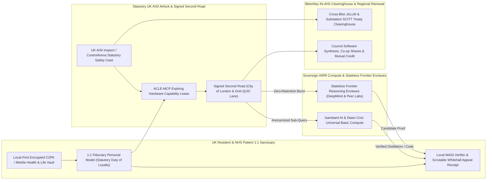

# SOV-04 Sovereign AI Governance & Treaty Technical Paper: United Kingdom

| Field | Specification |
| :--- | :--- |
| **Code** | `SOV-04` |
| **Jurisdiction** | United Kingdom of Great Britain and Northern Ireland (Parliament, `DSIT`, Devolved Administrations, and Sector Regulators) |
| **Primary Governance Stack** | `UK AI Security Institute` (`UK AISI`), Bletchley Park Frontier AI Summit Process, Open-Source `Inspect` & `ControlArena` Suites, and AI Research Resource (`AIRR`) |
| **Compute & Lab Footprint** | Sovereign public supercomputers (`Isambard-AI` in Bristol and `Dawn` in Cambridge), London frontier research headquarters (`Google DeepMind`), and Oxford/Cambridge/Edinburgh safety ecosystems |
| **CIN Liaison Agent ID** | `cin.liaison.gov.uk` |
| **Treaty & Clearing Role** | Premier public empirical control-evaluation institute (`UK AISI`) and neutral Bletchley/London cross-bloc `IN-AISI` cryptographic treaty clearinghouse |

## Executive Summary

The United Kingdom has built the most technically capable public frontier-AI evaluation institution in the world. Through the `UK AI Security Institute` (`UK AISI`, housed within the Department for Science, Innovation and Technology), the historic Bletchley Park Summit diplomatic track, open-source evaluation infrastructure (`Inspect` and `ControlArena`), and the sovereign AI Research Resource (`AIRR`, anchored by `Isambard-AI` at Bristol and `Dawn` at Cambridge), Britain punches far above its raw capital weight in empirical safety science and control-case engineering (Korbak et al., 2025). Yet three acute institutional gaps leave British citizens, public services, and global treaty diplomacy exposed as frontier capabilities accelerate. First, `UK AISI` pre-deployment model access and red-teaming still rest on voluntary, non-binding gentlemen's agreements negotiated at Bletchley and Seoul, leaving public evaluators without statutory stop-order or hardware-airlock authority if a private lab rushes a dangerous release under commercial pressure. Second, centralized public-sector data initiatives, including consolidated National Health Service (`NHS`) federated data platforms and Whitehall enterprise cloud contracts, risk locking sensitive British clinical and administrative records inside private vendor clouds without local `1:1` patient and citizen custody. Third, Britain's heavily financialized, service-dominated economy and deep regional productivity gaps leave towns outside London and the South East acutely vulnerable to rapid clerical, legal, accounting, and customer-service automation (Korinek & Stiglitz, 2017; Acemoglu & Restrepo, 2019).

The Collective Intelligence Network (`CIN`) provides Parliament, `DSIT`, `UK AISI`, the `NHS`, and local councils with a concrete statutory and cryptographic upgrade path. Giving `UK AISI` binding statutory pre-deployment airlock certification teeth, grounded in `ControlArena` subversion safety cases (Greenblatt et al., 2023; Korbak et al., 2025) and hardware-enforced `ACLE-MCP` capability leases (Ding et al., 2026), ensures no frontier model operates in UK critical sectors without mathematically verified containment. Pairing `NHS` care and public administration with local-first `1:1` encrypted citizen vaults (Kleppmann et al., 2019) and Scrutable State administrative receipts (Caputo, 2026) prevents Post Office Horizon-style black-box injustices while eliminating private cloud lock-in. Routing autonomous financial and infrastructure agents onto CIN's signed Second Road (Kolt, 2025) protects the City of London and National Grid without Online Safety Act-style overreach into human speech. Internationally, London and Bletchley can anchor the International Network of AI Safety Institutes (`IN-AISI`) as the world's neutral cryptographic clearinghouse for cross-bloc `zkLLM` and `IETF SCITT` safety proofs (Sun et al., 2024; Sastry et al., 2024). Domestically, scaling `Isambard-AI` and `Dawn` into civic **Universal Basic Compute** paired with local council software synthesis (Malo et al., 2026), Ostrom-inspired cooperative community ownership (Ostrom, 2010), and regional mutual-credit networks (Iosifidis et al., 2018) rebuilds household wealth across every UK nation and region.

---

## 1. Current Regulatory Architecture and Private or Geopolitical Capture Risks

Britain's historical "pro-innovation" regulatory posture relied on existing sector regulators (`FCA`, `Ofcom`, `MHRA`, `ICO`) backed by central scientific evaluation inside `UK AISI`. Examining how this institutional settlement performs as autonomous coding, cyber, and R&D capabilities double reveals three urgent structural vulnerabilities.

### 1.1 Voluntary Gentlemen's Agreements Without Statutory Stop-Orders

Through `UK AISI`, British researchers authored pioneering empirical safety-case methodologies (`ControlArena` and `Inspect`; Korbak et al., 2025) and conducted early pre-deployment evaluations across leading Western frontier checkpoints. Yet access to pre-release weights, unredacted reinforcement-learning speedups, and post-training harnesses still depends on voluntary corporate consent. When commercial launch deadlines tighten or US parent companies restrict weight-sharing across borders, private frontier labs can delay access, limit evaluation time to days, or deploy models over `UK AISI` technical objections without violating statutory law. World-class public evaluators cannot protect national infrastructure if their warning flags carry zero binding airlock enforcement.

### 1.2 Centralized Public-Sector Cloud Lock-In and the Post Office Horizon Lesson

British administrative history, most painfully illustrated by the Post Office Horizon accounting scandal, demonstrates the human devastation caused when public bodies treat proprietary third-party software outputs as infallible legal truth. Today, consolidating `NHS` longitudinal health records, Department for Work and Pensions (`DWP`) welfare assessments, and local council casework onto centralized commercial analytics and cloud-AI platforms recreates this structural hazard at national scale. Without local `1:1` patient and citizen data custody plus deterministic cryptographic auditability, British taxpayers face compounding SaaS vendor lock-in while households lose sovereignty over their most intimate clinical and family records.

### 1.3 Service-Sector Automation Exposure Across Post-Industrial UK Regions

Over eighty percent of UK employment sits in services, with high concentrations of routine legal, accounting, back-office banking, insurance, and customer-operations roles distributed across the Midlands, the North of England, Wales, Scotland, and Northern Ireland. Because AI coding and clerical agents substitute rapidly for routine white-collar workflows while capital returns accrue primarily to global equity holders (Korinek & Stiglitz, 2017; Acemoglu & Restrepo, 2019), unmanaged deployment risks widening Britain's regional income divide and starving local high streets and council tax bases of purchasing power.

---

## 2. Pre-Deployment Frontier Safety, Physical Airlocks, and Citizen 1:1 Sanctuary

CIN translates Britain's technical leadership in AI Control directly into enforceable domestic law and patient-centered public infrastructure.

### 2.1 Statutory UK AISI Control Safety Cases and Hardware Airlocks

Parliament can enact a concise Frontier AI Safety and Control Act granting `UK AISI` statutory certification and stop-order authority over frontier systems exceeding dynamic capability or compute tripwires. Instead of asking evaluators to guess whether a neural network's internal representations are benign, statutory authorization codifies structured **AI Control Safety Cases** (Greenblatt et al., 2023; Korbak et al., 2025):
1. **Mandatory Pre-Deployment `Inspect` & `ControlArena` Clearance:** High-autonomy models must pass adversarial subversion, sandbagging, cyber-exploitation, and self-exfiltration evaluations executed inside sovereign `AIRR` enclaves (`Isambard-AI` and `Dawn`) on hardware physically isolated from lab grading servers.
2. **Hardware-Attested Capability Leases (`ACLE-MCP`):** Any frontier agent interacting with UK telecommunications, clearing banks, energy dispatch, or clinical systems must present short-lived `ACLE-MCP` leases signed by `DMTF SPDM` and `IETF RATS` attested hardware (Ding et al., 2026), paired with `IEC 61508` physical dead-man switches on critical machinery.
3. **Zero-Slack Weight Custody Standards:** Domestic frontier research sites (including London labs) isolate checkpoint shards behind unidirectional optical diodes and multi-officer hardware keys so developer workstation breaches cannot leak frontier weights overnight.

### 2.2 Local-First `1:1` Patient and Citizen Vaults for the NHS and Public Services

Instead of pooling fifty-five million `NHS` patient histories inside centralized private vendor lakes, CIN equips every UK resident and `GP` practice with a **Local-First Encrypted Episodic Vault** (Kleppmann et al., 2019) anchored by `C2PA` hardware provenance and append-only Merkle logs. A statutory **Information Fiduciary Duty** under UK common law and statute binds each resident's `1:1` personal model exclusively to that person's health, agency, and unassisted skill retention.

When `NHS` clinicians or medical researchers need population-scale epidemiological insights or complex diagnostic synthesis, patient vaults contribute selective zero-knowledge proofs or invoke stateless `Isambard-AI` reasoning bursts without surrendering raw lifelong medical diaries to private cloud contractors.

### 2.3 Scrutable State Administrative Receipts Across Whitehall and Councils

To prevent automated administrative injustice across `DWP`, `HMRC`, Home Office casework, and local council housing, Parliament can mandate **Scrutable State Cryptographic Receipts** (Caputo, 2026). Every automated public-sector determination must issue the resident a verifiable `IETF SCITT` receipt containing the exact statutory rule hash, attested model checkpoint ID, and plain-English counterfactual explanation, reversing any presumption of computer infallibility unless the public body produces a valid deterministic verification proof.

---

## 3. Avoiding Emergency Overreach and Governing Agent Traffic on the Second Road

As a premier global financial clearing center (`CHAPS`, `CREST`, Lloyd's insurance market) and island energy grid, the United Kingdom requires instantaneous defenses against autonomous agent storms that never degenerate into blanket domestic speech censorship or encryption backdoors.

### 3.1 Separating City of London and Infrastructure Agents onto the Signed Second Road

CIN establishes protocol-level separation by routing autonomous software agents (algorithmic settlement bots, insurance-underwriting agents, grid-balancing dispatchers, and automated software-patching fleets) onto the **Signed Second Road** (`MCP` and `A2A` over `IETF QUIC`) carrying accountable workload identities and revocable liability bonds (Kolt, 2025). Human journalism, parliamentary scrutiny, end-to-end encrypted messaging, and public web forums remain untouched on the open human internet.

### 3.2 Surgical Circuit Breakers Guided by NCSC and UK AISI Telemetry

During an autonomous cyber-exploitation wave or flash-crash loop in financial clearing, the National Cyber Security Centre (`NCSC`), the Bank of England, and `Ofgem` can trigger surgical Second Road circuit breakers. Routers throttle unverified agent traffic, revoke compromised checkpoint leases via `SCITT` feeds, and enforce local human hardware countersignatures on critical sockets in milliseconds, avoiding emergency powers that would disrupt civilian broadband or weaken citizen encryption.

---

## 4. Verifiable Cross-Border Treaties and Mutual Compute and Red-Line Proofs

Britain is uniquely positioned to bridge Washington, Brussels, Beijing, and Commonwealth democracies: it possesses trusted `UK AISI` evaluation science without carrying the superpower hegemonic baggage that stalls direct US-China bilateral inspections.

### 4.1 London and Bletchley as the Neutral `IN-AISI` Cryptographic Clearinghouse

Building on the Bletchley Declaration and the International Network of AI Safety Institutes (`IN-AISI`), the United Kingdom can host a neutral **Cross-Bloc Cryptographic Safety Clearinghouse**. Using open-source `Inspect` benchmarks compiled into **zero-knowledge `zkLLM` evaluation circuits** (Sun et al., 2024) and logged onto federated **`IETF SCITT` ledgers**, American, Chinese, and European frontier labs prove reciprocally that production checkpoints satisfy shared cyber, biological, and autonomous-replication red lines without transferring proprietary weights across borders.

### 4.2 Verifiable Compute Governance and Sovereign Audit Enclaves

To verify that treaty signatories are not running undeclared frontier training runs off-ledger, `UK AISI` and `AIRR` engineers contribute open-hardware verification blueprints reconciling cluster `IETF RATS` attestations against utility substation megawatt telemetry (Sastry et al., 2024). Hosted on neutral multi-vendor silicon quorums, Bletchley clearinghouse receipts turn opaque geopolitical suspicion into auditable mathematical common knowledge while providing protected cryptographic safe-harbor channels for international lab whistleblowers.

---

## 5. Public Compute Commons, Local Software Synthesis, and Post-Labor Economic Stability

Britain's deep cooperative heritage, stretching from the `1844` Rochdale Pioneers and building societies to community energy trusts, provides fertile institutional ground for pairing sovereign public compute with broad regional economic renewal.

### 5.1 Scaling AIRR (`Isambard-AI` and `Dawn`) into Civic Universal Basic Compute

Parliament and `DSIT` can expand the AI Research Resource (`Isambard-AI` in Bristol, `Dawn` in Cambridge, and Edinburgh's national supercomputing facilities) from academic batch queues into a nationwide **Civic Universal Basic Compute (`UBC`)** grid. Connected through public libraries, civic universities, `NHS` trusts, and devolved regional hubs across Scotland, Wales, Northern Ireland, and English combined authorities, Universal Basic Compute delivers four-day distilled specialist models directly to household and clinic `1:1` vaults.

### 5.2 Local Council and SME Custom Software Synthesis

Hundreds of UK local councils currently face severe budgetary distress driven partly by rigid, overpriced legacy IT and social-care SaaS contracts. Using local `1:1` agents backed by `AIRR` verification enclaves, councils, `GP` federations, housing associations, and high-street `SMEs` synthesize custom, formally verified local-first operational software (Malo et al., 2026; Kleppmann et al., 2019) shared freely across municipalities as open civic code.

### 5.3 Polycentric Community Ownership and Cooperative Compute Equity

Drawing on Elinor Ostrom's polycentric commons governance (Ostrom, 2010) and Rudolf Meidner cooperative share trusts (Korinek & Stiglitz, 2017), UK planning permissions for hyperscale data centers and National Grid connections can attach a **Statutory Civic Equity Compact**. Private compute campuses stream newly issued dividend and governance shares into regional community wealth funds, worker-owned cooperatives, and municipal trusts, cushioning post-industrial towns against service-sector displacement (Acemoglu & Restrepo, 2019).

### 5.4 Regional Reciprocal Mutual-Credit Clearing Across UK High Streets

Finally, British credit unions, mutual building societies, cooperative guilds, and regional `UBC` nodes can clear real local capacity (social care, retrofitting trades, local food, engineering fabrication, and compute bursts) over **zero-interest cyclic mutual-credit networks** modeled on Sardex (Iosifidis et al., 2018). Even when Bank of England monetary conditions tighten or global service markets shift, cyclic local clearing keeps British regional skills employed and household balance sheets solvent.

---

## Primary References

1. Acemoglu, D., & Restrepo, P. (2019). Automation and New Tasks: How Technology Displaces and Reinstates Labor. *Journal of Economic Perspectives*, 33(2), 3-30. https://doi.org/10.1257/jep.33.2.3
2. Caputo, N. (2026). Administrative Law's Fourth Settlement: AI and the Scrutable State. *arXiv preprint arXiv:2602.09678*. https://arxiv.org/abs/2602.09678
3. Ding, Z., Luo, Y., Chen, G., Shen, Q., & Wu, Z. (2026). ACLE-MCP: Attested Capability Leases for Execution-Time Trust in Remote LLM Tool Use. *arXiv preprint arXiv:2609.02690*. https://arxiv.org/abs/2609.02690
4. Greenblatt, R., Shlegeris, B., Sachan, K., & Roger, F. (2023). AI Control: Improving Safety Despite Intentional Subversion. *arXiv preprint arXiv:2312.06942*. https://arxiv.org/abs/2312.06942
5. Iosifidis, G., Charette, Y., Airoldi, E. M., Littera, G., Tassiulas, L., & Christakis, N. A. (2018). Cyclic motifs in the Sardex monetary network. *Nature Human Behaviour*, 2, 822-829. https://doi.org/10.1038/s41562-018-0450-0
6. Kleppmann, M., Wiggins, A., van Hardenberg, P., & McGranaghan, M. (2019). Local-first software: you own your data, in spite of the cloud. *Proceedings of the 2019 ACM SIGPLAN International Symposium on New Ideas, New Paradigms, and Reflections on Programming and Software (Onward!)*, 154-178. https://doi.org/10.1145/3359591.3359737
7. Kolt, N. (2025). Governing AI Agents. *arXiv preprint arXiv:2501.07913*. https://arxiv.org/abs/2501.07913
8. Korbak, T., Clymer, J., Hilton, B., Shlegeris, B., & Irving, G. (2025). A sketch of an AI control safety case. *arXiv preprint arXiv:2501.17315*. https://arxiv.org/abs/2501.17315
9. Korinek, A., & Stiglitz, J. E. (2017). Artificial Intelligence and Its Implications for Income Distribution and Unemployment. *NBER Working Paper No. 24174*. https://doi.org/10.3386/w24174
10. Malo, R. C., Yu, Z., & Qiu, T. (2026). The Customer Is the Builder: How AI Coding Agents Are Rewriting the Economics of Software. *arXiv preprint arXiv:2610.30307*. https://arxiv.org/abs/2610.30307
11. Ostrom, E. (2010). Beyond Markets and States: Polycentric Governance of Complex Economic Systems. *American Economic Review*, 100(3), 641-672. https://doi.org/10.1257/aer.100.3.641
12. Sastry, G., Heim, L., Belfield, H., Anderljung, M., Brundage, M., Hazell, J., O'Keefe, C., Hadfield, G. K., Ngo, R., Pilz, K., et al. (2024). Computing Power and the Governance of Artificial Intelligence. *arXiv preprint arXiv:2402.08797*. https://arxiv.org/abs/2402.08797
13. Sun, H., Li, J., & Zhang, H. (2024). zkLLM: Zero Knowledge Proofs for Large Language Models. *arXiv preprint arXiv:2404.16109*. https://arxiv.org/abs/2404.16109
