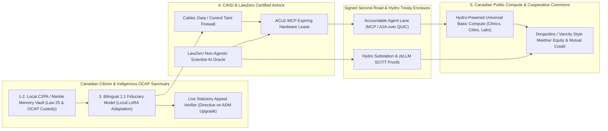

# SOV-05 Sovereign AI Governance & Treaty Technical Paper: Canada

| Field | Specification |
| :--- | :--- |
| **Code** | `SOV-05` |
| **Jurisdiction / Authority** | Government of Canada (Federal Parliament, Treasury Board Secretariat, Innovation, Science and Economic Development Canada, and Provincial Regulators) |
| **Primary Governance Instruments & Institutes** | Treasury Board *Directive on Automated Decision-Making*, Canadian AI Safety Institute (`CAISI`), Canadian Sovereign AI Compute Strategy, Quebec *Law 25*, and First Nations `OCAP` Data Governance |
| **Public Compute & Research Footprint** | Pan-Canadian AI Strategy (`Mila`, `Vector Institute`, `Amii`), `LawZero` Scientist-AI Initiative, Digital Research Alliance of Canada, and Hydro-Powered Regional Compute Corridors |
| **CIN Liaison & Commons Node** | `cin.sovereign.ca` (Ottawa Foundation Seat, Ontario / Quebec National Capital Region) |
| **Primary Public Portals** | https://ised-isde.canada.ca · https://www.tbs-sct.canada.ca |

## Executive Summary

Canada funded the neural-network breakthroughs that launched modern artificial intelligence across Montreal (`Mila`), Toronto (`Vector`), and Edmonton (`Amii`), enacted the Treasury Board *Directive on Automated Decision-Making*, established the Canadian AI Safety Institute (`CAISI`), and catalyzed non-agentic alignment science through `LawZero` alongside the Ottawa-headquartered Collective Intelligence Network (`CIN`). Despite these public investments, empirical audits of Canada's governance scaffold document a widening gap between public subsidy and public control (Tessono, Mim, & Guha, 2026). Public capital committed under the Canadian Sovereign AI Compute Strategy flows heavily toward private commercial data-center operators without securing public or cooperative equity ownership. At the statutory layer, parliamentary stalls and the collapse of Bill C-27's *Artificial Intelligence and Data Act* (`AIDA`) left private frontier deployments under a non-binding voluntary code, while domestic STEM talent and intellectual property routinely drain into foreign hyperscaler clouds that rent closed software subscriptions back to Canadian hospitals, cities, and households.

The Collective Intelligence Network (`CIN`) provides Canada with a non-partisan institutional architecture that converts early research leadership into durable civic sovereignty. Across CIN's five primitives, Ottawa and the provinces can upgrade the *Directive on Automated Decision-Making* from static pre-launch checklists into live cryptographic citizen appeal receipts (Caputo, 2026) and bilingual common-law and Quebec civil-law compliance verifiers (Ismaili & Dessureault, 2026). `CAISI` and `LawZero` Scientist-AI verifiers (Bengio et al., 2025) gain statutory authority to certify hardware capability airlocks (`ACLE-MCP`, Ding et al., 2026) and `IEC 61508` physical dead-man relays before high-autonomy systems touch critical infrastructure. Routing public and enterprise agents onto CIN's signed Second Road (Kolt, 2025) gives telecom operators surgical bot-flood circuit breakers without blunt emergency internet freezes. Internationally, Canada anchors G7 and `IN-AISI` compute treaties by pairing hydro substation telemetry (Sastry et al., 2024) with Waterloo-pioneered `zkLLM` proofs (Sun, Li, & Zhang, 2024), while dedicating public hydro compute to Universal Basic Compute, local software synthesis (Malo, Yu, & Qiu, 2026), and Rudolf Meidner cooperative equity modeled on `Desjardins` and `Vancity` credit unions (Korinek & Stiglitz, 2017; Iosifidis et al., 2018).

---

## 1. Current regulatory architecture and private or geopolitical capture risks

Canada's AI governance scaffold pairs federal public-service administrative rules with industrial compute subsidies. Examining how these instruments interact reveals three structural capture and safety vulnerabilities.

### 1.1 Public compute subsidies without public or cooperative ownership

Under the Canadian Sovereign AI Compute Strategy, federal funds partition billions across commercial compute vouchers, sovereign supercomputers, and private data-center buildouts. As Christelle Tessono, Nusrat Jahan Mim, and Shion Guha (2026) demonstrate, equating sovereignty with domestic geographic siting of private commercial data centers conflates corporate colocation with democratic public ownership. Subsidizing accelerator clusters and utility interconnections operated by private landlords or foreign cloud subsidiaries without public equity covenants socializes hydro grid expansion risks while private operators capture priority pricing and platform lock-in. Canada exports low-cost hydroelectricity, publicly funded research from `Mila`, `Vector`, and `Amii`, and graduate talent into foreign hyperscaler monopolies, then rents back closed SaaS tools across provincial hospitals, schools, and municipalities.

### 1.2 Statutory enforcement gaps after `AIDA` delays and voluntary-code reliance

Within federal ministries, the Treasury Board *Directive on Automated Decision-Making* pioneered mandatory Algorithmic Impact Assessments (`AIA`) and notice rules. Yet the Directive binds strictly federal agencies, excluding provincially regulated hospitals, workplaces, banks, and private frontier labs. When Bill C-27 stalled and died prior to enacting an enforceable *Artificial Intelligence and Data Act* (`AIDA`), private deployments fell back on ISED's non-binding *Voluntary Code of Conduct*, carrying zero statutory subpoena power, zero mandatory stop-orders for autonomous cyber or replication hazards, and zero developer-workstation isolation mandates. Even Quebec's *Law 25* relies on ex-post complaints when citizens lack cryptographic receipts showing which model checkpoint or data record drove an adverse credit, insurance, or clinical decision.

### 1.3 Cross-border cloud exposure and Indigenous data-sovereignty friction

Hosting Canadian enterprise and municipal workflows inside US-headquartered multi-tenant clouds exposes institutional records and citizen histories to extraterritorial foreign legal compulsion (such as the US *CLOUD Act*) and centralized cross-career post-training. For First Nations, Inuit, and Métis communities upholding First Nations `OCAP` principles (Ownership, Control, Access, and Possession), centralized cloud scraping of Indigenous languages, oral histories, and land-stewardship records violates collective self-determination.

---

## 2. Pre-deployment frontier safety, physical airlocks, and citizen 1:1 sanctuary

CIN closes Canada's statutory gaps by binding administrative law, `CAISI` frontier evaluations, and citizen privacy rights to verifiable cryptographic hardware primitives.

### 2.1 Upgrading the Automated Decision-Making Directive into live citizen appeal receipts

Static pre-procurement Algorithmic Impact Assessments evaluate vendor promises months before deployment without letting residents audit individual rulings. Building on Nicholas Caputo's (2026) scrutable-state settlement and Soukaina Alaoui Ismaili and Jean-Sebastien Dessureault's (2026) bilingual legal compliance architecture across Canadian common law and Quebec civil law, CIN upgrades federal and provincial agencies to emit **Cryptographic Citizen Appeal Receipts**. Whenever a public body executes an automated eligibility, immigration, tax, or clinical triage assessment $y = f_\theta(x)$, the agency enclave issues a signed receipt to the citizen's local vault:

$$R_{\mathrm{ADM}} = \mathrm{Sign}_{K_{\mathrm{agency}}}\!\left(H(\theta),\; H(\mathrm{policy\_statute}),\; \mathrm{counterfactual\_delta}(x),\; t_{\mathrm{device}}\right)$$

Inside the citizen's private hardware boundary, their `1:1` fiduciary assistant runs deterministic compliance checks (Ismaili & Dessureault, 2026) verifying Treasury Board AIA rules, *Charter* equality protections, Official Languages parity, and Quebec *Law 25* disclosure duties, generating a ready-to-file appeal whenever statutory bounds fail.

### 2.2 Empowering `CAISI` and `LawZero` Scientist-AI verifiers with hardware airlocks

Yoshua Bengio and colleagues at `Mila` and `LawZero` show that goal-directed autonomous agents introduce severe reward-hacking and power-seeking hazards, proposing **non-agentic Scientist AI** systems trained as calibrated world-model safety verifiers (Bengio et al., 2025). CIN operationalizes this Canadian alignment paradigm as a mandatory hardware gate. Frontier models invoked in Canada never hold persistent browser cookies or direct shell privileges; every external tool call requires an **Attested Capability Lease (`ACLE-MCP`)** (Ding et al., 2026) co-signed by `TCG DICE` / `DMTF SPDM` local hardware AND bounded by a `CAISI`-audited Scientist-AI risk posterior:

$$\Pr_{\mathrm{SciAI}}\!\left(\mathrm{Harm}(a \mid s) > \tau_{\mathrm{CAISI}}\right) < \epsilon \implies \mathrm{IssueLease}\!\left(a,\; \Delta t \le 5\text{ s}\right)$$

Local **CaMeL** taint tracking (Debenedetti et al., 2025) isolates untrusted external documents against prompt injection. On Hydro-Québec substations, national rail signaling, water plants, and northern mines, CIN mandates optical data diodes and `IEC 61508` passive dead-man relays that drop actuators to a safe de-energized state if local human renewal lapses.

### 2.3 Sovereign `1:1` citizen and Indigenous `OCAP` memory vaults

Each resident operates a monogamous `1:1` personal model bound by statutory **Information Fiduciary** law over a local-first `C2PA`/Merkle encrypted vault (Kleppmann et al., 2019). For First Nations, Inuit, and Métis governments, community-custodied vault nodes enforce cryptographic `OCAP` leases so Indigenous language adapters and territorial monitoring streams stay physically on sovereign Nation hardware under revocable threshold keys.

---

## 3. Avoiding emergency overreach and governing agent traffic on the Second Road

Canadian constitutional scrutiny over the 2022 *Emergencies Act* inquiry and proposed telecom security orders (Bill C-26) shows how blunt crisis tools strain public trust. Without protocol separation between bots and humans, an autonomous cyber swarm or synthetic bot flood hitting Canadian banks or portals forces a false choice between infrastructure paralysis and sweeping ISP blocks that chill *Charter* Section 2(b) expression.

### 3.1 Routing public and commercial agents onto the signed second road

CIN separates machine-to-machine agent traffic onto the **Signed Second Road**. Federal procurement agents, Crown corporations, chartered bank clearing bots, and commercial workflows execute over dedicated `IETF QUIC` (`RFC 9000`) lanes carrying cryptographic workload identities, accountable human or corporate principals (Kolt, 2025), and expiring `ACLE-MCP` leases (Ding et al., 2026).

### 3.2 Surgical telecom circuit breakers under parliamentary oversight

Because human journalism, messaging, and household browsing remain on the human web, the `CRTC` and Canadian Cyber Centre (`CSE`) can throttle or quarantine unattested Second Road agent floods at line rate during emergencies without touching human speech. Every rate-limit directive emits an append-only `IETF SCITT` public receipt audited by `NSICOP` parliamentarians and the Privacy Commissioner of Canada.

---

## 4. Verifiable cross-border treaties and mutual compute or red-line proofs

As a G7 member, `CUSMA` partner, and home to foundational alignment research, Canada bridges Washington, Brussels, Tokyo, and Commonwealth nations. CIN equips Global Affairs Canada and `CAISI` with a verifiable technical treaty stack.

### 4.1 Hydro-grid megawatt reconciliation and `SPDM` silicon accounting

Low-carbon hydroelectricity across Quebec, British Columbia, Manitoba, and Ontario makes Canada a prime site for massive training clusters. Drawing on Girish Sastry et al. (2024), `CAISI` and provincial hydro utilities (`Hydro-Québec`, `BC Hydro`, `Ontario IESO`) bind high-density data-center interconnections to continuous **substation megawatt telemetry and `DMTF SPDM` silicon attestation**, proving zero undeclared frontier runs occur on Canadian grids without exposing citizen prompts.

### 4.2 Waterloo-pioneered `zkLLM` red-line proofs across `IN-AISI`

To verify international cyber, biological, and self-replication safety red lines without demanding raw sovereign weights, `CAISI` deploys **zero-knowledge LLM proofs (`zkLLM`)** pioneered at the University of Waterloo (Sun, Li, & Zhang, 2024) over `IETF SCITT` transparency logs. Domestic and foreign labs prove mathematically that committed checkpoint hashes $H(\theta)$ passed `CAISI` and `IN-AISI` red-line suites before accessing Canadian procurement or hydro corridors.

---

## 5. Public compute commons, local software synthesis, and post-labor economic stability

Containment fails socially if automation hollows out municipal tax bases and drains software rents southward (Tessono, Mim, & Guha, 2026; Korinek & Stiglitz, 2017). CIN pairs Canada's clean hydro endowment and cooperative heritage with three stabilizers on the **Wide Network Ledger**.

### 5.1 Hydro-powered public basic compute as a civic utility

Following the precedent of provincial public hydro utilities and universal medicare, Canada dedicates a statutory share of the Sovereign AI Compute Strategy and Digital Research Alliance to **Universal Basic Compute** across provincial hospitals, libraries, universities, CBC / Radio-Canada archives, and Indigenous `OCAP` hubs. Cleared frontier models distill within four-day cycles into compact open-weight specialist checkpoints (`3B`-`32B` parameters) running locally at zero rent.

### 5.2 Local `1:1` software synthesis to end foreign SaaS rent extraction

Capable coding agents invert build-versus-buy software economics (Malo, Yu, & Qiu, 2026). Canadian municipalities, family-health teams, and small manufacturers use local `1:1` assistants and domestic public compute to compile verified, bilingual (`en-CA` / `fr-CA`) local-first operational software (Kleppmann et al., 2019), keeping IT procurement inside regional Canadian engineering cooperatives.

### 5.3 Credit-union Meidner cooperative equity and mutual-credit clearing

Anchored by Mouvement Desjardins in Quebec, Vancity in British Columbia, and Prairie cooperative federations, provincial compute-interconnection charters attach **Statutory Rudolf Meidner Cooperative Equity Covenants** (Korinek & Stiglitz, 2017): commercial clusters drawing subsidized hydro power stream a statutory share $\alpha_t$ of non-dilutive equity into regional citizen and worker trusts administered by regulated credit unions. Simultaneously, municipalities, eldercare co-ops, and builders settle local housing retrofits, care work, and compute bursts over **zero-interest cyclic mutual-credit networks** modeled on Sardex (Iosifidis et al., 2018) and governed under Elinor Ostrom's (2010) polycentric commons rules.

---

## Primary references

1. Bengio, Y., Cohen, M., Fornasiere, D., Ghosn, J., Greiner, P., MacDermott, M., Mindermann, S., Oberman, A., Richardson, J., Richardson, O., Rondeau, M.-A., St-Charles, P.-L., & Williams-King, D. (2025). Superintelligent Agents Pose Catastrophic Risks: Can Scientist AI Offer a Safer Path? *arXiv preprint arXiv:2502.15657*. https://arxiv.org/abs/2502.15657
2. Caputo, N. (2026). Administrative Law's Fourth Settlement: AI and the Scrutable State. *arXiv preprint arXiv:2602.09678*. https://arxiv.org/abs/2602.09678
3. Debenedetti, E., Shumailov, I., Fan, T., Hayes, J., Carlini, N., Fabian, D., Kern, C., Shi, C., Terzis, A., & Tramèr, F. (2025). Defeating Prompt Injections by Design. *arXiv preprint arXiv:2503.18813*. https://arxiv.org/abs/2503.18813
4. Ding, Z., Luo, Y., Chen, G., Shen, Q., & Wu, Z. (2026). ACLE-MCP: Attested Capability Leases for Execution-Time Trust in Remote LLM Tool Use. *arXiv preprint arXiv:2609.02690*. https://arxiv.org/abs/2609.02690
5. Iosifidis, G., Charette, Y., Airoldi, E. M., Littera, G., Tassiulas, L., & Christakis, N. A. (2018). Cyclic motifs in the Sardex monetary network. *Nature Human Behaviour*, 2, 822-829. https://doi.org/10.1038/s41562-018-0450-0
6. Ismaili, S. A., & Dessureault, J.-S. (2026). An LLM-Based Agent for Legal Compliance Assessment: Architecture, Memory, and Evaluation in a Canadian and Quebec Context. *arXiv preprint arXiv:2610.27347*. https://arxiv.org/abs/2610.27347
7. Kleppmann, M., Wiggins, A., van Hardenberg, P., & McGranaghan, M. (2019). Local-first software: you own your data, in spite of the cloud. *Proceedings of the 2019 ACM SIGPLAN International Symposium on New Ideas, New Paradigms, and Reflections on Programming and Software (Onward!)*, 154-178. https://doi.org/10.1145/3359591.3359737
8. Kolt, N. (2025). Governing AI Agents. *arXiv preprint arXiv:2501.07913*. https://arxiv.org/abs/2501.07913
9. Korinek, A., & Stiglitz, J. E. (2017). Artificial Intelligence and Its Implications for Income Distribution and Unemployment. *NBER Working Paper No. 24174*. https://doi.org/10.3386/w24174
10. Malo, R. C., Yu, Z., & Qiu, T. (2026). The Customer Is the Builder: How AI Coding Agents Are Rewriting the Economics of Software. *arXiv preprint arXiv:2610.30307*. https://arxiv.org/abs/2610.30307
11. Ostrom, E. (2010). Beyond Markets and States: Polycentric Governance of Complex Economic Systems. *American Economic Review*, 100(3), 641-672. https://doi.org/10.1257/aer.100.3.641
12. Sastry, G., Heim, L., Belfield, H., Anderljung, M., Brundage, M., Hazell, J., O'Keefe, C., Hadfield, G. K., Ngo, R., Pilz, K., et al. (2024). Computing Power and the Governance of Artificial Intelligence. *arXiv preprint arXiv:2402.08797*. https://arxiv.org/abs/2402.08797
13. Sun, H., Li, J., & Zhang, H. (2024). zkLLM: Zero Knowledge Proofs for Large Language Models. *arXiv preprint arXiv:2404.16109*. https://arxiv.org/abs/2404.16109
14. Tessono, C., Mim, N. J., & Guha, S. (2026). Infrastructure and its Discontents: Contestations of Power in Canada's AI Governance Scaffold. *arXiv preprint arXiv:2610.38077*. https://arxiv.org/abs/2610.38077
15. Treasury Board of Canada Secretariat. (2023). *Directive on Automated Decision-Making*. Government of Canada. https://www.tbs-sct.canada.ca/pol/doc-eng.aspx?id=32592
