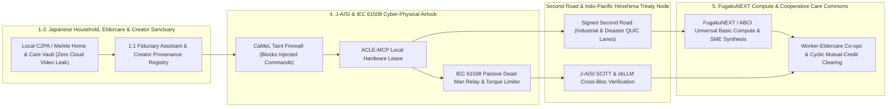

# SOV-06 Sovereign AI Governance & Treaty Technical Paper: Japan

| Field | Specification |
| :--- | :--- |
| **Code** | `SOV-06` |
| **Jurisdiction / Authority** | Government of Japan (Cabinet Secretariat AI Strategic Council, Ministry of Economy, Trade and Industry `METI`, Ministry of Internal Affairs and Communications `MIC`, and Diet Committees) |
| **Primary Governance Instruments & Institutes** | AI Promotion Act (2025), `G7 Hiroshima AI Process` International Code of Conduct, Japan AI Safety Institute (`J-AISI` within `IPA`), and Copyright Act Article 30-4 Framework |
| **Public Compute & Research Footprint** | RIKEN `Fugaku` & `FugakuNEXT`, AIST `ABCI 3.0` Public Supercomputing, `GENIAC` Domestic Foundation Model Program, and Precision Robotics Clusters |
| **CIN Liaison & Commons Node** | `cin.sovereign.jp` (Tokyo / Tsukuba / Kobe Public Compute & Robotics Corridor) |
| **Primary Public Portals** | https://aisi.go.jp · https://www8.cao.go.jp/cstp/ai/ |

## Executive Summary

Japan shaped early international consensus on advanced artificial intelligence by convening the `G7 Hiroshima AI Process`, establishing the Japan AI Safety Institute (`J-AISI` inside `IPA`), enacting the 2025 *AI Promotion Act*, and investing in sovereign supercomputing (`RIKEN Fugaku`, `FugakuNEXT`, and `AIST ABCI 3.0`) alongside domestic foundation-model grants (`GENIAC`). Confronting the world's steepest demographic aging curve and acute labor shortages across nursing, logistics, and precision manufacturing (`Monozukuri`), Tokyo prioritized rapid physical and industrial AI adoption through "agility-first" soft-law guidelines. Examining this governance trajectory against accelerating frontier capabilities exposes three concrete public-interest vulnerabilities: (1) **voluntary compliance without statutory stop-orders**, where administrative guidance lacks binding pre-deployment injunctions if frontier models cross autonomous cyber-offense, self-replication, or physical-actuation danger thresholds; (2) **permissive training-data ingestion without provenance**, where broad statutory text-and-data-mining exceptions under Copyright Act Article 30-4 lack cryptographic opt-in or attribution ledgers, eroding the livelihoods of Japanese illustrators, voice actors, and cultural stewards; and (3) **cyber-physical robotics hazards and moral crumple zones**, where connecting cloud-updated foundation models directly to eldercare nursing robots and factory actuators without hardware dead-man relays risks irreversible physical injury while shifting legal blame onto frontline care workers (Elish, 2019).

The Collective Intelligence Network (`CIN`) equips Japan to deploy high-reliability robotics and sovereign reasoning safely without sacrificing engineering speed or human dignity. Across CIN's five primitives, `J-AISI`'s ten-axis safety evaluation framework pairs directly with mandatory `IEC 61508` passive hardware dead-man relays, `ACLE-MCP` expiring local hardware capability leases (Ding et al., 2026), and `CaMeL` prompt-injection firewalls (Debenedetti et al., 2025) on every eldercare, clinical, and industrial actuator. Intimate bedroom, fall-detection, and health telemetry stays encrypted inside local-first `1:1` home and nursing-facility memory vaults (Kleppmann et al., 2019), while `C2PA` provenance manifests restore creator consent. High-reliability rail, grid, and factory agents route over CIN's signed Second Road (Kolt, 2025), preserving Japan's strict Article 21 constitutional communications secrecy during cyber or seismic emergencies. Internationally, Tokyo upgrades the `G7 Hiroshima Process` into an Indo-Pacific zero-knowledge treaty bridge (`zkLLM`, Sun, Li, & Zhang, 2024; Sastry et al., 2024), while coupling `FugakuNEXT` Universal Basic Compute with `Seikatsu`-style worker-eldercare cooperatives (Ostrom, 2010), local SME software synthesis (Malo, Yu, & Qiu, 2026), and upgraded `Fureai Kippu` cyclic mutual-credit care networks (Iosifidis et al., 2018).

---

## 1. Current regulatory architecture and private or geopolitical capture risks

Japan's governance model blends cooperative state-industry coordination led by `METI` and `MIC` with sovereign public supercomputing and international standards diplomacy. Three structural gaps now expose Japanese citizens, creators, and critical industries to severe risk.

### 1.1 Soft-law voluntarism without binding frontier stop-orders

Japan's *AI Guidelines for Business* and the 2025 *AI Promotion Act* emphasize non-binding administrative guidance, post-incident inquiries, and reputational disclosure over statutory pre-deployment licensing. As frontier reasoning and coding capabilities double rapidly, relying on ex-post inquiries leaves `J-AISI` without statutory authority to halt a commercial model rollout exhibiting autonomous cyber-exploitation, covert scheming, or uncontained self-replication. Meanwhile, Japan's steep digital trade deficit in cloud infrastructure transfers trillions of yen annually to foreign hyperscalers, pooling domestic `Monozukuri` manufacturing process parameters inside offshore multi-tenant clouds beyond Diet oversight.

### 1.2 Creator squeezing under unverified Article 30-4 data ingestion

Japan's 2018 amendment introducing Article 30-4 of the Copyright Act created a broad statutory exception for commercial machine-learning data analysis, subject only to an undefined proviso barring uses that "unreasonably prejudice the interests of the copyright owner." Lacking cryptographic provenance manifests or machine-readable licensing boundaries, commercial image, voice, and video generators scraped decades of Japanese manga, anime, studio voice performances, and regional craft designs to compete directly against those human creators without attribution or consent.

### 1.3 Physical eldercare robotics and human "moral crumple zones"

With nearly thirty percent of citizens aged sixty-five or older, Japanese nursing homes, hospitals, and warehouses are rapidly testing vision-language-action (`VLA`) foundation models on mobile manipulators and transfer lifts. Connecting stochastic neural policies or remote cloud APIs to high-torque actuators around frail seniors introduces acute physical hazards. As Madeleine Clare Elish (2019) demonstrates, deploying semi-autonomous machinery without hardware containment turns nearby nurses, care aides, and line technicians into **moral crumple zones**: frontline staff lack engineering control over cloud-pushed weight updates yet absorb legal and professional blame when an unverified robotic motion injures a resident.

---

## 2. Pre-deployment frontier safety, physical airlocks, and citizen 1:1 sanctuary

CIN resolves Japan's soft-law and cyber-physical safety gaps through deterministic hardware airlocks certified by `J-AISI`, preserving agile software iteration while enforcing physical safety around human bodies.

### 2.1 Pairing `J-AISI` ten-axis evaluations with `IEC 61508` dead-man relays and `ACLE-MCP`

`J-AISI` structured its safety methodology around ten evaluation axes spanning cyber offense, autonomous controllability, and systemic resilience. CIN binds `J-AISI` certification to execution-time hardware primitives on all robotic, medical, and industrial systems in Japan:

1. **Passive `IEC 61508` Dead-Man Relays and Kinematic Envelopes:** No neural policy or remote cloud model directly drives motor currents on eldercare lifts, surgical assistants, or factory cobots. Actuation passes through a formally verified microkernel (`DMTF SPDM` and `IETF RATS` attested) coupled to physical `IEC 61508` (`SIL-3`/`SIL-4`) passive dead-man relays and mechanical torque limiters. If local sensor confidence drops, network latency spikes, or caregiver renewal pulses cease, energy decouples mechanically into a passive brake state:

$$\tau_{\mathrm{actuator}}(t) = \mathbb{I}\!\left[\mathrm{LeaseValid}(t) \wedge \mathrm{KinematicSafe}(s_t) \wedge \mathrm{RelayClosed}(t)\right] \cdot \tau_{\mathrm{cmd}}(t)$$

2. **Eliminating Moral Crumple Zones via Hardware Flight Recorders:** Every robotic and clinical tool call requires an **Attested Capability Lease (`ACLE-MCP`)** (Ding et al., 2026) guarded by **CaMeL** taint isolation (Debenedetti et al., 2025). Local hardware records tamper-evident `C2PA` black-box logs separating vendor weight updates from caregiver actions, protecting nurses and technicians from unjust liability when vendor software malfunctions (Elish, 2019).

### 2.2 Local-first `1:1` eldercare vaults and creator `C2PA` provenance

Streaming bedroom cameras from millions of Japanese seniors into commercial cloud servers creates an unacceptable surveillance hazard. Under CIN Primitives 1 through 3, ambient fall-detection radar, acoustic, and wearable streams calibrate in local hardware `Device Time` and remain sealed inside **local-first `C2PA`/Merkle memory vaults** (Kleppmann et al., 2019) inside the home or care facility. A monogamous `1:1` fiduciary assistant adapts locally to the elder's speech and medical history, emitting minimal emergency alerts across the personal boundary. Simultaneously, Japan upgrades Copyright Act Article 30-4 by anchoring creative works in signed `C2PA` provenance registries so illustrators, voice actors (`seiyuu`), and studios enforce cryptographic opt-in licensing across `J-AISI`-compliant training enclaves.

---

## 3. Avoiding emergency overreach and governing agent traffic on the Second Road

Article 21, Paragraph 2 of the Constitution of Japan establishes a strict categorical guarantee: *"No censorship shall be maintained, nor shall the secrecy of any means of communication be violated."* Consequently, Japanese telecom regulators (`MIC`) and cybersecurity bodies (`NISC`) face constitutional barriers against deep-packet inspection or broad internet throttling, even when a massive cross-border autonomous bot storm strikes power utilities, `Shinkansen` dispatch systems, or earthquake-warning portals.

### 3.1 Isolating industrial and civic machine swarms onto the signed second road

CIN resolves this constitutional bind by separating autonomous machine traffic from human communications at the transport layer. Supply-chain agents, financial bots, semiconductor fab coordinators, and municipal procurement agents execute exclusively over CIN's **Signed Second Road** (`MCP` and `A2A` over dedicated `IETF QUIC` lanes) carrying cryptographic workload attestations and accountable corporate or public principal bindings (Kolt, 2025).

### 3.2 Disaster-resilient offline operation and Article 21 compliance

Because Second Road headers authenticate machine capability leases (`ACLE-MCP`, Ding et al., 2026) via public-key metadata without inspecting private human messages, Japanese carriers (`NTT`, `KDDI`, `SoftBank`) can throttle unattested autonomous agent floods at line rate during cyber incidents while upholding complete Article 21 secrecy for human voice, messaging, and journalism. Because citizen `1:1` models and municipal nodes run local-first software (Kleppmann et al., 2019), neighborhood evacuation shelters (`hinanjo`), clinics, and microgrids continue coordinating offline over local mesh links if earthquakes or typhoons sever undersea cables.

---

## 4. Verifiable cross-border treaties and mutual compute or red-line proofs

Through the `G7 Hiroshima AI Process` and its stewardship over semiconductor materials, photoresists, and packaging equipment, Japan holds strategic leverage across the Indo-Pacific. CIN upgrades voluntary Hiroshima questionnaires into a mathematically verifiable treaty protocol hosted through `J-AISI`.

### 4.1 Indo-Pacific `zkLLM` and `IETF SCITT` verification bridge

Geopolitical distrust prevents Washington, Beijing, Brussels, and Indo-Pacific capitals from sharing raw frontier model weights with foreign inspectors. Positioning `J-AISI` alongside peer institutes (`CAISI` Ottawa, `AISI` Singapore, `CERN`/Geneva), Japan operates an **Indo-Pacific `IETF SCITT` Transparency & Zero-Knowledge Verification Bridge**. Frontier labs submit cryptographic commitments $H(\theta)$ paired with non-interactive **zero-knowledge LLM proofs (`zkLLM`)** (Sun, Li, & Zhang, 2024) proving that committed weights passed Hiroshima Process cyber, CBRN, and autonomous-replication red-line suites without revealing proprietary parameters.

### 4.2 Multi-foundry `SPDM` silicon and substation megawatt accounting

Drawing on Sastry et al. (2024), Japan pairs its semiconductor-equipment stewardship with neutral **hardware-attested compute accounting**. High-density AI campuses reconcile utility substation megawatt telemetry and cooling heat rejection against `DMTF SPDM` accelerator attestation logs, giving treaty signatories continuous assurance that `FugakuNEXT`, `ABCI 3.0`, and commercial clusters run zero off-ledger frontier runs.

---

## 5. Public compute commons, local software synthesis, and post-labor economic stability

Japan's shrinking working-age cohort makes AI productivity vital for healthcare and regional towns, yet replacing domestic staff with rented foreign SaaS erodes household income shares (Korinek & Stiglitz, 2017). CIN couples public supercomputing with Japan's cooperative traditions.

### 5.1 Prefectural public compute utility across `FugakuNEXT` and `ABCI`

RIKEN's `FugakuNEXT`, AIST's `ABCI 3.0`, and national university centers federate to anchor **Universal Basic Compute** across all forty-seven prefectures. Cleared frontier models distill within four-day cycles into compact Japanese-language and domain-specialist checkpoints (`3B`-`32B` parameters) deployed directly onto prefectural hospitals, rural town halls, vocational colleges (`Kosen`), and household `1:1` vaults.

### 5.2 Overcoming the "Digital Cliff" through local SME (`Chusho Kigyo`) software synthesis

METI's "Digital Cliff" warnings document how legacy mainframe and multi-tier IT contractor lock-in drains trillions of yen from small and medium-sized manufacturers (`Chusho Kigyo`). Using local `1:1` fiduciary models and domestic public compute to compile bespoke local-first software directly (Malo, Yu, & Qiu, 2026; Kleppmann et al., 2019), precision workshops, clinics, and farm co-ops keep shop-floor trade secrets inside their own vaults while eliminating recurring SaaS rents.

### 5.3 Worker-eldercare cooperatives and upgraded `Fureai Kippu` mutual credit

Building on Japan's consumer and rural health cooperatives (`Seikatsu Club`, `JA`, `Koseiren`) and inter-prefectural eldercare time-banking (`Fureai Kippu`), CIN anchors two stabilizers on the **Wide Network Ledger**:
1. **Cooperative Robotics & Meidner Equity:** Robotics and compute clusters drawing `GENIAC` grants or public grid priority stream statutory Rudolf Meidner cooperative equity shares (Korinek & Stiglitz, 2017) into worker-eldercare and municipal trusts governed under Elinor Ostrom's (2010) polycentric rules.
2. **Capacity-Backed Cyclic Care Clearing:** Upgrading `Fureai Kippu` with Sardex-style zero-interest cyclic mutual-credit clearing (Iosifidis et al., 2018) lets rural towns, eldercare co-ops, microgrids, and artisans settle care hours, home repairs, farm produce, and local compute across balanced multilateral loops without inflationary debt.

---

## Primary references

1. Debenedetti, E., Shumailov, I., Fan, T., Hayes, J., Carlini, N., Fabian, D., Kern, C., Shi, C., Terzis, A., & Tramèr, F. (2025). Defeating Prompt Injections by Design. *arXiv preprint arXiv:2503.18813*. https://arxiv.org/abs/2503.18813
2. Ding, Z., Luo, Y., Chen, G., Shen, Q., & Wu, Z. (2026). ACLE-MCP: Attested Capability Leases for Execution-Time Trust in Remote LLM Tool Use. *arXiv preprint arXiv:2609.02690*. https://arxiv.org/abs/2609.02690
3. Elish, M. C. (2019). Moral Crumple Zones: Cautionary Tales in Human-Robot Interaction. *Engaging Science, Technology, and Society*, 5, 40-60. https://doi.org/10.17351/ests2019.260
4. Iosifidis, G., Charette, Y., Airoldi, E. M., Littera, G., Tassiulas, L., & Christakis, N. A. (2018). Cyclic motifs in the Sardex monetary network. *Nature Human Behaviour*, 2, 822-829. https://doi.org/10.1038/s41562-018-0450-0
5. Japan AI Safety Institute (`J-AISI`). (2024). *Guide to Evaluation Perspectives on AI Safety*. Information-technology Promotion Agency, Japan (`IPA`). https://aisi.go.jp/
6. Kleppmann, M., Wiggins, A., van Hardenberg, P., & McGranaghan, M. (2019). Local-first software: you own your data, in spite of the cloud. *Proceedings of the 2019 ACM SIGPLAN International Symposium on New Ideas, New Paradigms, and Reflections on Programming and Software (Onward!)*, 154-178. https://doi.org/10.1145/3359591.3359737
7. Kolt, N. (2025). Governing AI Agents. *arXiv preprint arXiv:2501.07913*. https://arxiv.org/abs/2501.07913
8. Korinek, A., & Stiglitz, J. E. (2017). Artificial Intelligence and Its Implications for Income Distribution and Unemployment. *NBER Working Paper No. 24174*. https://doi.org/10.3386/w24174
9. Malo, R. C., Yu, Z., & Qiu, T. (2026). The Customer Is the Builder: How AI Coding Agents Are Rewriting the Economics of Software. *arXiv preprint arXiv:2610.30307*. https://arxiv.org/abs/2610.30307
10. Ostrom, E. (2010). Beyond Markets and States: Polycentric Governance of Complex Economic Systems. *American Economic Review*, 100(3), 641-672. https://doi.org/10.1257/aer.100.3.641
11. Sastry, G., Heim, L., Belfield, H., Anderljung, M., Brundage, M., Hazell, J., O'Keefe, C., Hadfield, G. K., Ngo, R., Pilz, K., et al. (2024). Computing Power and the Governance of Artificial Intelligence. *arXiv preprint arXiv:2402.08797*. https://arxiv.org/abs/2402.08797
12. Sun, H., Li, J., & Zhang, H. (2024). zkLLM: Zero Knowledge Proofs for Large Language Models. *arXiv preprint arXiv:2404.16109*. https://arxiv.org/abs/2404.16109
