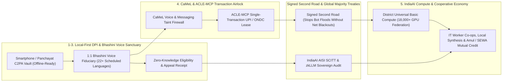

# SOV-09 Sovereign AI Governance & Treaty Technical Paper: India

| Field | Specification |
| :--- | :--- |
| **Code** | `SOV-09` |
| **Jurisdiction / Authority** | Republic of India (Ministry of Electronics and Information Technology `MeitY`, `IndiaAI` Mission, Telecom Regulatory Authority of India `TRAI`, Reserve Bank of India `RBI`, and Parliamentary Standing Committees) |
| **Primary Governance Instruments & Institutes** | Digital Personal Data Protection Act (`DPDPA` 2023), `IndiaAI` Safety Institute, Digital Public Infrastructure (`DPI`: `Aadhaar`, `UPI`, `ONDC`, `DEPA`), and `GPAI` New Delhi Declaration |
| **Public Compute & Research Footprint** | `IndiaAI` Compute Pillar (`18,000+` Subsidized Public-Access GPUs), `Bhashini` National Language Translation Mission (`22+` Scheduled Languages), `AIKosh` Datasets Platform, and `IIT` / `IISc` Research Nodes |
| **CIN Liaison & Commons Node** | `cin.sovereign.in` (Bengaluru / New Delhi / Hyderabad / Thiruvananthapuram Federated Commons) |
| **Primary Public Portals** | https://indiaai.gov.in · https://bhashini.gov.in |

## Executive Summary

India demonstrated that open public protocol rails can serve over `1.4` billion residents at population scale through Digital Public Infrastructure (`DPI`), spanning instant retail payments (`UPI`), federated commerce (`ONDC`), digital credentials (`DigiLocker`), voice-first multilingual AI across twenty-two scheduled constitutional languages (`Bhashini`), and the `IndiaAI` Mission's `18,000+` subsidized public-access GPUs. Yet coupling centralized identity registries and rapid AI deployment without local cryptographic boundaries creates three acute public-interest hazards: (1) **centralized surveillance honeypots and automated welfare exclusion**, where linking biometric `Aadhaar` identifiers to opaque algorithmic welfare-eligibility filters or policing databases strips vulnerable households of food rations and pensions without scrutable explanations (Caputo, 2026), compounded by broad state exemptions under Section 17(2) of the *Digital Personal Data Protection Act* (`DPDPA`); (2) **extractive cloud labor and IT/BPO displacement**, where foreign hyperscalers harvest low-wage Indian data-annotation labor and multilingual speech corpora while autonomous coding and support agents threaten millions of white-collar livelihoods across India's IT-services sector; and (3) **multilingual voice deepfakes vs. blunt mobile-internet shutdowns**, where synthetic WhatsApp rumors strain democratic elections while regional network blackouts paralyze daily `UPI` commerce, clinics, and schooling.

The Collective Intelligence Network (`CIN`) upgrades India's `DPI` philosophy from centralized state-linked registries to **local-first citizen sovereignty**. Across CIN's five primitives, citizens hold encrypted `1:1` memory vaults on affordable smartphones and Gram Panchayat community nodes (Kleppmann et al., 2019), proving ration, health, and civic eligibility through **zero-knowledge personhood and attribute credentials** (Adler et al., 2024) paired with live statutory appeal receipts (Caputo, 2026) so no central database tracks daily life. `Bhashini` voice-first assistants act as statutory `1:1` fiduciaries guarded by **CaMeL** prompt-injection firewalls (Debenedetti et al., 2025) and **ACLE-MCP** hardware capability leases (Ding et al., 2026) so voice phishing or injected messages never drain `UPI` accounts. Routing `ONDC` and enterprise bots onto CIN's signed Second Road (Kolt, 2025) replaces destructive district internet shutdowns with surgical bot-swarm circuit breakers. Internationally, New Delhi anchors Global Majority `zkLLM` and compute treaties (Sastry et al., 2024; Sun, Li, & Zhang, 2024), while converting `IndiaAI` GPUs into municipal and district **Universal Basic Compute** so Indian engineers transition into worker-owned software cooperatives (Acemoglu & Restrepo, 2019; Malo, Yu, & Qiu, 2026) linked to `Amul` and `SEWA`-inspired mutual-credit clearing networks (Iosifidis et al., 2018; Ostrom, 2010).

---

## 1. Current regulatory architecture and private or geopolitical capture risks

India's digital governance strategy combines public protocol engineering (`India Stack` / `DPI`) and subsidized national compute pools (`IndiaAI`) with pro-growth industrial policy. Assessing these layers under frontier AI pressure reveals three urgent tensions.

### 1.1 Centralized identity correlation, `DPDPA` state exemptions, and black-box welfare exclusion

First-generation Digital Public Infrastructure achieved historic financial inclusion yet relied on a centralized 12-digit biometric identifier (`Aadhaar`) seeded across bank accounts, SIM cards, health records (`ABHA`), and Public Distribution System (`PDS`) food-ration databases. Layering opaque machine-learning "fraud-detection" models atop linked registries without administrative-law safeguards causes database mismatches or weathered fingertips to trigger silent ration cancellations and pension suspensions (Caputo, 2026). Meanwhile, Section 17(2)(a) of the *Digital Personal Data Protection Act* (`DPDPA` 2023) empowers the central government to exempt state agencies on broad public-order grounds without judicial pre-authorization, creating a massive biometric honeypot when paired with multimodal cloud AI.

### 1.2 Hyperscaler data extraction and the IT/BPO white-collar shockwave

India's IT services, software engineering, and Business Process Outsourcing (`BPO`) sector anchors middle-class employment and export earnings across Bengaluru, Hyderabad, Pune, Chennai, NCR, and Tier-2 cities. Today, India faces a dual squeeze: global frontier labs contract Indian annotators, coders, and regional-language speakers to produce RLHF reasoning traces at piece-rate wages while retaining 100 percent of model weights offshore, even as autonomous coding and voice agents compress headcount-billed outsourcing margins without a domestic ownership bridge to reinstate worker bargaining power (Acemoglu & Restrepo, 2019).

### 1.3 Multilingual synthetic media vs. reactive telecom blackouts

Across WhatsApp, YouTube, and regional messaging groups spanning hundreds of dialects, low-cost voice clones and synthetic video deepfakes fabricate communal rumors or impersonate election officials within minutes. District magistrates lacking surgical protocol tools frequently invoke *Temporary Suspension of Telecom Services Rules* to shut down mobile data across entire districts, severing `UPI` vendor livelihoods, blocking `Bhashini` telemedicine, and straining Supreme Court proportionality standards (*Anuradha Bhasin v. Union of India*).

---

## 2. Pre-deployment frontier safety, physical airlocks, and citizen 1:1 sanctuary

CIN preserves universal `DPI` access while inverting its trust topology: personal memory and biometric proofs stay inside citizen-controlled hardware, and every voice or payment action crosses a cryptographic airlock.

### 2.1 Upgrading `DPI` with local-first vaults, zero-knowledge eligibility, and scrutable appeals

Under CIN Primitives 2 and 4, India decouples public-service verification from central behavioral tracking:

1. **Local-First Smartphone and Panchayat Vaults:** Citizens hold health, agricultural, educational, and transaction diaries inside encrypted `C2PA`/Merkle local-first vaults (Kleppmann et al., 2019) on budget smartphones or offline-capable community lockers at village Gram Panchayats unlocked strictly via citizen-held smartcards.
2. **Zero-Knowledge Personhood and Welfare Credentials:** Using privacy-preserving personhood and attribute credentials (Adler et al., 2024), residents prove to `PDS` ration shops, clinics, or scholarship portals that they are unique eligible citizens without exposing raw `Aadhaar` numbers or cross-agency histories:

$$\pi_{\mathrm{DPI}} = \mathrm{ZKProve}\!\left\{\text{credential } c \text{ signed by issuer},\; \mathrm{nullifier } \nu = H(s_{\mathrm{user}}, \mathrm{epoch}),\; \mathrm{Eligible}(c) = 1\right\}$$

3. **Mandatory Scrutable Administrative Receipts:** Under Caputo's (2026) scrutable-state settlement, no welfare algorithm may suspend a `PDS` ration, `MGNREGA` wage, or farm subsidy on an unverified flag; agencies emit signed counterfactual receipts with automatic benefit continuation during local appeal.

### 2.2 `Bhashini` voice-first `1:1` fiduciaries behind `CaMeL` and `ACLE-MCP` airlocks

For hundreds of millions of voice-first citizens across Hindi, Bengali, Marathi, Telugu, Tamil, Urdu, Gujarati, Kannada, Odia, Malayalam, Punjabi, Assamese, and tribal languages, quantized `Bhashini` models operate as **monogamous `1:1` Information Fiduciaries** on local silicon. To block indirect prompt injections hidden in SMS links, QR metadata, or forwarded WhatsApp voice notes, the `IndiaAI Safety Institute` certifies **CaMeL** taint isolation (Debenedetti et al., 2025) paired with **ACLE-MCP** single-transaction hardware capability leases (Ding et al., 2026) requiring explicit spoken local confirmation of exact rupee amount, recipient, and 5-second expiry. On railway signaling (`Kavach`), power dispatch, and irrigation gates, passive `IEC 61508` dead-man relays enforce mechanical fail-safe states.

---

## 3. Avoiding emergency overreach and governing agent traffic on the Second Road

Protecting `1.4` billion citizens from bot disinformation and cyber swarms without district internet shutdowns requires protocol-level separation between autonomous bots and human communication.

### 3.1 Routing commercial and public agents onto the signed second road

`TRAI`, `RBI`, and `MeitY` require automated `ONDC` merchant bots, banking clearing agents, telecom support bots, and public-procurement workflows to travel exclusively on CIN's **Signed Second Road** (`MCP` and `A2A` over `IETF QUIC`) carrying cryptographic workload identities and accountable principals (Kolt, 2025).

### 3.2 Ending district internet blackouts via surgical bot throttles and `C2PA` media proofs

During a synthetic rumor wave or DDoS storm, `CERT-In` and telecom carriers throttle unattested Second Road machine traffic and filter unsigned bulk bot amplification (verified via privacy-preserving personhood credentials, Adler et al., 2024, and hardware `C2PA` media signatures) **without shutting down human mobile data**. Street vendors keep clearing `UPI` payments, journalists file reports, students sit exams, and every throttle directive logs onto an append-only `IETF SCITT` public ledger under High Court and Supreme Court review.

---

## 4. Verifiable cross-border treaties and mutual compute or red-line proofs

Through its G20 Presidency and `GPAI` New Delhi leadership, India rejects closed governance clubs where two superpower blocs dictate rules to developing democracies (Ostrom, 2010). CIN equips India with a multipolar verification stack.

### 4.1 Sovereign `zkLLM` verification for foreign and domestic frontier models

Using **zero-knowledge LLM proofs (`zkLLM`)** (Sun, Li, & Zhang, 2024) over `IETF SCITT` logs, the `IndiaAI Safety Institute` requires foreign and domestic frontier providers entering Indian telecom, health, or banking markets to prove mathematically that active serving checkpoints passed Indian cyber-safety, bio-containment, and scheduled-language fairness suites inside hardware-attested zero-retention enclaves that never export Indian citizen prompts offshore.

### 4.2 Grid-attested domestic compute campuses

Solar-powered domestic GPU clusters implement **substation megawatt reconciliation and `DMTF SPDM` silicon attestation** (Sastry et al., 2024), positioning India as a verifiable peer in international compute treaties without foreign cloud lock-in.

---

## 5. Public compute commons, local software synthesis, and post-labor economic stability

India's youth cohort, the world's largest entering workforce, cannot prosper if AI concentrates wealth in offshore GPU landlords while eroding IT employment. CIN couples `IndiaAI` compute with India's cooperative heritage.

### 5.1 District public basic compute across `IndiaAI` and `IIT` or `NIT` hubs

The `IndiaAI` Mission's `18,000+` GPU pool expands into a statutory **Universal Basic Compute** federation spanning `IIT`s, `NIT`s, district libraries, Primary Health Centres, and agricultural extension hubs, running 4-day distilled multilingual specialist models (`3B`-`32B` parameters) rent-free.

### 5.2 Transitioning IT/BPO workers into worker-owned software synthesis cooperatives

Operationalizing Daron Acemoglu and Pascual Restrepo's (2019) **task-reinstatement principle** alongside bespoke local software synthesis (Malo, Yu, & Qiu, 2026), Indian `MSMEs`, municipal water boards, and farmer producer organizations compile verified local-first software (Kleppmann et al., 2019) in regional languages instead of paying foreign SaaS rents. Backed by concessional `SIDBI` / `NABARD` credit and priority `IndiaAI` compute, displaced IT and BPO engineers form **worker-owned AI verification and domain-engineering cooperatives** exporting Proof-Carrying software worldwide while retaining 100 percent of cooperative equity.

### 5.3 `Amul` and `SEWA`-inspired cooperative equity and rural mutual credit

Building on `Amul` dairy federations, `SEWA` women's cooperative banks, and Kerala's `Kudumbashree` network under Ostrom's (2010) polycentric design principles, voluntary `AIKosh` speech and farm datasets carry cryptographic provenance covenants streaming commercial dividends back to village and linguistic trusts. Simultaneously, linking `ONDC` and Primary Agricultural Credit Societies (`PACS`) to **zero-interest cyclic mutual-credit clearing** modeled on Sardex (Iosifidis et al., 2018) lets farmers, rural solar microgrids, artisans, and district software co-ops clear real goods, cold storage, and compute capacity smoothly during cash crunches.

---

## Primary references

1. Acemoglu, D., & Restrepo, P. (2019). Automation and New Tasks: How Technology Displaces and Reinstates Labor. *Journal of Economic Perspectives*, 33(2), 3-30. https://doi.org/10.1257/jep.33.2.3
2. Adler, S., Hitzig, Z., Jain, S., Brewer, C., Chang, W., DiResta, R., Lazzarin, E., McGregor, S., Seltzer, W., Siddarth, D., et al. (2024). Personhood credentials: Artificial intelligence and the value of privacy-preserving tools to distinguish who is real online. *arXiv preprint arXiv:2408.07892*. https://arxiv.org/abs/2408.07892
3. Caputo, N. (2026). Administrative Law's Fourth Settlement: AI and the Scrutable State. *arXiv preprint arXiv:2602.09678*. https://arxiv.org/abs/2602.09678
4. Debenedetti, E., Shumailov, I., Fan, T., Hayes, J., Carlini, N., Fabian, D., Kern, C., Shi, C., Terzis, A., & Tramèr, F. (2025). Defeating Prompt Injections by Design. *arXiv preprint arXiv:2503.18813*. https://arxiv.org/abs/2503.18813
5. Ding, Z., Luo, Y., Chen, G., Shen, Q., & Wu, Z. (2026). ACLE-MCP: Attested Capability Leases for Execution-Time Trust in Remote LLM Tool Use. *arXiv preprint arXiv:2609.02690*. https://arxiv.org/abs/2609.02690
6. Iosifidis, G., Charette, Y., Airoldi, E. M., Littera, G., Tassiulas, L., & Christakis, N. A. (2018). Cyclic motifs in the Sardex monetary network. *Nature Human Behaviour*, 2, 822-829. https://doi.org/10.1038/s41562-018-0450-0
7. Kleppmann, M., Wiggins, A., van Hardenberg, P., & McGranaghan, M. (2019). Local-first software: you own your data, in spite of the cloud. *Proceedings of the 2019 ACM SIGPLAN International Symposium on New Ideas, New Paradigms, and Reflections on Programming and Software (Onward!)*, 154-178. https://doi.org/10.1145/3359591.3359737
8. Kolt, N. (2025). Governing AI Agents. *arXiv preprint arXiv:2501.07913*. https://arxiv.org/abs/2501.07913
9. Malo, R. C., Yu, Z., & Qiu, T. (2026). The Customer Is the Builder: How AI Coding Agents Are Rewriting the Economics of Software. *arXiv preprint arXiv:2610.30307*. https://arxiv.org/abs/2610.30307
10. Ministry of Electronics and Information Technology (`MeitY`). (2024). *IndiaAI Mission & Bhashini National Language Translation Mission*. Government of India. https://indiaai.gov.in/
11. Ostrom, E. (2010). Beyond Markets and States: Polycentric Governance of Complex Economic Systems. *American Economic Review*, 100(3), 641-672. https://doi.org/10.1257/aer.100.3.641
12. Sastry, G., Heim, L., Belfield, H., Anderljung, M., Brundage, M., Hazell, J., O'Keefe, C., Hadfield, G. K., Ngo, R., Pilz, K., et al. (2024). Computing Power and the Governance of Artificial Intelligence. *arXiv preprint arXiv:2402.08797*. https://arxiv.org/abs/2402.08797
13. Sun, H., Li, J., & Zhang, H. (2024). zkLLM: Zero Knowledge Proofs for Large Language Models. *arXiv preprint arXiv:2404.16109*. https://arxiv.org/abs/2404.16109
